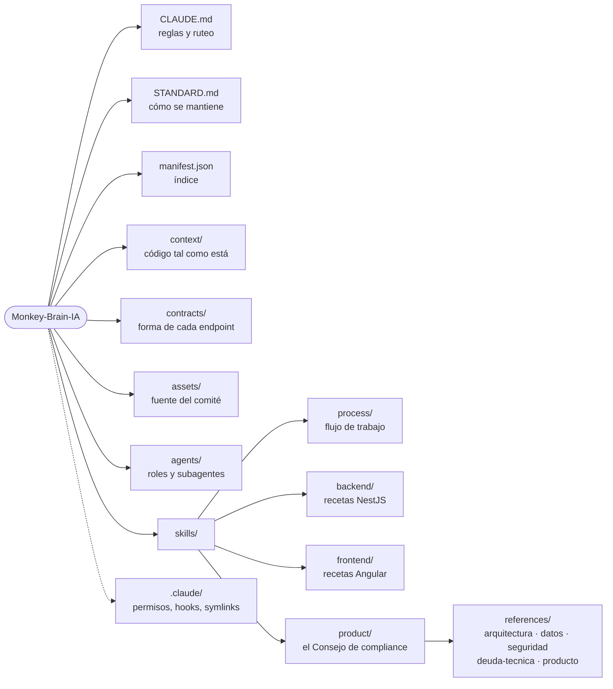
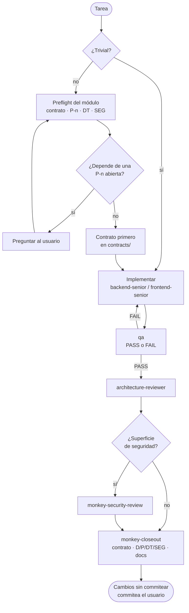
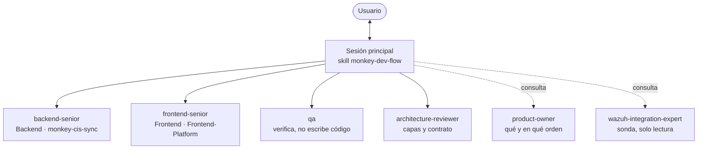
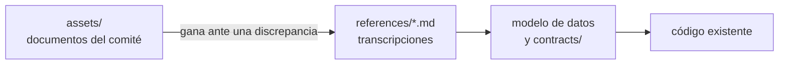

# Monkey-Brain-IA

El cerebro de Monkey: contexto de producto, contratos, skills y agentes para trabajar los repos del proyecto con IA.
Es Markdown con front-matter YAML y un índice en JSON (`manifest.json`); no depende de ninguna herramienta, aunque
está preparado para **Claude Code**.

## Qué cubre

| Repo | Qué es |
|---|---|
| `Backend` | La API (NestJS, Clean Architecture por features, Prisma, Postgres con RLS). |
| `Frontend` | El **admin interno**: empresas, usuarios y catálogo maestro GRC. |
| `Frontend-Platform` | La **plataforma del cliente**: onboarding, equipo y estado de cumplimiento. |
| `monkey-cis-sync` | Sincroniza el catálogo de checks de la sonda. Hoy es una carpeta de scripts Python, **no un repo git**. |

Este repo es independiente del código de producto. Se usa como carpeta **hermana** de los demás
(`Monkey/Backend/`, `Monkey/Frontend/`… junto a `Monkey/Monkey-Brain-IA/`). Claude Code se abre **siempre desde aquí**.

## Por dónde empezar

| Si eres… | Empieza por |
|---|---|
| Una IA a punto de trabajar | [`CLAUDE.md`](CLAUDE.md): reglas que no se rompen y la tabla «qué leer según la tarea» |
| Alguien que mantiene el cerebro | [`STANDARD.md`](STANDARD.md): un dato, un dueño; tamaños; IDs; cierre de tarea |
| Alguien que busca un dato del producto | [`references/README.md`](skills/product/monkey-compliance-council/references/README.md): mapa de carpetas del conocimiento |
| Una herramienta que descubre recursos | [`manifest.json`](manifest.json) |

## Mapa del repo

| Carpeta | Qué hay | Detalle |
|---|---|---|
| `context/` | `backend.md`, `frontend.md`: convenciones y mapa de features **del código tal como está** | |
| `contracts/` | Request, response y errores de cada endpoint; `conventions.md` (sobre, errores, i18n, paginación) y `enums/` | [`contracts/README.md`](contracts/README.md) |
| `assets/` | Documentos del **comité funcional**: la fuente de verdad (ver más abajo) | |
| `agents/` | Un archivo por rol; son subagentes reales en Claude Code | [Equipo de agentes](#equipo-de-agentes) |
| `skills/process/` | `monkey-dev-flow`, `-preflight`, `-closeout`, `-registry`, `-security-review`, `-ui-copy` | |
| `skills/backend/`, `skills/frontend/` | Recetas técnicas; cada `senior-*-engineer` las enruta | `type: recipe` (no son skills sueltas) |
| `skills/product/monkey-compliance-council/` | El **Consejo**: qué exige cada marco, modelo de datos, decisiones, pendientes, deuda, seguridad | [`references/README.md`](skills/product/monkey-compliance-council/references/README.md) |
| `.claude/` | Solo para Claude Code: permisos, hooks y symlinks a `skills/` y `agents/` | `settings.json` |

## Cómo se trabaja una tarea

La sesión principal ejecuta la skill `monkey-dev-flow` (`/monkey-dev`); los subagentes son trabajadores.
Los pasos detallados están en [`skills/process/monkey-dev-flow/SKILL.md`](skills/process/monkey-dev-flow/SKILL.md).

> Claude **no hace commits, pushes ni PRs**: lo bloquean `permissions.deny` y un hook.

## Equipo de agentes

| Agente | Hace | No hace |
|---|---|---|
| `backend-senior` · `frontend-senior` | Implementan lo que se les asigna, siguiendo las recetas del repo | Decidir alcance o prioridad |
| `qa` | Prueba punto a punto con peticiones y flujos reales; devuelve PASS o FAIL con el caso mínimo | Escribir o corregir código de producción |
| `architecture-reviewer` | Revisa un cambio ya hecho contra las capas y el contrato; devuelve violaciones con `archivo:línea` | Reescribir código |
| `product-owner` | Clasifica MUST / SHOULD / LATER / NO BUILD con el marco del Consejo | Tocar código |
| `wazuh-integration-expert` | Explica la sonda y su integración | Actuar por su cuenta; un cambio de puertos, firewall o credenciales siempre se pregunta al usuario |

El rol `tech-lead` (`agents/tech-lead.md`) queda como referencia: hoy lo ejecuta la sesión principal.
Todo lo que deba escalarse va **al usuario que usa la herramienta en ese momento**, nunca a una persona fija.

## Las fuentes del comité (`assets/`)

`assets/` no es una carpeta de adjuntos: son los documentos del **comité funcional** y mandan sobre todo lo demás.

La precedencia completa está en [`CLAUDE.md`](CLAUDE.md#precedencia-si-dos-fuentes-se-contradicen). El inventario de fuentes
(qué define cada una y quién la consume) está en `modelo-datos.md` §0 y en el bloque `sources` de `manifest.json`.
Parte de ellas vive fuera de este repo, en la carpeta `Monkey/`, porque incluyen datos operativos o credenciales.

Dos avisos:

- `conexion_api_wazuh_monkey.txt` contiene credenciales: no se lee, no se copia a ningún repo.
- La sonda y el motor de nube son **confidenciales frente al cliente final**: en producto se dice «sonda» o «capacidad automática»
  (regla 1 de `CLAUDE.md`).

## Cómo se carga en Claude Code

| Pieza | Dónde vive | Cómo se registra |
|---|---|---|
| Reglas permanentes | `CLAUDE.md` | Se carga al arrancar |
| Permisos y hooks | `.claude/settings.json` + `.claude/hooks/` | Claude Code los lee y recarga solos |
| Skills | `skills/process/`, `skills/backend/senior-*`, `skills/frontend/senior-*`, `skills/product/` | Symlinks en `.claude/skills/` |
| Subagentes | `agents/*.md` (frontmatter: `name`, `description`, `tools`, `model`) | Symlinks en `.claude/agents/` |

Para ver qué se cargó en una sesión: `/memory` y `/status`.

## Convenciones de formato

- Cada archivo de `agents/` y `skills/` lleva front-matter YAML (`id`, `name`, `description`, `type`) y Markdown plano.
- Los `path` de `manifest.json` son relativos a esta carpeta.
- Una skill nueva va en su categoría (`process/`, `backend/`, `frontend/`, `product/`), nunca suelta en la raíz de `skills/`.
- El contenido de `skills/`, `agents/`, `references/` y `contracts/` es portable; **`.claude/` es específico de Claude Code**.
- Excepción: `skills/product/monkey-compliance-council/` conserva su formato original de Skill (`SKILL.md` con `name`/`description` + `references/`);
  cualquier herramienta puede leer igual el Markdown de sus `references/`.
- Los diagramas se escriben en **Mermaid**.
