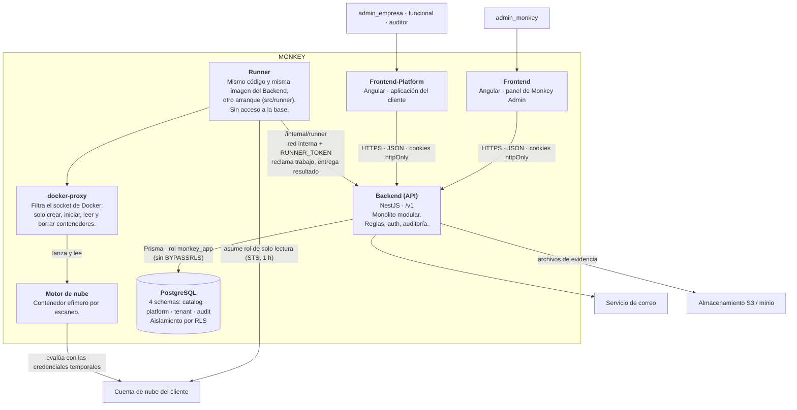

# C4 · Nivel 2 — Contenedores

Responde: **¿qué aplicaciones y bases de datos corren, y cómo se comunican?** Un "contenedor" aquí es
algo que se ejecuta por separado (una app, un proceso, una base), no necesariamente un contenedor Docker.

## Qué mirar aquí

- **Un solo Backend, no microservicios** (vetado en el MVP, `architecture.md`). Los dos frontends
  hablan con la **misma API**: lo que cambia es el rol del usuario, no la puerta de entrada.
- **El Runner es la pieza de seguridad más delicada.** Está separado a propósito: no ve la base de datos,
  ni el JWT, ni la clave de cifrado. Solo recibe su `runner.env` y habla con el Backend por una API
  interna. Corre en modo de solo lectura, sin capacidades extra y con memoria limitada.
- **Por qué `docker-proxy`:** el Runner necesita lanzar el motor en un contenedor efímero, y dar acceso
  al socket de Docker completo sería dar control de la máquina. El proxy deja pasar solo lo necesario.
  Limitación conocida y su salida para producción: comentario del compose y `DT-43`.
- **El aislamiento entre clientes está en la base**, con RLS, además del código. Por eso toda consulta a
  una tabla de cliente va dentro de `withScope` (`context/backend.md`).
- **Frontend vs. Frontend-Platform:** `Frontend` es el panel de administración de Monkey;
  `Frontend-Platform` es lo que ve la empresa cliente.

## Lo que NO está dibujado (y por qué)

- **Cola de eventos, índice vectorial, base de grafos, motor de IA:** están en el diseño objetivo
  (`architecture.md`), pero hoy no existen como contenedores. Dibujarlos aquí sería mentir.
- **La sonda de servidores y bases:** el puerto `ConnectionProbe` existe con adaptadores `simulated`,
  `unavailable` y `runner`; la integración real para servidores y bases es provisional (`DT-32…36`).
- **Proxy inverso y despliegue (VPS, `proxy_net`, CI/CD):** van en un diagrama de despliegue aparte, aún
  no escrito. Base para escribirlo: `Diagramas/03-arquitectura-docker-y-variables.drawio` y
  `Backend/deploy/docker-compose.dev.yml`.

## Cómo verificarlo

- Servicios y redes: `Backend/deploy/docker-compose.dev.yml`.
- Runner: `Backend/src/runner/` y `skills/backend/add-cloud-engine.md`.
- Schemas de la base: `datasource` en `Backend/prisma/schema/schema.prisma`.
- Frontends: `Frontend/src/app`, `Frontend-Platform/src/app`.
