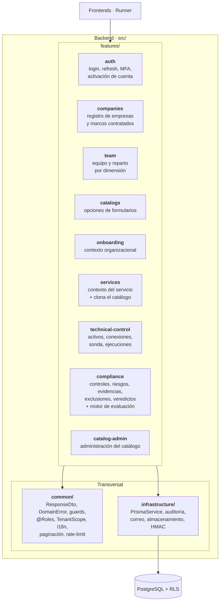
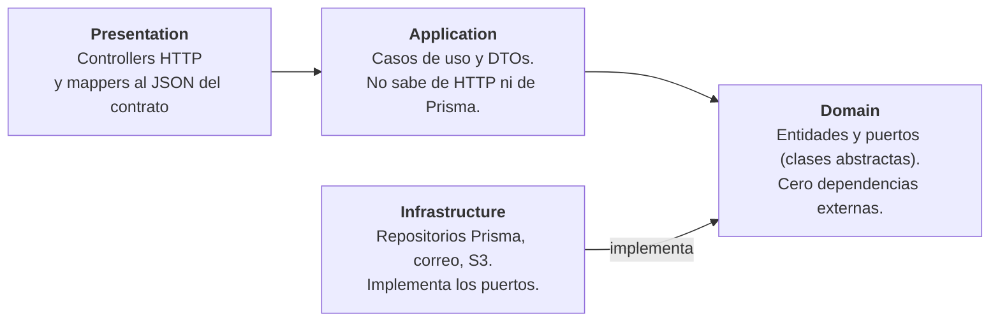

# C4 · Nivel 3 — Componentes del Backend

Responde: **¿cómo está organizado por dentro el Backend?** Dos ejes: las **features** (qué hace) y las
**capas** (cómo se escribe cada una). El detalle de cada módulo está en su propio `01-c4.md`.

## Eje 1 · Las features y lo que comparten

**Regla de este eje:** una feature **no importa el interior de otra**. Lo que dos features necesitan en
común va a `common/` o a `infrastructure/` (`skills/backend/architecture-guardian.md`).

**La regla tiene excepciones vigentes.** Hay cuatro imports entre features que la violan; están listados,
con su solución natural, en [`cumplimiento/06-mejoras.md`](cumplimiento/06-mejoras.md) (M1). El diagrama
muestra la arquitectura **prevista**; esas excepciones son la diferencia con lo real.

## Eje 2 · Las capas dentro de cada feature

Las flechas son **quién puede depender de quién**. `Domain` no depende de nadie; por eso ahí viven las
reglas que más importa proteger. `Infrastructure` depende de `Domain` (no al revés): el caso de uso pide
"un repositorio" y el módulo de Nest le entrega el de Prisma (`provide: XRepository, useClass: XPrismaRepository`).

## De una feature a su módulo documentado

Una feature del código no siempre es un módulo del producto: `technical-control` sirve a dos (conectar es
onboarding; medir es control técnico) y `compliance` se reparte en componentes.

| Feature del código | Módulo que lo documenta |
|---|---|
| `auth` | [`autenticacion/`](autenticacion/README.md) |
| `team` | [`gestion-usuarios/`](gestion-usuarios/README.md) |
| `common/guards`, `common/tenancy` | [`roles-permisos/`](roles-permisos/README.md) |
| `onboarding` | [`onboarding/contexto-organizacional/`](onboarding/contexto-organizacional/README.md) |
| `services` | [`onboarding/contexto-servicio/`](onboarding/contexto-servicio/README.md) |
| `technical-control` (conectar) | [`onboarding/conexion-activos/`](onboarding/conexion-activos/README.md) |
| `technical-control` (medir) · `src/runner` | [`control-tecnico/`](control-tecnico/README.md) |
| `compliance` | [`cumplimiento/`](cumplimiento/README.md) |
| `companies` · `catalogs` · `catalog-admin` | pendientes ([`README.md`](README.md)) |

## Cómo se ve una petición

`Request → guard de sesión y rol → Controller → Caso de uso → Repositorio (dentro de withScope) → Postgres (RLS)`.
Todo cambio de datos escribe su rastro de auditoría **en la misma transacción** (D52, SEG-36): si falla el
rastro, se revierte la acción. El detalle, en [`roles-permisos/03-flujos.md`](roles-permisos/03-flujos.md).

## La pieza más importante de entender

`features/compliance/domain/engine/` son **funciones puras, sin base de datos**: calculan el estado de un
test, un control, una categoría y un marco. Todo el cumplimiento se deriva ahí. Es lo que más vale la pena
estudiar primero: [`cumplimiento/motor/`](cumplimiento/motor/README.md).

## Cómo verificarlo

- Las features: `ls Backend/src/features`.
- Las capas de una feature: `ls Backend/src/features/auth`.
- Mapa de features con su contrato: `context/backend.md`.
