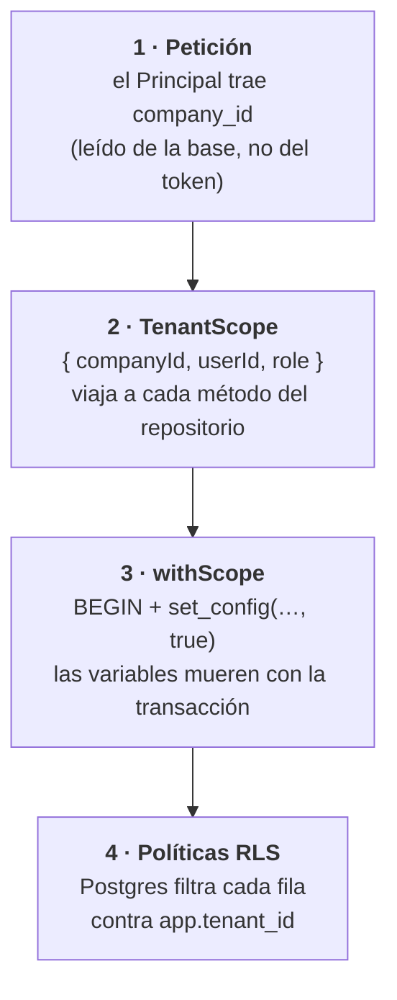
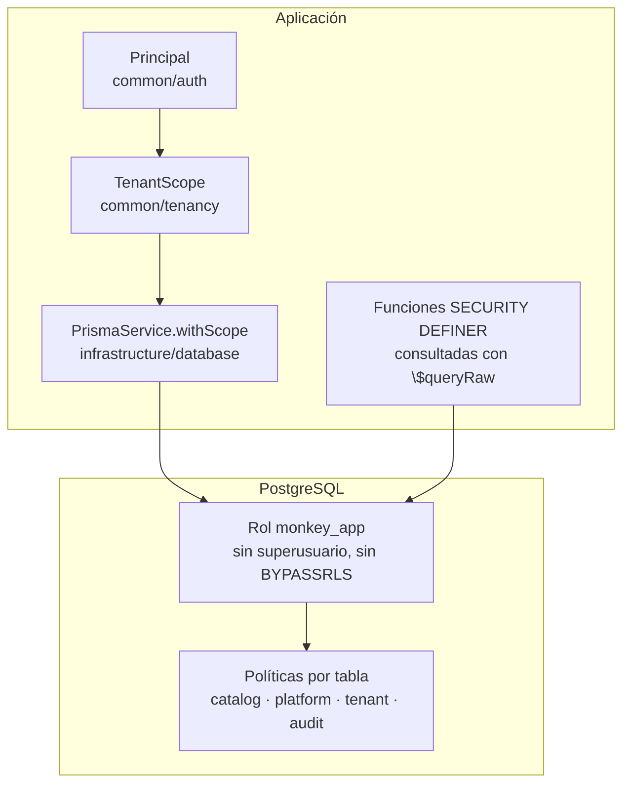

# Aislamiento multi-tenant · C4

Responde: **¿qué piezas hacen cumplir el aislamiento y en qué orden actúan?**

## Las cuatro capas

**El detalle que lo hace seguro:** `set_config(..., true)` acota las variables a **esa transacción**. Si se fijaran
a nivel de conexión, la siguiente petición que reutilizara esa conexión del pool heredaría la empresa anterior.

## Nivel 3 · Piezas internas

**`monkey_app` no puede saltarse RLS.** No es superusuario y no tiene `BYPASSRLS`: aunque la aplicación tuviera un
error, la base no se lo permite.

## Los cuatro schemas y su política

| Schema | Qué contiene | RLS |
|---|---|---|
| `catalog` | El catálogo maestro, global, sin `tenant_id` | Solo de **escritura**: todos leen, únicamente `admin_monkey` modifica (D31) |
| `platform` | Empresas, usuarios y sesiones | Sí: por `admin_monkey` o por el propio tenant |
| `tenant` | Onboarding, Cumplimiento y Control técnico | Sí, todo |
| `audit` | El rastro y los eventos | Sí, más `REVOKE` y triggers ([Trazabilidad](../trazabilidad/README.md)) |

Un schema es un **namespace, no un perímetro**: las llaves foráneas cruzan schemas con normalidad.

## La excepción: antes de conocer el tenant

El login, el canje de una clave, el refresh y una API key ocurren **antes** de saber qué empresa es. No pueden pasar
por RLS (fallaría cerrado), así que cada uno tiene una función `SECURITY DEFINER` angosta, con `search_path` fijo,
que devuelve solo las columnas necesarias (D29): `find_login_candidates`, `find_access_key`,
`find_session_by_token` y `find_api_key`. Con el `company_id` que devuelven, la aplicación fija `app.tenant_id` y
sigue con RLS normal.

## Cómo verificarlo

- `cat Backend/src/infrastructure/database/prisma.service.ts` (el `withScope`).
- `grep -rln "app.tenant_id" Backend/prisma/migrations | head`.
- `npm run test:e2e` incluye las pruebas de aislamiento entre empresas.
