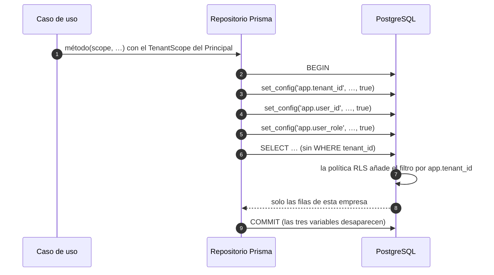
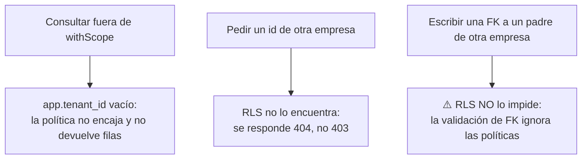

# Aislamiento multi-tenant · Flujos

Responde: **¿qué pasa exactamente en una consulta, y qué pasa si alguien se equivoca?**

## 1 · Una consulta normal



La consulta **no lleva el filtro escrito**. Lo pone la base. Eso es lo que hace que olvidarlo sea imposible.

## 2 · Los tres errores posibles y qué pasa con cada uno



El tercero es el único peligroso, y por eso hay una regla de aplicación: **antes de escribir una fila con una FK a
otra tabla de tenant, se lee el padre con el cliente ya sujeto a RLS**. Si no lo ve, no es suyo. La lista completa
de reglas que RLS no puede imponer está en `datos/modelo/04-monkey-admin.md` §4.4.

## 3 · `404` y no `403`

Un recurso de **otra empresa** responde `404`: decir `403` revelaría que existe. Un recurso **de la propia empresa**
que no le corresponde a ese usuario sí responde `403` (`contracts/conventions.md`). La diferencia es deliberada y la
aplican los dos módulos de permisos: este y [Roles y permisos](../roles-permisos/README.md).

## 4 · El rastro también está aislado

`audit_logs` y `compliance_events` llevan RLS: el rastro de una empresa no se lee desde otra (SEG-34). Con una
particularidad: el rastro se escribe **sin `RETURNING`**, porque una acción de plataforma sin tenant no pasaría la
política de lectura de la fila que acaba de insertar.

## 5 · Cómo se prueba

La prueba real no es un test unitario: es conectarse como `monkey_app` sin fijar la empresa y comprobar que no se ve
nada.

```sql
-- sin empresa declarada: 0 filas
select count(*) from tenant.client_controls;
-- con empresa declarada: las suyas
select set_config('app.tenant_id', '<uuid>', false);
select count(*) from tenant.client_controls;
```

`npm run test:e2e` hace lo mismo desde la API: crea dos empresas y comprueba que ninguna ve a la otra.

## Cómo verificarlo

`Backend/test/` (pruebas de aislamiento) y `datos/schema-implementacion.md` §5.
