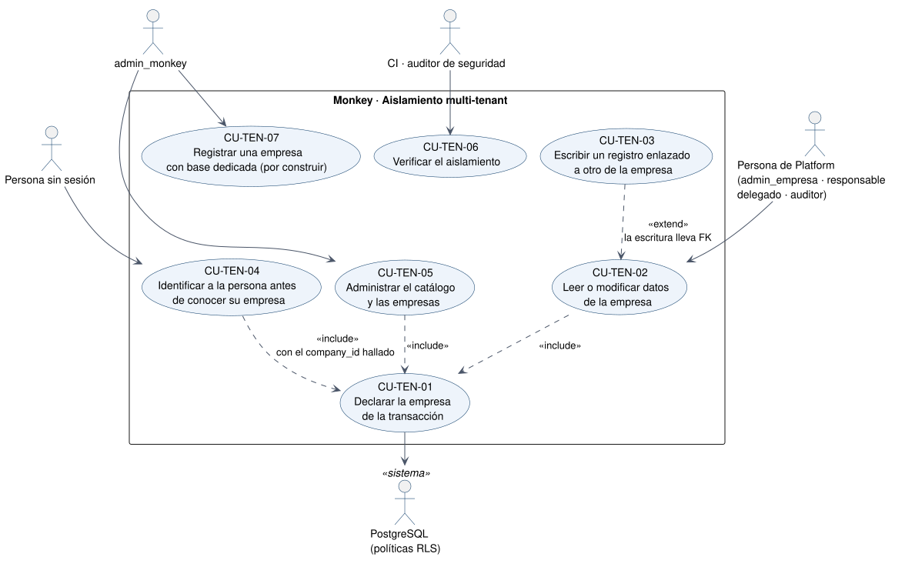

# Aislamiento multi-tenant · casos de uso

Responde: **¿qué pasos sigue el sistema para que cada operación quede dentro de una sola empresa, qué puede salir
distinto y en qué estado queda todo al terminar?** Cada caso realiza una o varias [historias](04-historias.md); la
secuencia técnica está en [`03-flujos.md`](03-flujos.md) y el patrón SQL en
[`datos/schema-implementacion.md`](../../datos/schema-implementacion.md) §5. No hay contrato propio: los errores son los
genéricos de [`contracts/conventions.md`](../../../../../../contracts/conventions.md).

## Diagrama de casos de uso

Fuente del diagrama: [`05-casos-de-uso.puml`](05-casos-de-uso.puml) (PlantUML; se regenera con
`skills/process/monkey-docs/scripts/render-uml.sh`). «Persona de Platform» agrupa a `admin_empresa`, `responsable`,
`delegado` y `auditor`. **PostgreSQL** es actor secundario: es quien aplica las políticas.

## Resumen

| ID | Caso | Actor principal | Historias |
|---|---|---|---|
| CU-TEN-01 | Declarar la empresa de la transacción | Sistema (`withScope`) | HU-TEN-03, HU-TEN-04 |
| CU-TEN-02 | Leer o modificar datos de la empresa | Persona de Platform | HU-TEN-01, HU-TEN-02, HU-TEN-09 |
| CU-TEN-03 | Escribir un registro enlazado a otro de la empresa | Persona de Platform | HU-TEN-10 |
| CU-TEN-04 | Identificar a la persona antes de conocer su empresa | Persona sin sesión | HU-TEN-11 |
| CU-TEN-05 | Administrar el catálogo y las empresas | `admin_monkey` | HU-TEN-07, HU-TEN-08 |
| CU-TEN-06 | Verificar el aislamiento | CI · `auditor` | HU-TEN-05, HU-TEN-06 |
| CU-TEN-07 | Registrar una empresa con base dedicada | `admin_monkey` | HU-TEN-12 (⚪) |

---

### CU-TEN-01 · Declarar la empresa de la transacción

| | |
|---|---|
| **Actor** | Sistema: el repositorio, a través de `PrismaService.withScope` |
| **Precondición** | Un `TenantScope` (`companyId`, `userId`, `role`) sacado del `Principal`, que se leyó de la base al validar la sesión |
| **Postcondición** | La consulta corrió con las políticas filtrando por esa empresa; al cerrar la transacción las tres variables desaparecen |

**Flujo principal**
1. El caso de uso llama al repositorio con el `TenantScope`.
2. El sistema abre una transacción y fija `app.tenant_id`, `app.user_id` y `app.user_role` con `set_config(…, true)`.
3. El repositorio consulta sin escribir el filtro por empresa.
4. PostgreSQL añade el filtro de la política a cada fila y devuelve solo las de esa empresa.
5. El sistema confirma o revierte la transacción; las variables mueren con ella.

**Flujos alternos**
- 2a. Una consulta corre fuera de `withScope` (sin empresa) → la política no encaja y devuelve 0 filas (SEG-02).
- 2b. `app.tenant_id` no es un uuid → la consulta falla, no abre el acceso (SEG-02).
- 5a. La conexión vuelve al pool y la reutiliza otra petición → no hereda la empresa anterior (SEG-03).

### CU-TEN-02 · Leer o modificar datos de la empresa

| | |
|---|---|
| **Actor** | Persona de Platform |
| **Precondición** | Sesión válida |
| **Postcondición** | La persona leyó o cambió solo datos de su empresa; si escribió, el rastro quedó en la misma transacción, aislado por empresa |

**Flujo principal**
1. La persona pide un listado o un recurso por id, o envía un cambio.
2. El sistema ejecuta la operación con la empresa de la persona (**CU-TEN-01**).
3. El sistema responde solo con lo de su empresa; si fue una escritura, registra el rastro en `audit_logs` sin
   `RETURNING`.

**Flujos alternos**
- 1a. Sin sesión, o con una cookie manipulada → `401` (`UNAUTHENTICATED`, `conventions.md`).
- 2a. El id es de otra empresa (leer, modificar, borrar, validar, activar) → `404` `NOT_FOUND`; la otra empresa conserva
  lo suyo intacto (SEG-01).
- 2b. El recurso es de su empresa pero su rol no lo alcanza → `403` `FORBIDDEN` ([Roles y permisos](../roles-permisos/README.md)).
- 2c. La escritura intenta poner el `tenant_id` de otra empresa → la base la rechaza (`WITH CHECK`).

### CU-TEN-03 · Escribir un registro enlazado a otro de la empresa

| | |
|---|---|
| **Actor** | Persona de Platform |
| **Precondición** | Sesión válida; el registro nuevo lleva una FK a otra tabla de tenant (p. ej. un activo a un servicio) |
| **Postcondición** | El registro quedó enlazado a un padre de su misma empresa |

**Flujo principal**
1. La persona envía el registro con el id del padre.
2. El sistema lee el padre bajo RLS (**CU-TEN-01**).
3. Lo ve: escribe el registro con la FK.

**Flujos alternos**
- 2a. No lo ve (es de otra empresa o no existe) → no se escribe nada (SEG-07). En el caso probado, un activo enlazado al
  servicio de otra empresa, responde `422` `VALIDATION_FAILED` sobre `service_ids`. La FK sola no lo impediría: su
  validación ignora RLS.

### CU-TEN-04 · Identificar a la persona antes de conocer su empresa

| | |
|---|---|
| **Actor** | Persona sin sesión (login, canje de clave o código, refresh, segundo factor, recuperación de contraseña) |
| **Precondición** | Ninguna empresa declarada todavía |
| **Postcondición** | El sistema conoce el `company_id` y sigue con RLS normal; no se abrió ninguna tabla completa |

**Flujo principal**
1. La persona envía su correo, su clave, su código o su token.
2. El sistema llama a la función `SECURITY DEFINER` correspondiente (`find_login_candidates`, `find_access_key`,
   `find_activation_code`, `find_session_by_token`, `find_mfa_challenge`, `find_trusted_device` o
   `find_password_reset_token`), que devuelve solo las columnas necesarias.
3. Con el `company_id` devuelto, el sistema sigue con **CU-TEN-01**.

**Flujos alternos**
- 2a. La función no encuentra nada → el error propio del flujo de [Autenticación](../autenticacion/05-casos-de-uso.md)
  (p. ej. `INVALID_CREDENTIALS`, `ACCESS_KEY_INVALID`), sin revelar si existe en otra empresa.

### CU-TEN-05 · Administrar el catálogo y las empresas

| | |
|---|---|
| **Actor** | `admin_monkey` |
| **Precondición** | Sesión de Monkey Admin; `app.user_role = 'admin_monkey'` |
| **Postcondición** | El catálogo o la empresa cambiaron; el rastro queda con `tenant_id` nulo si la acción es de plataforma |

**Flujo principal**
1. `admin_monkey` lista empresas, ve sus claves o modifica el catálogo maestro.
2. El sistema ejecuta con su rol (**CU-TEN-01**); las políticas de `companies`, `access_keys`, `audit_logs` y de
   escritura de `catalog` lo dejan pasar por `app.user_role` (D31).

**Flujos alternos**
- 1a. Una persona de Platform intenta lo mismo → no ve empresas ajenas ni puede escribir el catálogo; las rutas de Monkey
  Admin le responden `403` (SEG-06, D31).
- 1b. `admin_monkey` intenta una acción de cliente (declarar un servicio) → se rechaza: no actúa como `admin_empresa`.

### CU-TEN-06 · Verificar el aislamiento

| | |
|---|---|
| **Actor** | CI (las pruebas de `test/aislamiento/`) · `auditor` de seguridad |
| **Precondición** | Base con las migraciones aplicadas y el rol `monkey_app` |
| **Postcondición** | Constancia de que el rol, las tablas y el comportamiento cumplen SEG-01 a SEG-06 |

**Flujo principal**
1. `rls-cobertura` comprueba que `monkey_app` no es superusuario ni `BYPASSRLS` y que toda tabla de datos de cliente
   tiene RLS activa y forzada, discriminante y una política condicionada a la sesión.
2. `rls-comportamiento` comprueba como `monkey_app`: falla cerrado, cada empresa ve lo suyo, no se inserta, cambia ni
   regala una fila ajena, el tenant no pasa a la transacción siguiente, el rastro y el catálogo.
3. `http` repite lo esencial desde la API con dos empresas.

**Flujos alternos**
- 1a. Una tabla nueva quedó sin RLS, sin `FORCE`, sin política o con una política incondicional → la prueba falla y el
  cambio no pasa el CI (SEG-05).
- 1b. Falta el índice sobre `tenant_id` → hoy no se detecta (SEG-05 🟡).

### CU-TEN-07 · Registrar una empresa con base dedicada (⚪)

| | |
|---|---|
| **Actor** | `admin_monkey` |
| **Precondición** | El cliente exige separación total por política propia |
| **Postcondición** | *(Objetivo, D25)* la empresa tiene su propia base con una réplica completa del esquema |

**Flujo principal** *(por construir, SEG-09; depende de **P2(d)**, abierta)*
1. `admin_monkey` registra la empresa marcando «base de datos dedicada».
2. El sistema aprovisiona la base y envía la clave de acceso.

**Flujos alternos**
- 2a. Hoy → `DEDICATED_DATABASE_NOT_AVAILABLE`; la empresa no se crea (DT-22).
