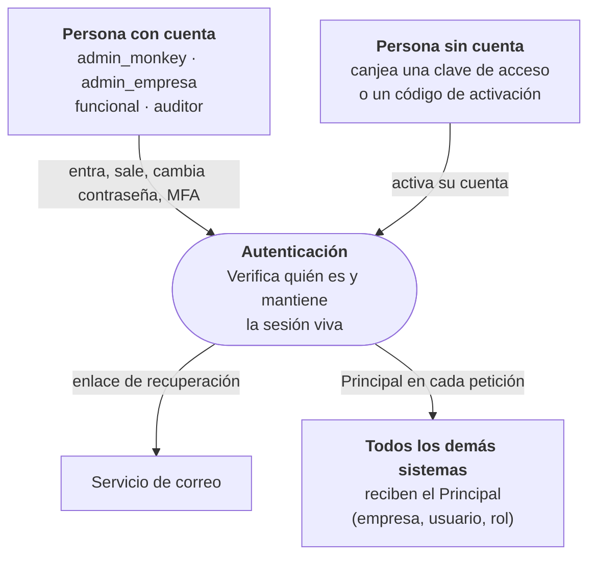
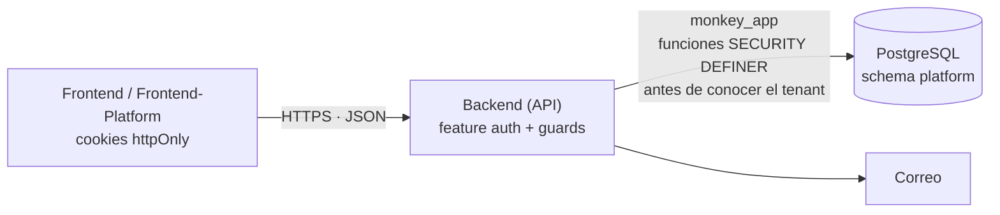
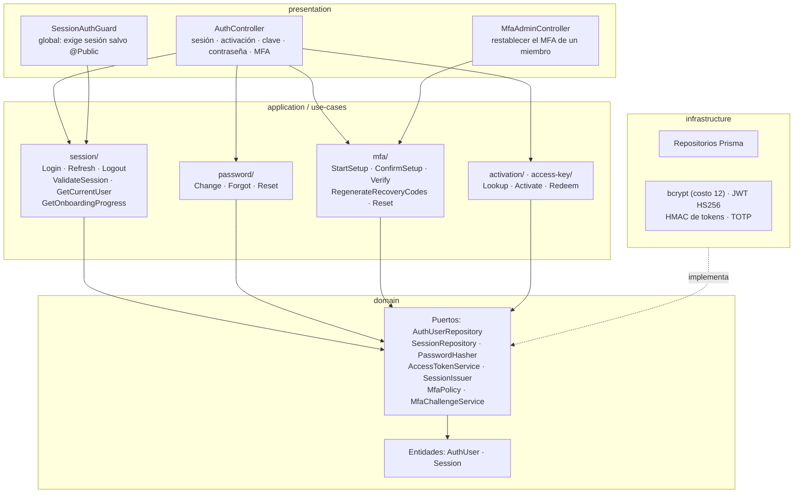

# Autenticación · C4

Responde: **¿qué piezas hacen posible entrar y mantener la sesión, y con qué se hablan?** Contrato de las rutas:
`contracts/autenticacion.md`. Mapa general: [`../c4-contexto.md`](../c4-contexto.md) y [`../c4-contenedores.md`](../c4-contenedores.md).

## Nivel 1 · Contexto

## Nivel 2 · Contenedores que toca

El frontend nunca ve un token: viajan en cookies `httpOnly` (SEG-18).

## Nivel 3 · Componentes

Transversales que usa y no posee: `PermissionsGuard` y `@Can` (ver [`roles-permisos/`](../roles-permisos/README.md)),
`RateLimitGuard` (`common/rate-limit`), `AuditLogWriter` e `insertAuditLog` (trazabilidad) y `Mailer`.

## Cómo verificarlo

`ls Backend/src/features/auth/application/use-cases/*` y `grep -rn "APP_GUARD" Backend/src`.
