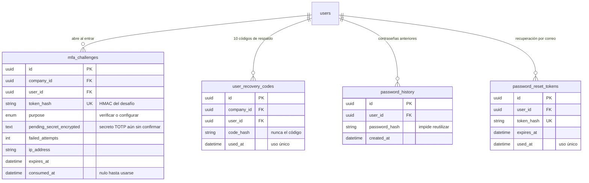

# Autenticación · Modelo

Responde: **¿qué tablas sostienen la identidad y cómo se relacionan?** El diagrama de `users`, `sessions` y
`user_activation_codes` ya está en [`datos/modelo/05-usuarios.md`](../../datos/modelo/05-usuarios.md) §5.2 y **no se
redibuja aquí**. Este archivo dibuja lo que §5.2 no tiene: el segundo factor, la recuperación de contraseña, el
historial y los códigos de un solo uso.

## Tablas fuera del diagrama de §5.2

## La clave de acceso es de otro módulo

La tabla `access_keys` la posee [Empresas](../empresas/README.md) (dibujada en `datos/modelo/04-monkey-admin.md` §4.1):
la crea `admin_monkey` al registrar la empresa. Autenticación solo la **canja**.

## La regla común de todas estas tablas

Ningún secreto se guarda en claro: contraseñas con bcrypt; códigos, claves y tokens como HMAC con *pepper*; el
secreto TOTP cifrado (SEG-17). Todo lo de uso único lleva `used_at` o `consumed_at` y fecha de vencimiento.

## Frontera con Gestión de usuarios

`users` es una sola tabla con tres dueños. **Autenticación** posee las columnas de acceso: `email`, `password_hash`,
`status`, `is_mfa_enabled`, `mfa_secret_encrypted`, `mfa_last_used_step`, `failed_login_attempts`, `locked_until`,
`last_login_at`, `password_changed_at`. **Gestión de usuarios** posee `name`, `last_name`, `company_id` y las tablas de
especialidad y reparto; **Roles y permisos** posee `role`.

## Por qué `company_id` está repetido

Cada tabla de acceso lleva `company_id` aunque `user_id` ya lo implique: las políticas RLS comparan una columna local
con `app.tenant_id` sin hacer joins (`datos/schema-implementacion.md`). El login es la excepción: corre antes de
conocer el tenant y usa funciones `SECURITY DEFINER` del schema `platform`.

## Cómo verificarlo

`Backend/prisma/schema/platform/users.prisma` y `companies.prisma`.
