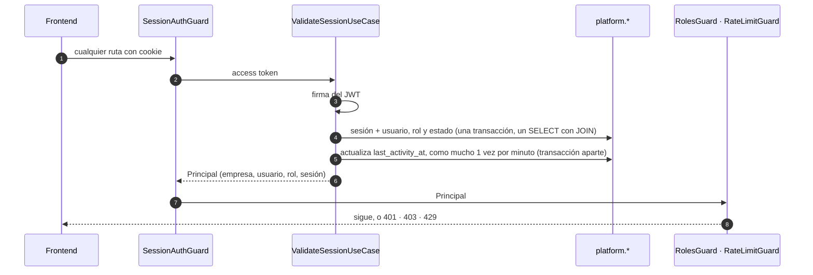
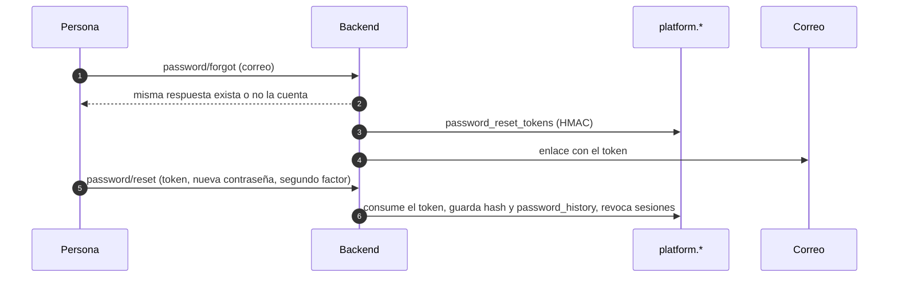

# Autenticación · Flujos de información

Responde: **¿qué dato viaja, de dónde a dónde y cómo va protegido en cada operación?** Los cuerpos exactos de cada
ruta están en `contracts/autenticacion.md`; aquí solo el movimiento de la información.

## Mapa de datos sensibles

| Dato | Nace en | Viaja a | Se guarda como | Vida |
|---|---|---|---|---|
| Contraseña | Formulario | API (TLS) | bcrypt, costo 12; historial en `password_history` | No vence (D101) |
| Access token | API al entrar | Cookie `httpOnly` | No se guarda: JWT firmado HS256 | Corta (15 min) |
| Refresh token | API al entrar | Cookie `httpOnly` | HMAC en `sessions.refresh_token_hash` | Rota en cada uso |
| Código TOTP | App del usuario | API | No se guarda; se recuerda el último paso usado | 30 s |
| Secreto TOTP | API al configurar | QR al usuario | Cifrado en `users.mfa_secret_encrypted` | Hasta restablecerlo |
| Códigos de recuperación | API al confirmar MFA | Pantalla, una vez | HMAC en `user_recovery_codes` | Uso único |
| Clave de acceso | `admin_monkey` al registrar | Correo del administrador | HMAC en `access_keys` | Vence; uso único |
| Código de activación | `admin_empresa` al invitar | Respuesta de la API, una vez | HMAC en `user_activation_codes` | 7 días; uso único |
| Token de recuperación | API | Correo | HMAC en `password_reset_tokens` | Corto; uso único |
| Dispositivo recordado (D123) | API al verificar el código con la casilla | Cookie `httpOnly` `mnk_device` (ruta `/v1/auth`) | HMAC en `trusted_devices` | 30 días sin renovarse; se olvida al cerrar sesión (solo si es de quien sale) o cambiar credenciales; Monkey Admin (`X-Monkey-Client: admin`) ni la lee ni la escribe ni la borra (MD-489) |

## 1 · Entrar (con y sin segundo factor)

```mermaid
sequenceDiagram
    autonumber
    participant FE as Frontend
    participant UC as LoginUseCase
    participant DB as platform.*
    FE->>UC: correo y contraseña
    UC->>DB: función SECURITY DEFINER: credenciales por correo
    alt correo inexistente o contraseña mala
        UC->>UC: bcrypt contra un hash falso (mismo costo)
        UC->>DB: suma intento fallido (5 → bloqueo de 15 min)
        UC-->>FE: INVALID_CREDENTIALS (no dice cuál falló)
    else correcta
        UC->>UC: ¿cuenta activa? ¿tiene MFA o es obligatoria?
        UC->>DB: ¿mnk_device es un dispositivo vigente de esta persona? (no admin_monkey, D123)
        opt MFA y sin dispositivo recordado
            UC->>DB: mfa_challenges (verify o setup)
            UC-->>FE: desafío; el cliente pide el código TOTP
            FE->>UC: mfa/verify (código)
            UC->>DB: valida y consume el desafío
            opt casilla «Recordar este dispositivo»
                UC->>DB: trusted_devices + auth.device_trusted (misma transacción que la sesión)
            end
        end
        UC->>DB: sesión + auth.login en audit_logs (una sola transacción)
        UC-->>FE: cookies access y refresh
    end
```

Los intentos **fallidos** se auditan aparte (`auth.login_failed`, sin tenant, porque el correo puede no existir);
el acceso correcto se audita con la sesión, en la misma transacción (D52, SEG-36). Con un dispositivo recordado, el rastro
`auth.login` lleva `mfa: "trusted_device"` y el dispositivo anota su último uso y ubicación en esa misma transacción (D123, SEG-84).

## 2 · Cada petición autenticada



El rol sale de la base y no del token. Si la sesión venció o la cuenta se desactivó, se revoca en ese momento.
Desde MD-219 (D124, sin caché) la validación abre **una** transacción: `SessionRepository.findWithOwner` lee la sesión y su
dueño con un `LEFT JOIN` bajo el mismo RLS. La escritura de `last_activity_at` sigue aparte para no revivir una sesión
vencida. `GET /v1/auth/me` abre 2 en total (el guard y una sola de caso de uso, `CurrentUserReader`, con el perfil y el
avance del onboarding); antes eran hasta 6. Lo mide `Backend/test/autenticacion/transacciones.e2e-spec.ts`.

## 3 · Activar una cuenta

Dos orígenes, mismo destino (cuenta `active` con contraseña y sesión):

| Origen | Quién entrega el secreto | Qué se canjea |
|---|---|---|
| Primer `admin_empresa` | `admin_monkey` registra la empresa; la **clave de acceso** llega por correo | `redeem/lookup` verifica y `redeem` crea la cuenta (D51, D99) |
| Miembro del equipo | `admin_empresa` lo invita; el **código** viaja en claro solo en esa respuesta | `activate/lookup` y `activate` (D95, D96) |

En ambos casos el paso 1 solo comprueba el secreto sin gastarlo; el paso 2 lo consume junto con la creación de la
cuenta, en una transacción. Un código usado, vencido o revocado no vuelve a servir (SEG-64).

## 4 · Recuperar o cambiar la contraseña



El cambio voluntario (`password/change`) exige la contraseña actual y el segundo factor (SEG-14, D101).

## 5 · Renovar y cerrar

`refresh` valida el refresh token contra su hash, **rota** el token y extiende la sesión sin pasar de 8 h desde que
se creó. `logout` revoca la sesión; el refresh deja de servir (SEG-11).

## Cómo verificarlo

`test/autenticacion/` (e2e) cubre bloqueo, MFA, sesión y rotación; ver la columna «Prueba» de SEG-10 a SEG-19.
