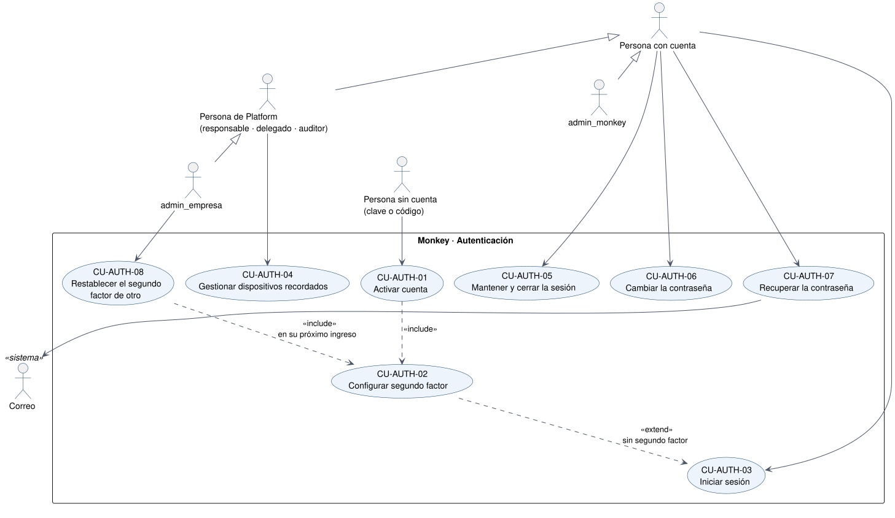

# Autenticación · casos de uso

Responde: **¿qué pasos sigue cada actor con el sistema, qué puede salir distinto y en qué estado queda todo al
terminar?** Cada caso realiza una o varias [historias](04-historias.md); la secuencia técnica (tablas, transacciones)
está en [`03-flujos.md`](03-flujos.md) y los cuerpos y errores en el
[contrato](../../../../../../contracts/autenticacion.md).

## Diagrama de casos de uso

Fuente del diagrama: [`05-casos-de-uso.puml`](05-casos-de-uso.puml) (PlantUML; se regenera con
`skills/process/monkey-docs/scripts/render-uml.sh`). «Persona con cuenta» generaliza a los roles de Platform y a
`admin_monkey`; `admin_empresa` es además «Persona de Platform».

`admin_monkey` usa los mismos casos en Monkey Admin, salvo CU-AUTH-04 (no recuerda dispositivos, D123).

## Resumen

| ID | Caso | Actor principal | Historias |
|---|---|---|---|
| CU-AUTH-01 | Activar cuenta | Persona sin cuenta | HU-AUTH-01, HU-AUTH-02 |
| CU-AUTH-02 | Configurar segundo factor | Persona | HU-AUTH-03 |
| CU-AUTH-03 | Iniciar sesión | Persona · `admin_monkey` | HU-AUTH-04, HU-AUTH-05, HU-AUTH-06 |
| CU-AUTH-04 | Gestionar dispositivos recordados | Persona | HU-AUTH-07 |
| CU-AUTH-05 | Mantener y cerrar la sesión | Persona · `admin_monkey` | HU-AUTH-08, HU-AUTH-09 |
| CU-AUTH-06 | Cambiar la contraseña | Persona · `admin_monkey` | HU-AUTH-10, HU-AUTH-12 |
| CU-AUTH-07 | Recuperar la contraseña | Persona · `admin_monkey` | HU-AUTH-11 |
| CU-AUTH-08 | Restablecer el segundo factor de otro | `admin_empresa` | HU-AUTH-13 |

---

### CU-AUTH-01 · Activar cuenta

| | |
|---|---|
| **Actor** | Persona sin cuenta: el administrador de una empresa nueva (clave de acceso) o alguien invitado (código de activación) |
| **Precondición** | Clave o código vigentes, emitidos por Monkey Admin (empresas) o por el `admin_empresa` (equipo) |
| **Postcondición** | Cuenta `active`, contraseña guardada, clave o código gastados; desafío de configuración del segundo factor abierto |

**Flujo principal**
1. La persona escribe la clave o el código.
2. El sistema muestra a qué empresa y a qué correo corresponde, sin gastarlo.
3. La persona pone su contraseña; el sistema comprueba la política (SEG-13).
4. El sistema crea o activa la cuenta y gasta la clave o el código en la misma operación.
5. Sigue con **CU-AUTH-02**.

**Flujos alternos**
- 1a. Clave inexistente o revocada → «clave inválida», sin decir cuál (`ACCESS_KEY_INVALID`). Vencida → `ACCESS_KEY_EXPIRED`.
- 1b. Diez fallos desde la misma dirección en 15 min → frenado (`ACCESS_KEY_RATE_LIMITED`).
- 3a. Contraseña que no cumple la política → se muestran los requisitos pendientes (`VALIDATION_FAILED`).
- 4a. El correo no es el registrado para la empresa → `ACCESS_KEY_EMAIL_MISMATCH`; la clave sigue pendiente.

### CU-AUTH-02 · Configurar segundo factor

| | |
|---|---|
| **Actor** | Persona con desafío de configuración (cuenta recién activada o con el segundo factor restablecido) |
| **Precondición** | Contraseña correcta; desafío vigente (5 min) |
| **Postcondición** | Segundo factor activo, 10 códigos de recuperación entregados una vez, sesión abierta; dispositivo recordado si lo marcó |

**Flujo principal**
1. El sistema muestra el QR y la clave manual.
2. La persona la añade a su app y escribe el primer código; opcionalmente marca «Recordar este dispositivo».
3. El sistema activa el factor, entrega los códigos de recuperación y abre la sesión.

**Flujos alternos**
- 2a. Código equivocado → suma al bloqueo del desafío y de la cuenta; a los 5, vuelve a iniciar sesión.
- 2b. El desafío venció → vuelve a iniciar sesión (`MFA_CHALLENGE_INVALID`).

### CU-AUTH-03 · Iniciar sesión

| | |
|---|---|
| **Actor** | Persona · `admin_monkey` |
| **Precondición** | Cuenta `active` |
| **Postcondición** | Sesión abierta (30 min sin actividad, 8 h máximo) con rastro `auth.login`; dispositivo recordado si lo marcó |

**Flujo principal**
1. La persona escribe correo y contraseña.
2. El sistema comprueba la contraseña y el estado de la cuenta.
3. Si el navegador tiene un dispositivo recordado vigente de esa persona, abre la sesión (fin).
4. Si no, pide el código de la app; la persona lo escribe y puede marcar «Recordar este dispositivo».
5. El sistema verifica el código y abre la sesión.

**Flujos alternos**
- 2a. Correo o contraseña incorrectos → mensaje único; suma al bloqueo. A los 5: bloqueo de 15 min (`ACCOUNT_LOCKED`).
- 2b. Cuenta `inactive` o `suspended` → `ACCOUNT_INACTIVE` (solo tras una contraseña correcta).
- 2c. La persona no tiene segundo factor → sigue con **CU-AUTH-02**.
- 4a. Usa un código de recuperación → entra y ve cuántos le quedan.
- 4b. `admin_monkey` envía «recordar» → `REMEMBER_DEVICE_NOT_ALLOWED`, sin gastar el código.
- 5a. Código equivocado o ya usado → suma al bloqueo (`MFA_CODE_INVALID`).

### CU-AUTH-04 · Gestionar dispositivos recordados

| | |
|---|---|
| **Actor** | Persona (no `admin_monkey`) |
| **Precondición** | Sesión abierta |
| **Postcondición** | Los dispositivos elegidos dejan de valer, con rastro `auth.device_revoked` |

**Flujo principal**
1. La persona abre Ajustes → Seguridad → Control de acceso → Dispositivos recordados.
2. El sistema muestra los vigentes, agrupados por tipo y sistema, con el actual marcado.
3. La persona elige «Olvidar» en uno (o «Olvidar todos») y confirma.
4. El sistema los revoca; si incluía el actual, borra su cookie.

**Flujos alternos**
- 3a. El dispositivo ya no está vigente o es de otra persona → `DEVICE_NOT_FOUND`; la lista se recarga.
- 2a. No tiene ninguno → se explica cómo recordar uno.

### CU-AUTH-05 · Mantener y cerrar la sesión

| | |
|---|---|
| **Actor** | Persona · `admin_monkey` |
| **Precondición** | Sesión abierta |
| **Postcondición** | Sesión renovada mientras hay actividad; cerrada al salir o al vencer |

**Flujo principal**
1. Mientras la persona trabaja, el sistema renueva el acceso de forma invisible (el refresh rota en cada uso).
2. La persona pulsa «Cerrar sesión».
3. El sistema cierra la sesión, olvida el dispositivo recordado de ese navegador y borra las cookies.

**Flujos alternos**
- 1a. 30 min sin actividad u 8 h desde que entró → la sesión vence; la siguiente acción lleva al ingreso.
- 1b. Otra pestaña renovó a la vez → se reintenta una vez; no saca a la persona.
- 1c. Un error de dominio (p. ej. código equivocado) no se confunde con una sesión vencida: no renueva ni reintenta (MD-229).
- 3a. La sesión ya había vencido → igual se olvida el dispositivo del navegador.

### CU-AUTH-06 · Cambiar la contraseña

| | |
|---|---|
| **Actor** | Persona · `admin_monkey` |
| **Precondición** | Sesión abierta y segundo factor activo |
| **Postcondición** | Contraseña nueva; demás sesiones cerradas y dispositivos olvidados; aviso por correo; rastro `auth.password_changed` |

**Flujo principal**
1. La persona escribe su contraseña actual, la nueva (con el globo de requisitos) y un código de su app.
2. El sistema verifica las tres cosas y guarda la contraseña.
3. La sesión actual sigue; las demás se cierran.

**Flujos alternos**
- 2a. Contraseña actual equivocada → `CURRENT_PASSWORD_INVALID`; suma al bloqueo.
- 2b. Código equivocado → `MFA_CODE_INVALID`; suma al bloqueo, una sola vez.
- 2c. Repite la actual o una de las 5 anteriores → `PASSWORD_REUSED`.
- 2d. Cuarto cambio en 24 h → `PASSWORD_CHANGE_LIMIT`.
- 1a. Quiere códigos de recuperación nuevos → los regenera con un código de su app (HU-AUTH-12); sus dispositivos se olvidan.

### CU-AUTH-07 · Recuperar la contraseña

| | |
|---|---|
| **Actor** | Persona · `admin_monkey`; actor secundario: el correo |
| **Precondición** | Cuenta `active` con segundo factor (o códigos de recuperación) |
| **Postcondición** | Contraseña nueva; **todas** las sesiones cerradas y dispositivos olvidados; rastro `auth.password_reset` |

**Flujo principal**
1. La persona pide el enlace con su correo; el sistema responde igual exista o no la cuenta.
2. El sistema envía un enlace de un solo uso que dura 30 min, en el idioma de la persona.
3. La persona abre el enlace, escribe la contraseña nueva y un código de su app.
4. El sistema la guarda y cierra todas sus sesiones; la persona entra de nuevo (**CU-AUTH-03**).

**Flujos alternos**
- 1a. Más de 5 enlaces en una hora → responde igual y no envía otro.
- 3a. El enlace venció, ya se usó o fue reemplazado → `PASSWORD_RESET_INVALID`.
- 3b. Tampoco tiene el segundo factor → su administrador lo restablece (**CU-AUTH-08**) y repite desde el paso 1.

### CU-AUTH-08 · Restablecer el segundo factor de otro

| | |
|---|---|
| **Actor** | `admin_empresa` |
| **Precondición** | La persona es `responsable`, `delegado` o `auditor` de su empresa, tiene segundo factor y no es él mismo |
| **Postcondición** | Secreto y códigos borrados, sesiones cerradas, dispositivos olvidados; rastro `auth.mfa_reset` |

**Flujo principal**
1. El administrador abre la persona en su equipo y elige restablecer el segundo factor.
2. El sistema lo restablece en una sola operación.
3. En su próximo ingreso, la persona lo configura de nuevo (**CU-AUTH-02**).

**Flujos alternos**
- 1a. La persona no tiene segundo factor → `MFA_NOT_ENABLED`.
- 1b. Es sobre sí mismo, otro `admin_empresa` o alguien de otra empresa → no está permitido.
- 1c. Para un `admin_empresa`, Monkey lo hace por script (`npm run mfa:reset`) tras verificar su identidad por otro canal.
