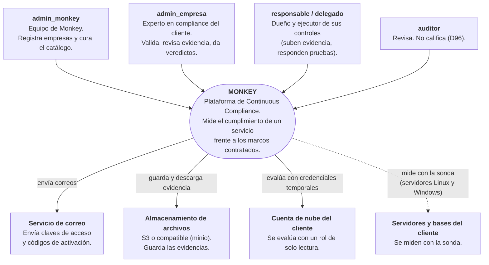

# C4 · Nivel 1 — Contexto

Responde: **¿quién usa Monkey y con qué sistemas externos habla?** Monkey se ve como una sola caja.

## Qué mirar aquí

- **Hay dos tipos de usuario con aplicaciones distintas:** el personal de Monkey (`admin_monkey`) y los
  usuarios de cada empresa cliente (los otros tres roles). Roles y permisos: `datos/modelo/05-usuarios.md`.
- **Monkey solo lee del cliente.** Nunca escribe en su nube ni en sus servidores; entra con un rol de
  solo lectura y credenciales temporales (D57, D58).
- **La IA no aparece como actor ni como sistema externo** porque hoy no hay un componente de IA
  construido en el código. El diseño objetivo sí la prevé (`architecture.md`, capa de razonamiento).
- Los proveedores de la sonda y del motor de nube **no se nombran en el producto** (regla de
  confidencialidad de `CLAUDE.md`). En este mapa interno se llaman "la sonda" y "el motor de nube".

## Cómo verificarlo

- Roles: `Backend/prisma/schema/platform/` (enum de roles de usuario).
- Correo y almacenamiento: `Backend/src/infrastructure/mail`, `Backend/src/infrastructure/storage`
  y las variables `S3_*` de `Backend/.env.example`.
- Nube y sonda: `context/backend.md`, fila `technical-control`, y `control-tecnico/motores/README.md`.
