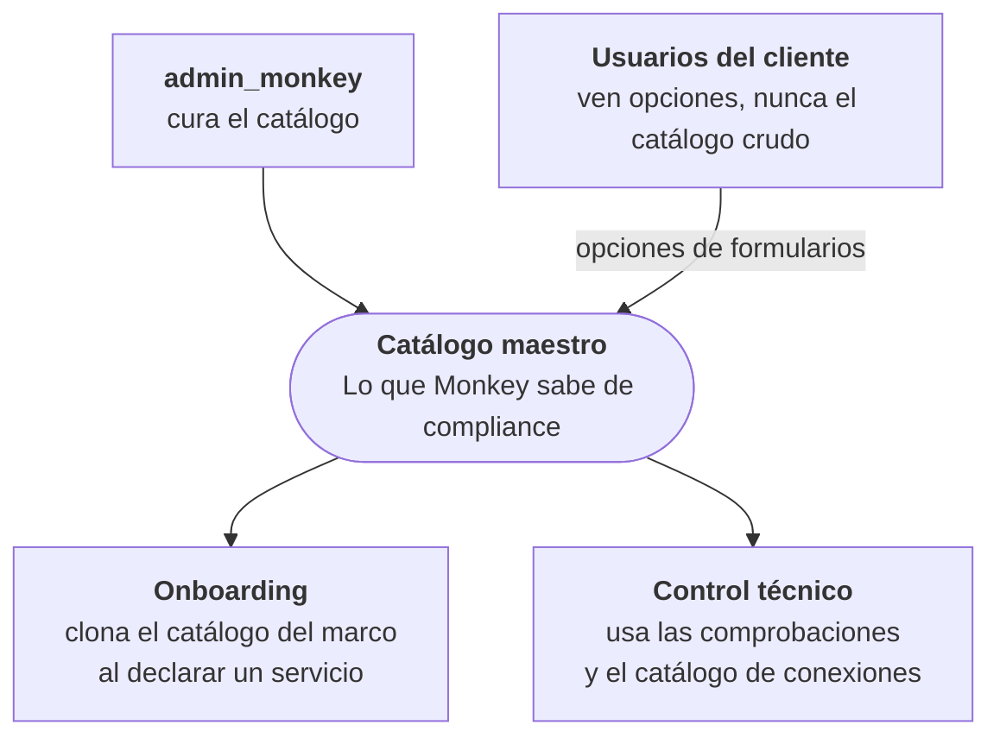
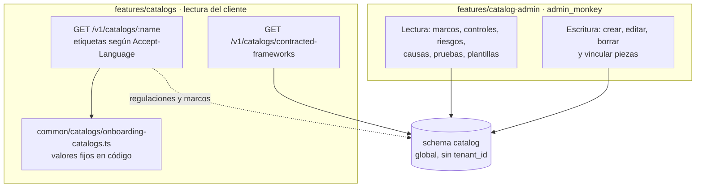

# Catálogo maestro · C4

Responde: **¿qué piezas leen y mantienen el catálogo?**

## Nivel 1 · Contexto

## Nivel 3 · Piezas internas

**El frontend nunca hardcodea listas de opciones**: las pide a `/catalogs/:name`. El `valor` es snake_case estable
y la etiqueta se traduce en el servidor (`contracts/enums.md`).

## La carga inicial no es una pantalla

`npm run reference:load` (regulaciones, marcos ofrecidos, capacidades automáticas) y `npm run catalog:load`
(el catálogo SOC 2). Los dos son idempotentes; `reference:verify` y `catalog:verify` solo comparan.

## Cómo verificarlo

`grep -nE "@(Get|Post|Patch|Delete|Roles)\(" Backend/src/features/catalog-admin/presentation/*.ts` y
`npm run catalog:verify`.
