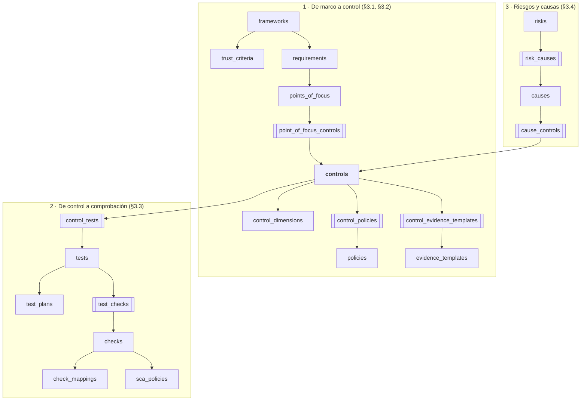

# Catálogo maestro · Modelo

> **VF18 (D128): esto describe el código construido con el catálogo v1.** El modelo del catálogo v2 está en [§3](../../datos/modelo/03-catalogo-maestro.md) y [§11](../../datos/modelo/11-documentos.md) (D129): requisitos del control, la prueba de un control, documentos, procedimientos, categorías de integración, mapeo a marcos y el rol del check. La carga (RC-01, MD-491) ya existe: las tablas v2 conviven con las v1 (que quedan vacías hasta las fases 2 y 3); los nombres finales están en [`contracts/catalogo-maestro.md`](../../../../../../contracts/catalogo-maestro.md#carga-del-catálogo-v2-rc-01) y en `Backend/prisma/schema/catalog/`.

Responde: **¿cómo se encadenan las piezas del catálogo?** Los diagramas campo por campo están en
[`datos/modelo/03-catalogo-maestro.md`](../../datos/modelo/03-catalogo-maestro.md) §3.1 a §3.5 y **no se
redibujan**. Aquí el mapa de las tres cadenas y la frontera con lo del cliente.

## Las tres cadenas

Las tablas de doble borde son **puentes N:M**: solo las dos llaves y un único sobre el par. Son la razón de que un
control sirva a varios requisitos y una causa a varios riesgos sin duplicar nada.

## Qué se clona al cliente y qué no

Es la frontera de este módulo. El detalle está en §3.5; en una línea:

| Se clona (el cliente lo puede reescribir) | Se referencia con FK real |
|---|---|
| `controls`, `control_dimensions`, `control_tests` | `requirements`, `points_of_focus` |
| `evidence_templates` → `evidence_requirements` | `tests` (el cliente no reescribe una prueba) |
| `risks`, `causes` | `control_measurements` (no se clona: peso lineal, D2) |

Lo clonado pasa a ser de [Cumplimiento](../cumplimiento/02-modelo.md) y del
[contexto del servicio](../onboarding/contexto-servicio/02-modelo.md), que es quien dispara la copia.

## El versionado, y por qué existe

`catalog_versions` numera cada publicación, y **cada fila de `evaluations` guarda contra qué versión se midió**
(A4). Sin eso un histórico no es comparable y un número entregado a un auditor puede cambiar solo: ya pasó una vez
con la reclasificación de un lote de comprobaciones.

Un cambio de redacción **se propaga solo**; un cambio que altera lo que se mide **requiere aceptación** del
`admin_empresa` (D96). La tabla completa de qué cae en cada lado está en §3.5.

## Cómo verificarlo

`ls Backend/prisma/schema/catalog/` y `grep -hE "^model " Backend/prisma/schema/catalog/*.prisma`.
