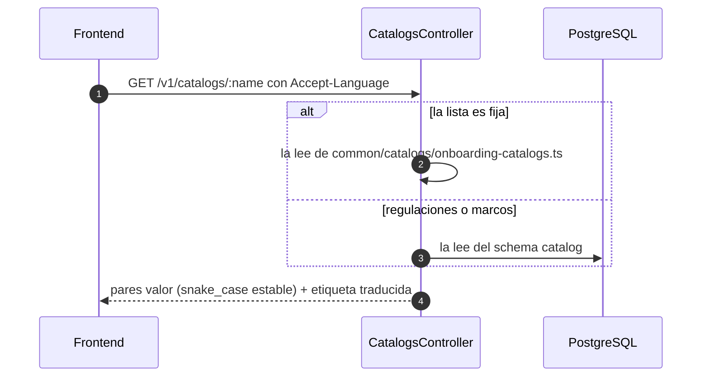
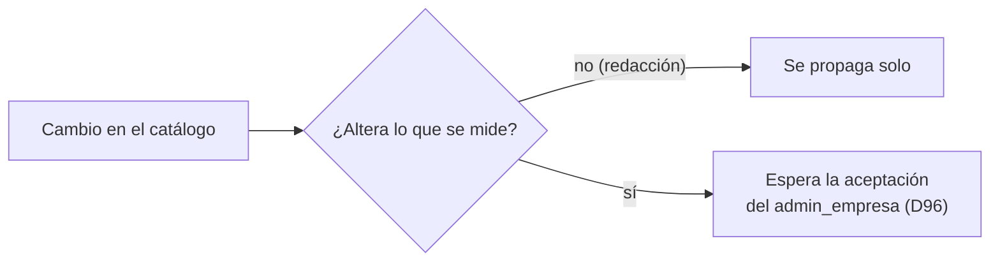
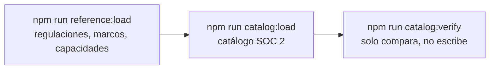

# Catálogo maestro · Flujos

> **VF18 (D128): esto describe el código construido con el catálogo v1.** La carga del catálogo v2 sigue el **orden de la tabla 10 de `01_DESARROLLO`** (matriz y mapeo a marcos, riesgos, causas, documentos, procedimientos e integraciones, controles, requisitos, pruebas, catálogos de checks, `TEST_CHECKS`, parámetros, roles y formularios) y valida sus totales y las reglas `IN-01` a `IN-10` ([§0](../../datos/modelo/00-fuentes.md)). Se escribe con RC-01.

Responde: **¿cómo llega una opción al formulario del cliente y cómo se mantiene el catálogo?**

## 1 · Una opción en un formulario

**Por qué así:** si el frontend escribiera las opciones, cada idioma y cada cambio del comité serían un despliegue
del frontend. El `valor` no cambia nunca; la etiqueta es presentación.

## 2 · Mantener el catálogo

Solo `admin_monkey`. Las rutas de `catalog-admin` son de dos tipos:

| Tipo | Ejemplos |
|---|---|
| La pieza en sí | controles, pruebas, riesgos, causas, plantillas de evidencia |
| El **vínculo** entre piezas | control ↔ prueba, control ↔ punto de enfoque, control ↔ dimensión, riesgo ↔ causa, causa ↔ control |

Toda escritura deja su rastro de auditoría ([Trazabilidad](../trazabilidad/README.md)).

## 3 · Qué pasa con los clientes ya creados

Un cliente trabaja siempre con su **copia**, así que el catálogo puede corregirse sin mover a nadie. Es la razón de
ser del clonado ([contexto del servicio](../onboarding/contexto-servicio/02-modelo.md)).

## 4 · La carga inicial

Los dos primeros son idempotentes: se pueden volver a correr sin duplicar.

## Cómo verificarlo

`Backend/prisma/seed/` y `contracts/enums.md`.
