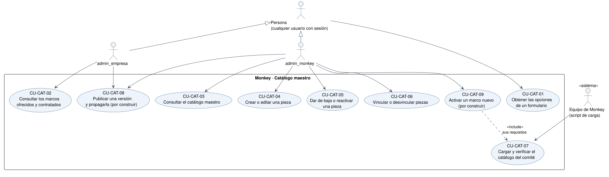

# Catálogo maestro · casos de uso

Responde: **¿qué pasos sigue cada actor con el sistema, qué puede salir distinto y en qué estado queda todo al
terminar?** Cada caso realiza una o varias [historias](04-historias.md); la secuencia técnica está en
[`03-flujos.md`](03-flujos.md) y los cuerpos y errores en el
[contrato](../../../../../../contracts/catalogo-maestro.md).

## Diagrama de casos de uso

Fuente del diagrama: [`05-casos-de-uso.puml`](05-casos-de-uso.puml) (PlantUML; se regenera con
`skills/process/monkey-docs/scripts/render-uml.sh`). «Persona» es cualquier usuario con sesión; `admin_empresa` y
`admin_monkey` heredan sus casos. El clonado al contratar un marco lo dispara el
[contexto del servicio](../onboarding/contexto-servicio/README.md); aquí solo se describe lo que el catálogo garantiza.

CU-CAT-08 y CU-CAT-09 están por construir: se describen como los dejan §3.5 del modelo, el contrato y
[`marcos/`](marcos/README.md), no como construidos. La parte de CU-CAT-07 que toca `P9` se carga tal cual hasta que el
comité responda.

## Resumen

| ID | Caso | Actor principal | Historias |
|---|---|---|---|
| CU-CAT-01 | Obtener las opciones de un formulario | Persona | HU-CAT-01, HU-CAT-16 |
| CU-CAT-02 | Consultar los marcos ofrecidos y contratados | `admin_empresa` | HU-CAT-02 |
| CU-CAT-03 | Consultar el catálogo maestro | `admin_monkey` | HU-CAT-03, HU-CAT-04, HU-CAT-09 |
| CU-CAT-04 | Crear o editar una pieza del catálogo | `admin_monkey` | HU-CAT-05, HU-CAT-06, HU-CAT-09 |
| CU-CAT-05 | Dar de baja o reactivar una pieza | `admin_monkey` | HU-CAT-07, HU-CAT-12 |
| CU-CAT-06 | Vincular o desvincular piezas | `admin_monkey` | HU-CAT-08 |
| CU-CAT-07 | Cargar y verificar el catálogo del comité | Equipo de Monkey (script) | HU-CAT-10, HU-CAT-11 |
| CU-CAT-08 | Publicar una versión y propagarla | `admin_monkey` | HU-CAT-13, HU-CAT-14 |
| CU-CAT-09 | Activar un marco nuevo | `admin_monkey` | HU-CAT-15 |

---

### CU-CAT-01 · Obtener las opciones de un formulario

| | |
|---|---|
| **Actor** | Persona (cualquier usuario con sesión, de Platform o de Monkey Admin) |
| **Precondición** | Sesión abierta |
| **Postcondición** | Nada cambia |

**Flujo principal**
1. La pantalla pide `GET /v1/catalogs/{name}` con `Accept-Language`.
2. El sistema lee la lista del código (listas fijas) o del schema `catalog` (regulaciones y marcos).
3. El sistema devuelve los pares `value` + `label` traducida, en el orden del enum.
4. La pantalla muestra la etiqueta y guarda el `value`.

**Flujos alternos**
- 1a. El nombre no existe → `404`.
- 3a. La lista es contenido del comité (un control, un riesgo): sale en español aunque la aplicación esté en inglés
  (DT-100), salvo el nombre de las 11 pruebas de nube.

### CU-CAT-02 · Consultar los marcos ofrecidos y contratados

| | |
|---|---|
| **Actor** | `admin_empresa` |
| **Precondición** | Sesión abierta; Monkey Admin contrató al menos un marco para la empresa |
| **Postcondición** | Nada cambia; el servicio solo puede quedar con marcos contratados |

**Flujo principal**
1. `admin_empresa` abre la elección de marco de un servicio.
2. El sistema devuelve los 7 marcos ofrecidos con su `availability` y, aparte, los contratados por su empresa.
3. La pantalla deja elegir solo los contratados; el resto se ve bloqueado.

**Flujos alternos**
- 3a. Toca un marco no contratado → no se selecciona y se abre el aviso de hablar con mercadeo; el botón solo cierra el
  aviso (DT-41).
- 3b. Envía un marco no contratado al declarar el servicio → `FRAMEWORK_NOT_CONTRACTED`.
- 2a. Pide los contratados con otro rol → `403 FORBIDDEN`.

### CU-CAT-03 · Consultar el catálogo maestro

| | |
|---|---|
| **Actor** | `admin_monkey` |
| **Precondición** | Sesión abierta en Monkey Admin |
| **Postcondición** | Nada cambia |

**Flujo principal**
1. `admin_monkey` abre «Catálogo maestro» y ve los marcos como tarjetas con sus conteos.
2. Elige un marco y una pestaña (controles, riesgos, causas, pruebas o evidencias requeridas); puede buscar y filtrar
   por origen y estado.
3. El sistema devuelve la página pedida.
4. `admin_monkey` abre un elemento y ve su detalle en el panel lateral.

**Flujos alternos**
- 2a. En controles elige el ámbito «todo el catálogo» o «sin requisito» (`unlinked=true`) → ve también CPL-1 y los
  controles sin vincular.
- 2b. Filtra «sin evidencia requerida» (`has_evidence_template=false`) → ve los controles que no piden evidencia.
- 2c. En pruebas filtra por dimensión.
- 3a. El rol no es `admin_monkey` → `403 FORBIDDEN`.
- 4a. El elemento no existe → `404 NOT_FOUND`.

### CU-CAT-04 · Crear o editar una pieza del catálogo

| | |
|---|---|
| **Actor** | `admin_monkey` |
| **Precondición** | Sesión abierta en Monkey Admin |
| **Postcondición** | Pieza creada (`origin: monkey_admin`, activa) o editada; rastro `catalog.*` en la misma transacción |

**Flujo principal**
1. `admin_monkey` elige «Nuevo» en una pestaña, o «Editar» en el detalle de un elemento.
2. Llena el formulario común; las listas salen de **CU-CAT-01**. En una prueba, los textos del comité van en una sección
   aparte y opcional.
3. El sistema valida el código, los campos y, en una prueba, que lo que ve el cliente no nombre al proveedor.
4. El sistema guarda el elemento y su rastro en una transacción y responde con el elemento.
5. Un elemento recién creado se abre para vincularlo (**CU-CAT-06**).

**Flujos alternos**
- 3a. Campo obligatorio vacío o enum inválido → `422 VALIDATION_FAILED`, con el error junto a cada campo.
- 3b. `code` repetido en su tipo → `409 CODE_ALREADY_EXISTS`.
- 3c. El prefijo del código de la prueba no corresponde a su dimensión → `422 code.dimension_mismatch`.
- 3d. `display_name` o `display_description` nombran al proveedor → `422 text.names_provider`.
- 3e. Edición sin ningún campo → `422`.
- 1a. Riesgo o causa sin `code` → el servidor asigna el siguiente `R0NN` o `F0NN`.
- 4a. Edita una fila del comité → conserva `origin: committee` y el rastro la marcará en la próxima carga
  (**CU-CAT-07**).

### CU-CAT-05 · Dar de baja o reactivar una pieza

| | |
|---|---|
| **Actor** | `admin_monkey` |
| **Precondición** | El elemento existe |
| **Postcondición** | `is_active` cambiado; la fila sigue en la base; los servicios nuevos ya no la clonan y las copias existentes no cambian; rastro `catalog.*.deactivate` o `reactivate` |

**Flujo principal**
1. `admin_monkey` elige «Dar de baja» en el detalle y confirma.
2. El sistema comprueba que la baja no deje a un control activo sin nada que medir.
3. El sistema marca `is_active = false` y deja el rastro en la misma transacción.
4. Desde ahí, el clonado de un servicio nuevo salta ese elemento.

**Flujos alternos**
- 1a. Elige «Reactivar» en un elemento dado de baja → `is_active = true`, con su rastro.
- 2a. Es la única prueba de un control activo → `409 CATALOG_ITEM_IN_USE`.
- 3a. Ya estaba dado de baja → la operación es idempotente.

### CU-CAT-06 · Vincular o desvincular piezas

| | |
|---|---|
| **Actor** | `admin_monkey` |
| **Precondición** | Los dos elementos existen |
| **Postcondición** | Relación creada o borrada (nunca los elementos); rastro `catalog.*.link` o `unlink` |

**Flujo principal**
1. `admin_monkey` abre un control (o una causa, o un riesgo) y elige agregar un vínculo.
2. El selector busca entre lo activo y deja fuera lo ya vinculado (puntos de enfoque por marco y requisito; pruebas
   solo de las dimensiones del control; evidencias con posición opcional; dimensiones; causas y riesgos).
3. El sistema valida y crea la relación con su rastro, y responde `201` con el padre actualizado.
4. Para quitar un vínculo, `admin_monkey` lo elimina y el sistema responde `204`.

**Flujos alternos**
- 3a. El vínculo ya existe → `409 LINK_ALREADY_EXISTS`.
- 3b. La prueba no es de una dimensión del control → `422 dimension.not_in_control`.
- 3c. Posición de evidencia fuera de rango → `422 sequence.range`; en rango, las siguientes se corren.
- 4a. Es la única prueba de un control activo, o una dimensión de la que el control todavía usa pruebas →
  `409 CATALOG_ITEM_IN_USE`.
- 4b. Quita una evidencia de en medio → las siguientes cierran el hueco.

### CU-CAT-07 · Cargar y verificar el catálogo del comité

| | |
|---|---|
| **Actor** | Equipo de Monkey, con un script (`reference:load`, `catalog:load`, `catalog:verify`) |
| **Precondición** | El JSON versionado del Excel del comité con su sha256 |
| **Postcondición** | Lo que faltaba del comité queda insertado, con `origin: committee`; nada se borra ni se sobrescribe |

**Flujo principal**
1. El equipo corre `npm run reference:load`: regulaciones, los 7 marcos ofrecidos y las capacidades automáticas.
2. El equipo corre `npm run catalog:load` sobre el catálogo SOC 2.
3. El script valida todo antes de escribir, comprueba las cifras medidas e inserta en una transacción solo lo que falta.
4. El equipo corre `npm run catalog:verify`, que solo compara.

**Flujos alternos**
- 3a. Una fila del comité existente difiere → aborta con diff, no sobrescribe.
- 3b. La fila difiere porque se editó desde Monkey Admin → el conflicto sale marcado «[editado desde Monkey Admin]»; qué
  versión queda se decide con el comité.
- 3c. Filas creadas desde Monkey Admin → se ignoran y se cuentan aparte.
- 3d. Las cifras del Excel cambiaron o una prueba no trae numeración → la extracción falla en vez de adivinar.
- 3e. Pruebas `T-APP-001…006` y diez causas sin riesgo → se cargan tal cual hasta que el comité responda `P9`.
- 2a. Se vuelve a correr → no duplica nada.

### CU-CAT-08 · Publicar una versión y propagarla

> ⚪ **Por construir** (A4). Pasos según §3.5 del modelo.

| | |
|---|---|
| **Actor** | `admin_monkey`; actor secundario: `admin_empresa` (acepta) |
| **Precondición** | Cambios en el catálogo sin publicar |
| **Postcondición** | Versión nueva en `catalog_versions`; los cambios que se propagan solos llegan a las copias; los demás quedan pendientes de aceptación |

**Flujo principal**
1. `admin_monkey` publica una versión con su resumen de cambios.
2. El sistema propaga solo las correcciones de redacción y los controles nuevos.
3. Los cambios en cómo se mide, las bajas de controles y los cambios de mapeo de un check quedan pendientes.
4. `admin_empresa` acepta el cambio y desde el siguiente periodo cuenta en su servicio.

**Flujos alternos**
- 2a. Un control nuevo → cuenta desde el siguiente periodo de evaluación; el periodo en curso no se toca.
- 4a. `admin_empresa` no acepta → su copia sigue como estaba.

### CU-CAT-09 · Activar un marco nuevo

> ⚪ **Por construir:** espera el mapeo del comité y DT-38.

| | |
|---|---|
| **Actor** | `admin_monkey`; actor secundario: el equipo de Monkey (carga) |
| **Precondición** | Marco `coming_soon` con su conocimiento escrito en [`marcos/`](marcos/README.md) y el mapeo del comité |
| **Postcondición** | Marco `available` con sus requisitos vinculados a controles; Monkey Admin deja contratarlo |

**Flujo principal**
1. El equipo carga los requisitos y puntos de enfoque del marco, con sus categorías nativas (**CU-CAT-07**).
2. `admin_monkey` vincula esos puntos de enfoque a los controles que ya existen (**CU-CAT-06**) y crea solo los
   realmente distintos (**CU-CAT-04**).
3. El marco pasa a `available`.

**Flujos alternos**
- 1a. Las categorías siguen siendo las 5 de SOC 2 → hay que generalizar a dominios por marco antes (DT-38).
- 2a. El motor trae el marco etiquetado de fábrica → es un insumo; gana el mapeo del comité (D56).
- 3a. Es CIS Controls → no se activa como marco contratable (vetado).
