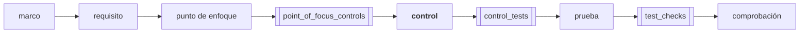

# Catálogo maestro

Responde: **¿de dónde salen los marcos, los controles y las pruebas que Monkey usa para medir?** Es lo que Monkey
sabe de compliance, igual para todos los clientes: marcos, requisitos, puntos de enfoque, controles, pruebas,
comprobaciones, riesgos, causas y plantillas de evidencia. Lo cura el equipo de Monkey.

## Dos públicos, dos caminos

| Para | Qué hace | Código |
|---|---|---|
| El cliente | Lee las **opciones de los formularios** con su etiqueta traducida | `features/catalogs` |
| `admin_monkey` | **Administra el catálogo**: crea, edita, borra y vincula sus piezas | `features/catalog-admin` |

## La regla estructural que lo explica todo

**El control es atómico e independiente del marco.** Se vincula a requisitos a través de puntos de enfoque; los
requisitos pertenecen a un marco. Así un mismo control sirve a SOC 2 y a ISO 27001 sin copiarse, y agregar un marco
no obliga a reconstruir nada.

## Qué posee

Todo el schema `catalog`. Sin `tenant_id`: es global. RLS **solo de escritura**: cualquiera lo lee, únicamente
`admin_monkey` lo modifica (D31).

Las opciones que no son del catálogo (tamaño de empresa, industria…) viven en código,
`src/common/catalogs/onboarding-catalogs.ts`; solo regulaciones y marcos salen de la base.

## Dónde está cada dato

| Dato | Dueño |
|---|---|
| Entidades, relaciones y el porqué | `datos/modelo/03-catalogo-maestro.md` §3.1 a §3.5 |
| Rutas de administración | `contracts/catalogo-maestro.md` |
| Valores de los enums | [`contracts/enums/catalogo-maestro.md`](../../../../../../contracts/enums/catalogo-maestro.md) |
| Valores y etiquetas de cada enum | `contracts/enums.md` |
| Qué exige cada marco | [`marcos/`](marcos/README.md) (este módulo) |
| Decisiones (`D-n`) | [`datos/decisiones/catalogo-maestro/`](../../datos/decisiones/catalogo-maestro/README.md): `D26` · `D28` · `D32` · `D34` · `D35` · `D36` · `D38` · `D39` · `D40` · `D82` · `D128` · `D129` · `D139`; marcos: `D37` · `D50` |
| Pendientes del comité (`P-n`) | [`datos/pendientes/catalogo-maestro.md`](../../datos/pendientes/catalogo-maestro.md): `P9` · `P21` · `P50` — **si sigue abierto, se pregunta** |
| Código | `Backend/src/features/catalogs` y `catalog-admin` |
| Deuda vigente (6 `DT-n`) | [`deuda-tecnica/catalogo-maestro.md`](../../deuda-tecnica/catalogo-maestro.md) |
| Requisitos de seguridad (`SEG-n`) | ninguno propio: le aplican los de [`seguridad/plataforma.md`](../../seguridad/plataforma.md) y [`aislamiento-tenant.md`](../../seguridad/aislamiento-tenant.md) (solo `admin_monkey` escribe el catálogo) |

## Índice del módulo

| # | Lee | Qué aprendes |
|---|---|---|
| **1** | Este archivo | Para qué existe y la regla que lo explica |
| **2** | [`01-c4.md`](01-c4.md) | Las piezas: lectura del cliente y administración |
| **3** | [`02-modelo.md`](02-modelo.md) | Las tres cadenas, qué se clona y el versionado |
| **4** | [`03-flujos.md`](03-flujos.md) | De una opción en un formulario a la carga inicial |
| **4.1** | ↳ [**Marcos**](marcos/README.md) | Qué exige cada marco y qué falta para activarlo |

## Contenido

[`01-c4.md`](01-c4.md) · [`02-modelo.md`](02-modelo.md) · [`03-flujos.md`](03-flujos.md) · [`04-historias.md`](04-historias.md) ·
[`05-casos-de-uso.md`](05-casos-de-uso.md) · [`marcos/`](marcos/README.md)
