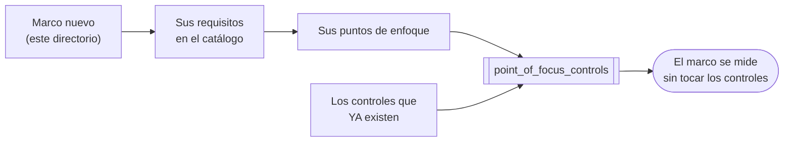

# Marcos — qué exige cada uno

Responde: **¿qué pide cada marco de cumplimiento y qué hace falta para que Monkey lo mida?** Es el material fuente
del [catálogo maestro](../README.md): cada marco se transcribe a requisitos → puntos de enfoque → controles →
pruebas. Sin esto el catálogo no se puede construir ni defender ante un auditor.

Un archivo por marco, **con fuente y fecha de verificación**. No se inventan citas ni cifras: si un dato no está
ahí, se verifica antes de afirmarlo.

## Estado en el producto

Que el conocimiento de un marco esté escrito **no lo activa**. Lo que decide es la tabla `catalog.frameworks`:

| Marco | En el producto | Qué falta para activarlo |
|---|---|---|
| [SOC 2](soc2.md) | ✅ **Contratable** (`available`) — el único construido (D37) | Nada. Es el catálogo que carga `npm run catalog:load` |
| [ISO 27001](iso27001.md) | 🟡 Se ofrece bloqueado (`coming_soon`) | Cargar sus requisitos y mapear a ellos los controles que ya existen |
| [HIPAA](hipaa.md) | 🟡 Se ofrece bloqueado | Ídem |
| [GDPR](gdpr.md) | 🟡 Se ofrece bloqueado | Ídem |
| [PCI DSS](pci-dss.md) | 🟡 Se ofrece bloqueado | Ídem |
| [NIST CSF](nist-csf.md) | 🟡 Se ofrece bloqueado | Ídem |
| [SOC 1](soc1.md) | 🟡 Se ofrece bloqueado | Ídem |
| [CIS Controls](cis-controls.md) | 🔴 **Vetado** como marco contratable | Decisión de producto, no trabajo técnico. La sonda sí lo usa como *benchmark* de configuración |
| [NIS2](nis2.md) · [DORA](dora.md) · [LGPD](lgpd.md) | ⚪ Solo conocimiento | No está ni sembrado: entra como módulo completo en la Fase 3 |
| [FedRAMP](fedramp.md) · [CMMC](cmmc.md) | ⚪ Solo conocimiento | Se evalúan según demanda real |
| [CCPA/CPRA](ccpa-cpra.md) | ⚪ Solo conocimiento | Sin fase asignada |

**Siete se ofrecen, uno se contrata** (D37, D50): los seis `coming_soon` se siembran sin requisitos con
`npm run reference:load` y se muestran como gancho comercial; Monkey Admin rechaza contratarlos
(`409 FRAMEWORK_NOT_AVAILABLE`). El orden de la lista es el de demanda real, no alfabético.
Fases en [`mvp-roadmap.md`](../../../producto/mvp-roadmap.md); el enum, en `contracts/enums.md`.

## Por qué activar un marco nuevo es mapear, no reconstruir

Es la consecuencia práctica de que **el control sea atómico e independiente del marco**:

Los Common Criteria de SOC 2 (CC1–CC9) son el núcleo de mayor solapamiento con ISO 27001, PCI DSS y NIST CSF. Por
eso el catálogo nació cubriendo CC6 (acceso) y CC7 (operaciones): son los que más marcos comparten.

## Qué cubre la medición automática

Cada archivo tiene una sección por motor, pero **el dueño del dato es el motor**, no el marco:

| Pregunta | Dónde |
|---|---|
| Qué marcos trae etiquetados la sonda de fábrica, y con qué claves | [`control-tecnico/motores/wazuh-compliance.md`](../../control-tecnico/motores/wazuh-compliance.md) |
| Qué cubre el motor de nube y con qué cifras | [`control-tecnico/motores/prowler.md`](../../control-tecnico/motores/prowler.md) · [`cruce-nube-aws.md`](../../control-tecnico/motores/cruce-nube-aws.md) |
| Cómo se convierte un resultado en cumplimiento | [`control-tecnico/03-flujos.md`](../../control-tecnico/03-flujos.md) |

**Lo que el motor trae de fábrica es un insumo, no la verdad**: gana el mapeo del comité (D56).

## Confidencialidad

Los proveedores de los motores son **internos**. En el producto se dice «sonda» o «evaluación automática», nunca su
nombre (D70, SEG-39). Estos archivos sí los nombran porque son documentación interna.

## Dónde está el resto del cumplimiento

| Pregunta | Dónde |
|---|---|
| Cómo se modela un marco (requisito → punto de enfoque → control) | [`../02-modelo.md`](../02-modelo.md) · `datos/modelo/03-catalogo-maestro.md` §3.1 y §3.2 |
| Cómo se calcula el cumplimiento de un marco | [`../../cumplimiento/motor/reglas.md`](../../cumplimiento/motor/reglas.md) · `datos/modelo/09-calculo-cumplimiento.md` |
| Cómo se le muestra al usuario final | [`philosophy.md`](../../../producto/philosophy.md) |
| Qué se clona al contratar un marco | [`../../onboarding/contexto-servicio/02-modelo.md`](../../onboarding/contexto-servicio/02-modelo.md) |
