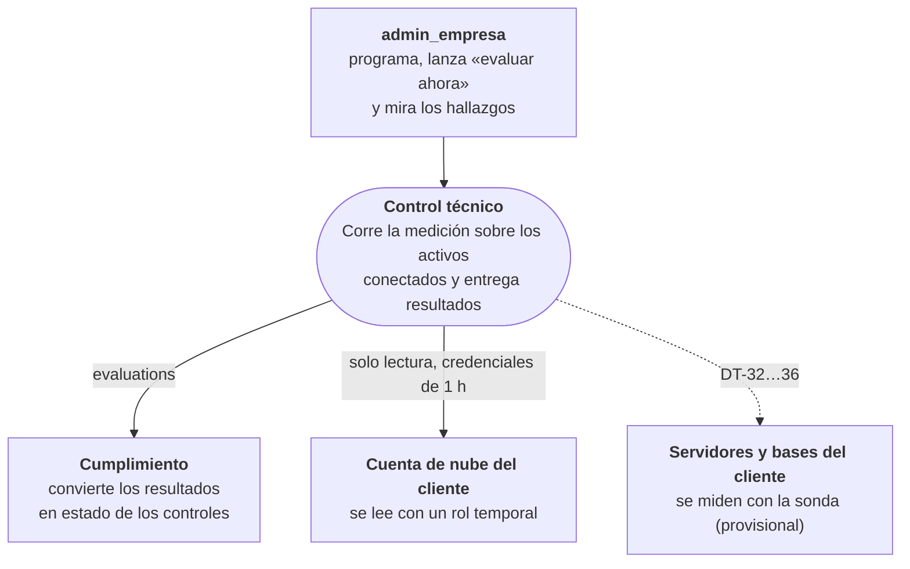
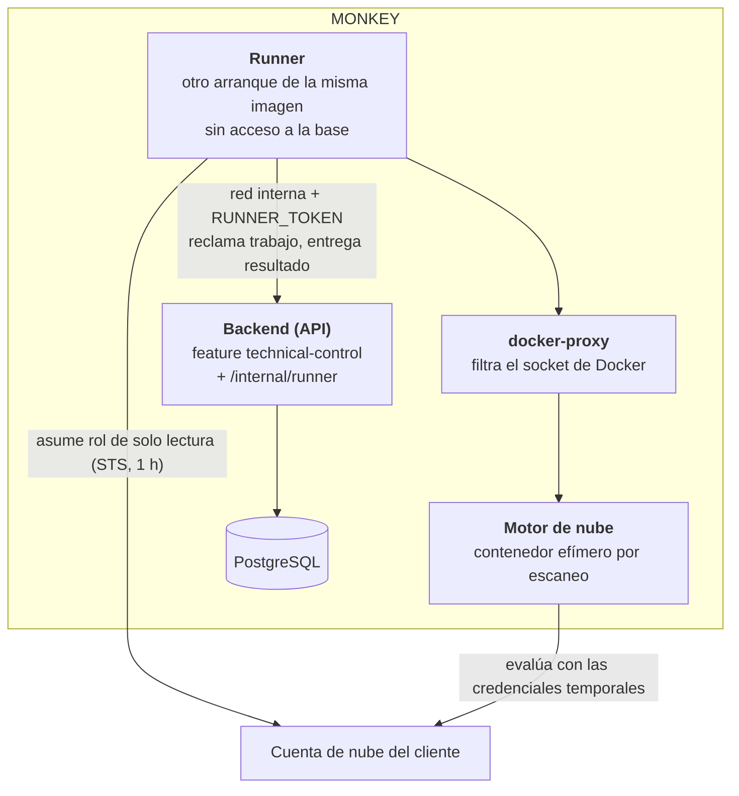
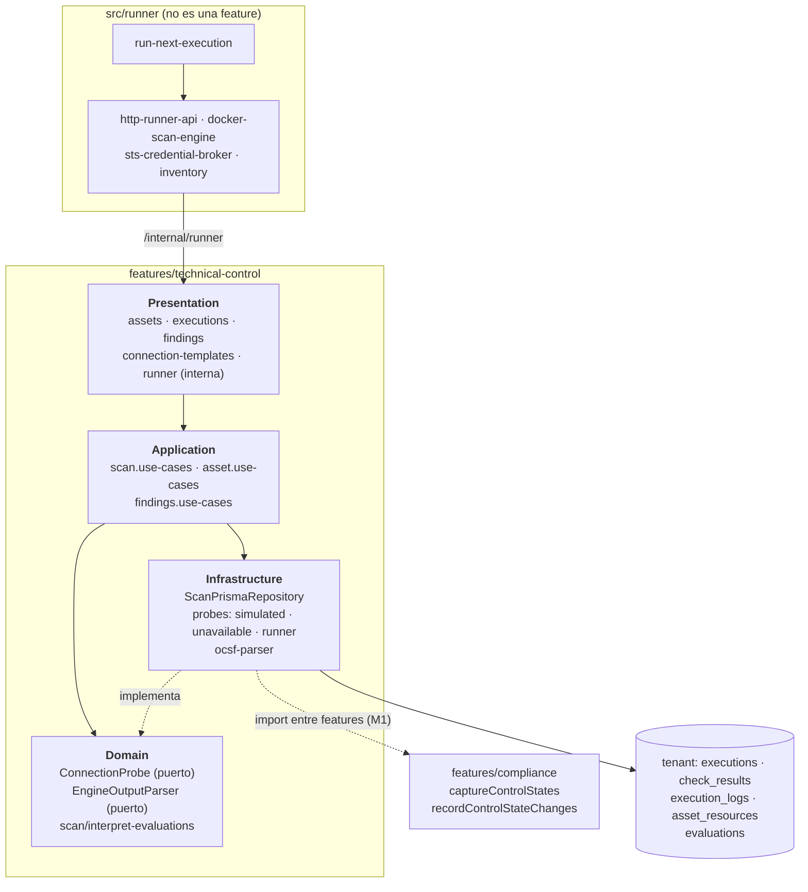

# Control técnico · C4

Responde: **¿qué piezas corren una medición automática y dónde vive cada una?** El mapa general está en
[`../01-contexto.md`](../01-contexto.md) y [`../02-contenedores.md`](../02-contenedores.md).

## Nivel 1 · Contexto

**Monkey nunca escribe en los sistemas del cliente.** Entra con un rol de solo lectura y credenciales temporales
(D57, D58).

## Nivel 2 · Contenedores

**El Runner es la pieza más delicada y por eso está separada**: no ve la base, ni el JWT, ni la clave de cifrado.
Solo habla con la API interna.

## Nivel 3 · Piezas internas

El adaptador que corre lo decide `PROBE_MODE`: `simulated`, `unavailable` o `runner`. Cuando exista un conector
real para servidores se agrega un cuarto **sin tocar los casos de uso**.

## Cómo verificarlo

- Rutas: `grep -nE "@(Get|Post|Put)\(" Backend/src/features/technical-control/presentation/*.ts`
- Runner: `ls Backend/src/runner` y `skills/backend/add-cloud-engine.md`.
