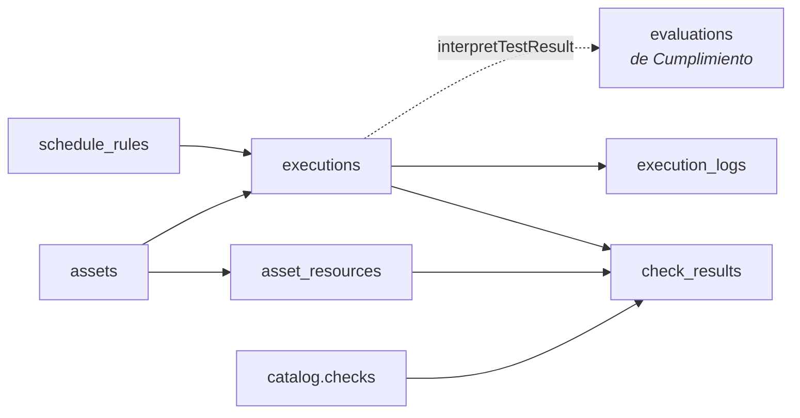
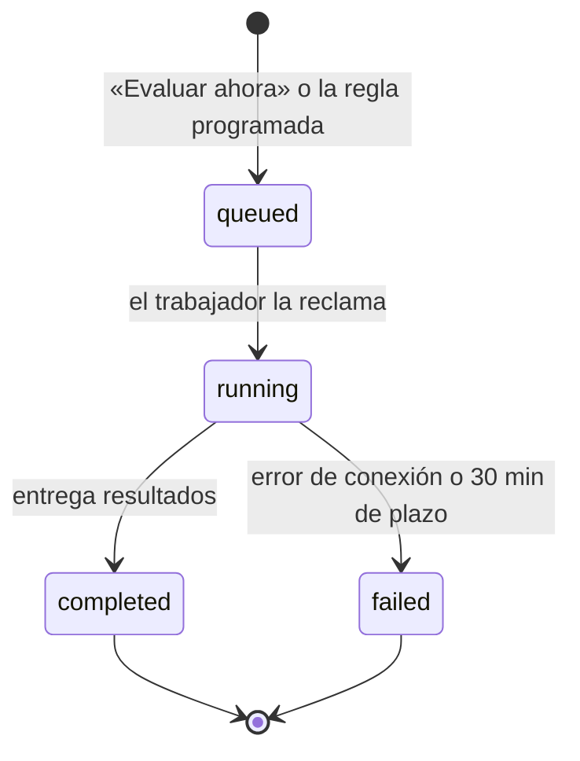

# Control técnico · Modelo

Responde: **¿qué tablas guardan una corrida y su resultado?** El modelo completo y su porqué están en
`datos/modelo/08-control-tecnico.md` (§8); aquí el recorte del módulo.

## Qué tabla guarda qué

**Ninguna se redibuja aquí**: el ER campo por campo está en
[`datos/modelo/08-control-tecnico.md`](../../datos/modelo/08-control-tecnico.md) §8.

| Tabla | Qué guarda |
|---|---|
| `schedule_rules` | Cada cuánto se mide un activo |
| `executions` | Una corrida: su tipo, su estado y, si falló, por qué falló **la conexión** |
| `check_results` | El resultado crudo de cada comprobación, por recurso |
| `asset_resources` | Los recursos que cuelgan de una cuenta de nube |
| `execution_logs` | La bitácora técnica de la corrida |

## Cómo se encadenan (sin campos)

La flecha punteada es **el puente con [Cumplimiento](../cumplimiento/02-modelo.md)**: lo crudo se interpreta y se
guarda como un hecho medible. Es el único punto donde los dos módulos se tocan.

## Las tres reglas que explican el modelo

- **`executions` ≠ `evaluations`.** Una es «corrió la sonda»; la otra, «se midió el cumplimiento». Colapsarlas
  impide distinguir *el control falla* de *la conexión falla*. `check_results` es el dato crudo de una corrida;
  `evaluations` (de [Cumplimiento](../cumplimiento/02-modelo.md)) es la interpretación.
- **La frecuencia vive en la conexión y en la regla, no en el control.** Al vencer **avisa sin mover el
  porcentaje**: vencido ≠ incumplido.
- **La cobertura técnica es un número aparte** del cumplimiento. Mezclarlos produce un número falso.

## Dos tipos de ejecución (D58)

| Tipo | Qué hace | Cuánto tarda | Sale en el historial |
|---|---|---|---|
| `validation` | Comprueba que se puede acceder a la cuenta del cliente | Segundos, el cliente espera en pantalla | No |
| `assessment` | Corre el motor sobre la cuenta | Minutos | Sí |

Corren en carriles distintos.

## Ciclo de vida de una ejecución (D57)

**Un activo no puede tener dos ejecuciones abiertas** (`queued` o `running`): lo impone un índice único parcial, no
una comprobación previa. Un fallo de ejecución es un problema de **conexión**, no un incumplimiento, y no mueve la
preparación.

## La nube (D53, D56)

El activo es la **cuenta** (o suscripción, o proyecto); sus recursos cuelgan de él en `asset_resources` y cada
`check_results` apunta al recurso evaluado. Solo se evalúan las regiones que el cliente declaró
(`asset_provisionings.regions`, del componente [Conexión de activos](../onboarding/conexion-activos/README.md)).

## Cómo verificarlo

`Backend/prisma/schema/tenant/technical-control.prisma`.
