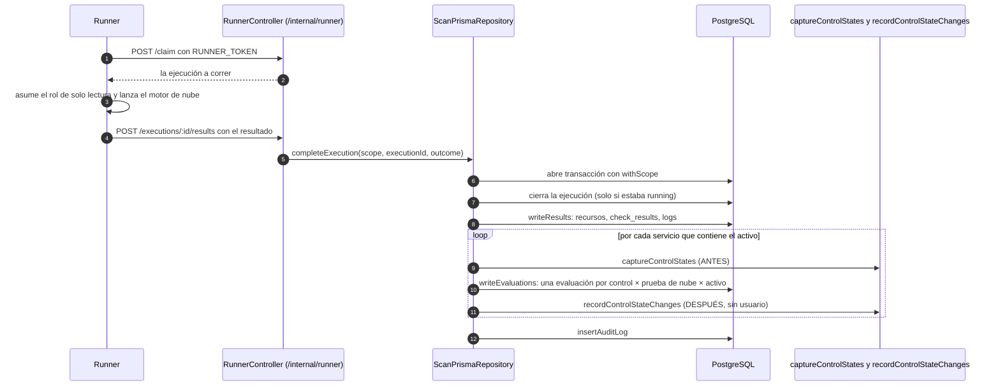
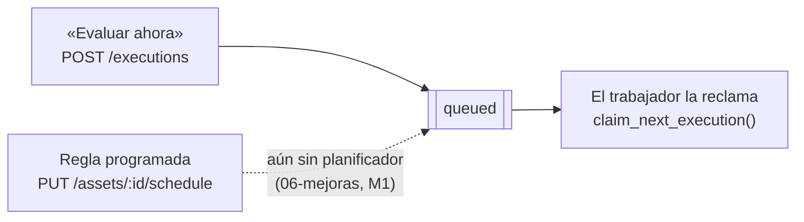

# Control técnico · Flujos

Responde: **¿qué pasa desde que se lanza una medición hasta que cambia el cumplimiento?** Es el puente entre la
infraestructura del cliente y [Cumplimiento](../cumplimiento/README.md).

## La corrida completa

**Qué mirar**

- **Dos niveles de resultado.** `check_results` es lo crudo que dijo el motor (un resultado por *check*).
  `evaluations` es lo que lee el cumplimiento (un resultado por *prueba*). `interpretTestResult` hace el paso de uno
  al otro: **este es el puente entre Control técnico y Cumplimiento**.
- **Solo cuentan los checks que el comité ratificó** (D56), salvo en desarrollo (`READINESS_INCLUDE_PROPOSED`). Si
  una prueba no tiene ningún check ratificado, no se escribe nada: queda pendiente, no «no aplica».
- **El evento de cambio de estado no tiene usuario** (`userId` nulo): lo causó el sistema, no una persona.
- **El Runner no toca la base.** Solo habla con `/internal/runner`; es el Backend quien escribe todo.
- Es el mismo patrón de escritura que las operaciones humanas ([`../cumplimiento/03-flujos.md`](../cumplimiento/03-flujos.md)).

**Cómo verificarlo**: `ScanPrismaRepository.completeExecution`, `writeResults` y `writeEvaluations`.

## Cómo nace una ejecución

`claim_next_execution()` es una función SQL angosta que busca entre empresas y pasa la ejecución a `running` con
`FOR UPDATE SKIP LOCKED`: dos trabajadores nunca toman el mismo trabajo.

## Lo que el cliente ve del resultado

| Pantalla | De dónde sale |
|---|---|
| Historial de evaluaciones | `GET /executions` (solo las `assessment`) |
| Preparación de un activo o servicio | `GET /executions/readiness` |
| Qué falló y cómo corregirlo | `GET /findings` sobre los `check_results` fallidos, con la guía del catálogo traducida (D90) |

**Nada nombra al motor** (D70): ni el código del check, ni el tipo de recurso, ni el mensaje crudo del proveedor.

## Cómo verificarlo

`grep -rn "claim_next_execution" Backend/prisma/migrations` y `Backend/src/runner/application/run-next-execution.ts`.
