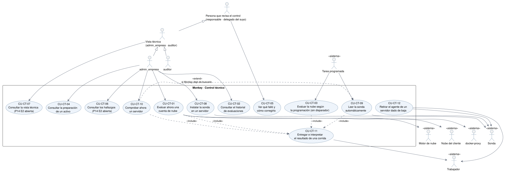

# Control técnico · casos de uso

Responde: **¿qué pasos sigue cada actor con el sistema, qué puede salir distinto y en qué estado queda todo al
terminar?** Cada caso realiza una o varias [historias](04-historias.md); la secuencia técnica (tablas, transacciones)
está en [`03-flujos.md`](03-flujos.md) y los cuerpos y errores en el
[contrato](../../../../../../contracts/control-tecnico.md).

## Diagrama de casos de uso

Fuente del diagrama: [`05-casos-de-uso.puml`](05-casos-de-uso.puml) (PlantUML; se regenera con
`skills/process/monkey-docs/scripts/render-uml.sh`). Los actores humanos están en Monkey Platform; el trabajador, la
tarea programada, el `docker-proxy`, la sonda, el motor de nube y la nube del cliente son piezas del sistema o externas.
Conectar un activo por primera vez está en [Conexión de activos](../onboarding/conexion-activos/README.md).

CU-CT-06 y CU-CT-07 dependen de `P14` E2, abierta, y CU-CT-03 no tiene quien lo dispare: se describen como el
contrato los supone, no como construidos.

## Resumen

| ID | Caso | Actor principal | Historias |
|---|---|---|---|
| CU-CT-01 | Evaluar ahora una cuenta de nube | `admin_empresa` | HU-CT-01, HU-CT-15 |
| CU-CT-02 | Consultar el historial de evaluaciones | `admin_empresa` | HU-CT-02, HU-CT-03 |
| CU-CT-03 | Evaluar la nube según la programación | Tarea programada | HU-CT-04 |
| CU-CT-04 | Consultar la preparación de un activo | `admin_empresa` | HU-CT-05 |
| CU-CT-05 | Ver qué falló y cómo corregirlo | Persona que revisa el control | HU-CT-06, HU-CT-16 |
| CU-CT-06 | Consultar los hallazgos de un activo | `admin_empresa` | HU-CT-07 |
| CU-CT-07 | Consultar la vista técnica | `admin_empresa` · `auditor` | HU-CT-08 |
| CU-CT-08 | Instalar la sonda en un servidor | `admin_empresa` | HU-CT-09, HU-CT-10, HU-CT-17 |
| CU-CT-09 | Leer la sonda automáticamente | Tarea programada | HU-CT-11, HU-CT-13 |
| CU-CT-10 | Comprobar ahora un servidor | `admin_empresa` | HU-CT-12 |
| CU-CT-11 | Entregar e interpretar el resultado de una corrida | Trabajador | HU-CT-03, HU-CT-13, HU-CT-14, HU-CT-17, HU-CT-19 |
| CU-CT-12 | Retirar el agente de un servidor dado de baja | Trabajador | HU-CT-18 |

---

### CU-CT-01 · Evaluar ahora una cuenta de nube

| | |
|---|---|
| **Actor** | `admin_empresa`; actores secundarios: el trabajador, el `docker-proxy`, el motor de nube y la nube del cliente |
| **Precondición** | Activo de nube con la conexión `validated` o `active` y sin otra ejecución abierta |
| **Postcondición** | Ejecución `assessment` `queued` con `origin: manual`; rastro `execution.queue`. Al cerrarse sigue en **CU-CT-11** |

**Flujo principal**
1. `admin_empresa` elige «Evaluar ahora» en el activo.
2. El sistema crea la ejecución en cola con su rastro y responde `202` sin esperar.
3. El trabajador la reclama (pasa a `running`) y recibe la conexión del activo: rol y `ExternalId` en AWS, o
   `external_id` y número de proyecto en GCP.
4. El trabajador obtiene credenciales temporales de 1 hora y lanza el motor de nube en un contenedor efímero, a través
   del `docker-proxy`, solo sobre las regiones declaradas.
5. El motor evalúa la nube del cliente en solo lectura; el contenedor se elimina.
6. El trabajador entrega el resultado (**CU-CT-11**).

**Flujos alternos**
- 2a. Sin conexión validada → `ASSET_NOT_VALIDATED`.
- 2b. Ya hay una ejecución en cola o en curso → `EXECUTION_IN_PROGRESS`.
- 3a. La conexión no sirve al reclamar (sin regiones, sin rol, sin número de proyecto, proveedor no soportado) → la
  ejecución se cierra `failed` con su razón y el reclamo sigue con la siguiente.
- 4a. El rol no existe, la cuenta no es la declarada o la federación se rechaza → `failed` con
  `connection.role_not_found`, `connection.account_mismatch` o `connection.federation_rejected`; no mueve la
  preparación.
- 5a. El motor falla o se agota su tiempo → `failed` con `execution.engine_failed` o `execution.engine_timeout`.
- 6a. Nadie la cierra en 30 minutos → el siguiente reclamo la pasa a `failed` con `execution.timed_out`.

### CU-CT-02 · Consultar el historial de evaluaciones

| | |
|---|---|
| **Actor** | `admin_empresa` |
| **Precondición** | El activo existe en su empresa |
| **Postcondición** | Nada cambia |

**Flujo principal**
1. `admin_empresa` abre el activo.
2. El sistema devuelve las evaluaciones, de la más reciente a la más antigua, con estado, origen, inicio y fin; sin
   validaciones ni creaciones de agente.
3. Mientras una evaluación está abierta, la pantalla la sigue hasta que cierra.

**Flujos alternos**
- 2a. Una evaluación falló → trae `failure_reason` y su texto traducido; nunca el mensaje del motor.
- 2b. Una lectura automática de un servidor «todavía no lista» quedó `cancelled` → no aparece.
- 3a. 🟡 La API aún no trae `progress` ni `narration` → la pantalla estima el avance por el tiempo y lo dice.

### CU-CT-03 · Evaluar la nube según la programación

> ✅ *(D158)* La crea la tarea de evaluación programada del Backend.

| | |
|---|---|
| **Actor** | Tarea programada; actor secundario: el trabajador |
| **Precondición** | Activo de nube con frecuencia elegida y sin ejecución abierta |
| **Postcondición** | Ejecución `assessment` `queued` con `origin: scheduled` |

**Flujo principal**
1. Al vencer la frecuencia del activo, la tarea crea la ejecución en cola.
2. El trabajador la corre igual que en **CU-CT-01** (pasos 3 a 6).

**Flujos alternos**
- 1a. Ya hay una ejecución abierta → no se crea otra (índice único).
- 1b. La anterior falló → un solo reintento a la hora; después, la frecuencia completa (D158).
- 1c. Ya hay 2 programadas esperando → se encola en una revisión posterior.

### CU-CT-04 · Consultar la preparación de un activo

| | |
|---|---|
| **Actor** | `admin_empresa` |
| **Precondición** | El activo existe en su empresa |
| **Postcondición** | Nada cambia; el estado se deriva, no se guarda |

**Flujo principal**
1. `admin_empresa` pide la preparación del activo, o de lo que el activo aporta a un servicio (`service_id`).
2. El sistema toma la última evaluación completada y cuenta solo los checks ratificados por el comité.
3. El sistema devuelve el estado cualitativo, la cobertura y lo medido que cumple como dos números aparte, el detalle
   por área y lo que necesita revisión manual.

**Flujos alternos**
- 1a. El servicio no es de la empresa, o el activo no existe → `404`.
- 2a. Aún no hay evaluación completada → `not_measured` con todo en cero.
- 2b. En desarrollo o demostración cuenta también los vínculos propuestos → `includes_proposed_mappings: true` y la
  pantalla lo dice.
- 3a. 🟡 Hoy el estado lo decide la severidad, no el porcentaje con cortes de 100 % y 80 % (DT-66), y no hay pantalla
  (DT-64).

### CU-CT-05 · Ver qué falló y cómo corregirlo

| | |
|---|---|
| **Actor** | `admin_empresa`, `auditor`, o el `responsable` o `delegado` del control |
| **Precondición** | Un control con una prueba automática (de nube o de servidores) |
| **Postcondición** | Nada cambia |

**Flujo principal**
1. La persona abre la prueba automática de un control.
2. El sistema toma la última evaluación completada de las conexiones del servicio y sus resultados `failed`.
3. El sistema devuelve, de la más grave a la menos grave, cada comprobación con su título, los recursos afectados y la
   guía de corrección en el idioma de la petición, etiquetada como traducción de IA.

**Flujos alternos**
- 1a. El control o la prueba son de otra empresa → `404`.
- 1b. Es `responsable` o `delegado` y el control no está a su cargo → `403`.
- 3a. La guía no tiene traducción → sale el original con `language: "en"`.
- 3b. Un título o una guía nombra al proveedor → se omite.
- 3c. El hallazgo es de un servidor → sin severidad, y el recurso es el propio servidor.

### CU-CT-06 · Consultar los hallazgos de un activo

> ⚪ **Por construir; depende de `P14` E2, abierta.** Pasos según el contrato.

| | |
|---|---|
| **Actor** | `admin_empresa` |
| **Precondición** | El activo tiene al menos una evaluación completada |
| **Postcondición** | Nada cambia |

**Flujo principal**
1. `admin_empresa` abre los hallazgos del activo y filtra por área, severidad o estado.
2. El sistema devuelve cada hallazgo en la plantilla de siete campos, con su recurso, resueltos en su idioma.

**Flujos alternos**
- 2a. El hallazgo aún no tiene redacción propia → los campos vienen `null` y una corrección neutra.
- 2b. Un texto lo redactó la IA → `is_ai_generated: true` con `ai_confidence`.

### CU-CT-07 · Consultar la vista técnica

> ⚪ **Por construir.**

| | |
|---|---|
| **Actor** | `admin_empresa` o `auditor` |
| **Precondición** | El activo tiene al menos una evaluación completada |
| **Postcondición** | Nada cambia |

**Flujo principal**
1. La persona pide los resultados del activo con `view=technical`.
2. El sistema devuelve cada comprobación con su resultado, su recurso y el objeto `technical` (prueba, requisitos y
   procedencia del vínculo).

**Flujos alternos**
- 1a. La pide un `responsable`, un `delegado` o `admin_monkey` → `403`.
- 2a. El vínculo es una propuesta → `mapping_provenance: monkey_proposed`; nunca se presenta como validado.

### CU-CT-08 · Instalar la sonda en un servidor

| | |
|---|---|
| **Actor** | `admin_empresa`; actores secundarios: el trabajador y la sonda |
| **Precondición** | Servidor declarado con su versión de sistema y conexión por agente |
| **Postcondición** | Agente creado en la sonda, en el grupo de la empresa y con el id del activo como nombre; vínculo en `asset_agents`; comando entregado una vez; rastros `agent.install.prepare`, `agent.enroll` y `agent.install.reveal`. La conexión sigue en **CU-CT-09** |

**Flujo principal**
1. `admin_empresa` abre el servidor y ve qué destino y puerto de salida debe permitir su firewall.
2. Elige empezar; el sistema deja en cola la creación del agente y responde `202`.
3. El trabajador reclama la ejecución `enrollment`, asegura el grupo de la empresa, retira un agente anterior con ese
   nombre, crea el agente y entrega su id y su clave.
4. El sistema valida la forma de ambos, guarda la clave cifrada con su caducidad y enlaza el agente al activo en una
   transacción; el estado pasa a `ready`.
5. `admin_empresa` elige mostrar el comando; el sistema lo entrega una sola vez y borra la clave.
6. `admin_empresa` ejecuta el comando en su servidor como administrador.

**Flujos alternos**
- 2a. El activo no usa agente → `ASSET_NOT_AGENT`; no existe o es de otra empresa → `404`.
- 2b. La instalación de Monkey no está configurada → `AGENT_INSTALL_UNAVAILABLE`; no queda nada en cola.
- 2c. Ya se está creando el agente → `EXECUTION_IN_PROGRESS`.
- 3a. La sonda tiene una versión que el trabajador no conoce → `failed` con `execution.probe_version_unsupported`.
- 3b. El agente se creó pero no llegó a guardarse → el trabajador lo retira y falla con
  `connection.agent_enroll_failed`.
- 3c. Nadie la reclama o termina en 2 minutos → `execution.timed_out`; se reintenta empezando de nuevo.
- 4a. El id que entrega la sonda figuraba en otro activo (id reciclado) → ese vínculo viejo se suelta y queda en la
  auditoría.
- 5a. El comando ya se mostró, caducó o no está listo → `AGENT_INSTALL_NOT_READY`.
- 5b. El sistema es `macos`, `solaris` o `hp_ux` → `409`, aún sin instalador.
- 5c. No alcanzó a copiarlo → elige generar de nuevo: el agente anterior se retira, se vuelve al paso 3 y deja
  `agent.install.regenerate`.
- 6a. La clave no corresponde a ese servidor, o falta `sudo` → el instalador se niega sin tocar nada.

### CU-CT-09 · Leer la sonda automáticamente

| | |
|---|---|
| **Actor** | Tarea programada; actores secundarios: el trabajador y la sonda |
| **Precondición** | Servidor con agente creado por Monkey, de una empresa no archivada, sin lectura abierta |
| **Postcondición** | Lectura `assessment` `scheduled` cerrada: con resultado (**CU-CT-11**), `cancelled` si aún no estaba lista, o `failed` con su motivo |

**Flujo principal**
1. Cada minuto la tarea decide a qué servidores les toca: sin conectar cada 3 minutos hasta 24 horas; conectados cada
   24 horas; desconectados o con una lectura fallida, cada hora. Encola como máximo 200 por pasada.
2. El trabajador reclama la lectura y recibe el agente y el grupo esperado, sin credenciales.
3. El trabajador lee de la sonda las pruebas de configuración del agente y comprueba su grupo.
4. El trabajador entrega el resultado (**CU-CT-11**); el servidor pasa a `connected` y la conexión a `active`.

**Flujos alternos**
- 1a. Pasaron 24 horas sin conectarse → deja de buscarlo (`watching: false`); la pantalla ofrece **CU-CT-10** o un
  comando nuevo (**CU-CT-08**, 5c).
- 3a. El servidor aún no terminó su primera revisión o no está conectado → la lectura queda `cancelled`, sin auditoría
  y fuera del historial.
- 3b. Estaba `connected` y ya no lo está → pasa a `disconnected` y se audita `agent.disconnected`.
- 3c. El agente desapareció → `failed` con `connection.agent_not_found`.
- 3d. El grupo del agente no es el de la empresa → `failed` con `connection.agent_group_mismatch`, con rastro.

### CU-CT-10 · Comprobar ahora un servidor

| | |
|---|---|
| **Actor** | `admin_empresa`; actores secundarios: el trabajador y la sonda |
| **Precondición** | El agente del servidor existe en la sonda |
| **Postcondición** | Lectura `assessment` `manual` cerrada con resultado o `failed` con su motivo a la vista |

**Flujo principal**
1. `admin_empresa` elige «Comprobar ahora».
2. El sistema encola la lectura y la pantalla sigue el historial hasta que cierra.
3. El trabajador la corre como en **CU-CT-09** (pasos 2 a 4).

**Flujos alternos**
- 1a. El agente aún no existe → `ASSET_NOT_VALIDATED`.
- 1b. Ya hay una lectura abierta → `EXECUTION_IN_PROGRESS`.
- 3a. El servidor no estaba listo o se desconectó → `failed` con su motivo (no `cancelled`: la pidió una persona).

### CU-CT-11 · Entregar e interpretar el resultado de una corrida

| | |
|---|---|
| **Actor** | Trabajador |
| **Precondición** | Ejecución `running` que el trabajador reclamó, con el `tenant_id` recibido al reclamar |
| **Postcondición** | Ejecución `completed`; `check_results`, recursos y bitácora guardados; `evaluations` de cada servicio del activo escritas; cambios de estado de los controles sin usuario; rastro en la auditoría. O `failed` con su razón, sin mover la preparación |

**Flujo principal**
1. El trabajador entrega con su token el resultado crudo: los hallazgos del motor de nube, o las políticas y checks de
   la sonda con el agente y su versión.
2. El sistema abre la transacción de esa empresa y cierra la ejecución solo si estaba en curso.
3. El sistema resuelve cada check contra el catálogo y guarda los resultados crudos, los recursos y la bitácora.
4. Por cada servicio que tiene el activo, captura el estado de los controles, escribe una evaluación por control,
   prueba automática y activo con los checks ratificados, y registra los cambios de estado sin usuario.
5. El sistema deja el rastro del cierre.

**Flujos alternos**
- 1a. La corrida no pudo conectar → el trabajador la cierra por `…/fail` con su razón: `failed`, sin mover la
  preparación ni el cumplimiento.
- 1b. Sin token válido → `401`; llegando por el proxy público o bajo `/v1` → `404`.
- 2a. La ejecución no está en curso, ya se entregó o el `tenant_id` no es el suyo → `EXECUTION_NOT_RUNNING`.
- 3a. Una fila del motor está mal formada → `ENGINE_OUTPUT_INVALID`, sin guardar nada.
- 3b. El agente no está enlazado a ese activo → `AGENT_NOT_LINKED`; su nombre o su grupo no son los de la empresa →
  `AGENT_GROUP_MISMATCH`. No se guarda nada y el trabajador la cierra `failed`.
- 3c. Una política o un check que el catálogo no conoce → no se guarda; queda como aviso en la bitácora.
- 3d. Un resultado de la sonda desconocido → se guarda `invalid`, nunca `passed`.
- 4a. Una prueba sin ningún check ratificado → no se escribe nada y queda pendiente (salvo `READINESS_INCLUDE_PROPOSED`
  en desarrollo).
- 4b. Ningún check de la prueba devolvió filas → `not_applicable`.

### CU-CT-12 · Retirar el agente de un servidor dado de baja

| | |
|---|---|
| **Actor** | Trabajador; actor secundario: la sonda |
| **Precondición** | El servidor se dio de baja: su vínculo y su clave ya se soltaron y quedó en cola el retiro |
| **Postcondición** | Agente retirado de la sonda; ejecución cerrada |

**Flujo principal**
1. El trabajador reclama la ejecución `enrollment` con `remove: true`.
2. El trabajador retira el agente de la sonda por su nombre (el id del activo).
3. El trabajador avisa al sistema, que cierra la ejecución.

**Flujos alternos**
- 1a. 🟡 Ningún trabajador la reclama en 2 minutos → se cancela y el agente queda en la sonda sin dueño (DT-106).
- 2a. El agente ya no estaba → también termina bien.
- 3a. La ejecución ya no estaba en curso → `EXECUTION_NOT_RUNNING`.
