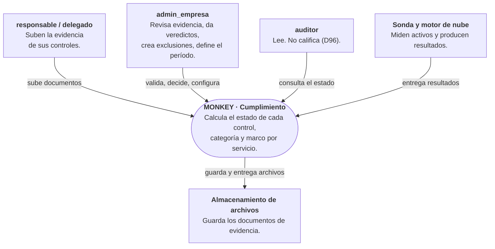
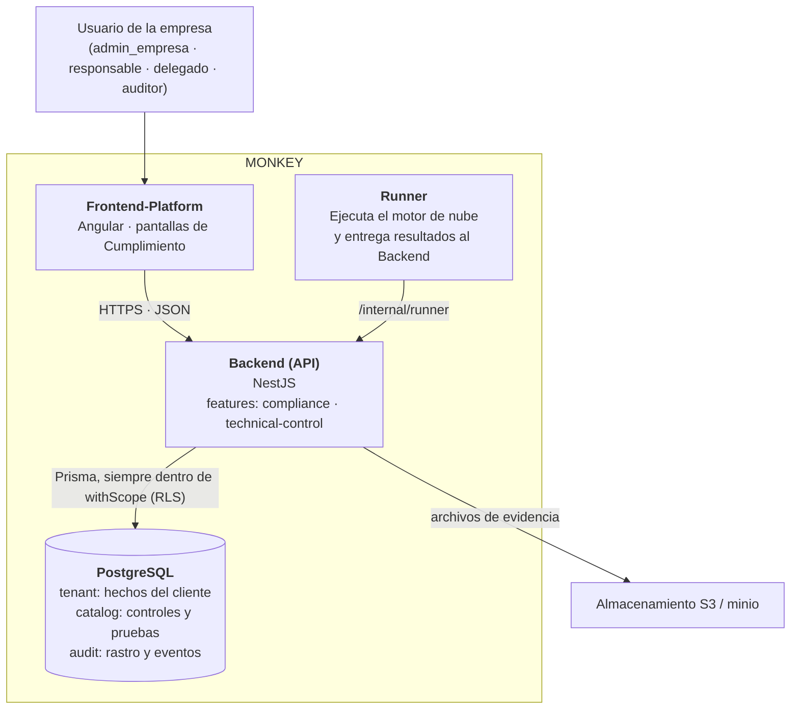
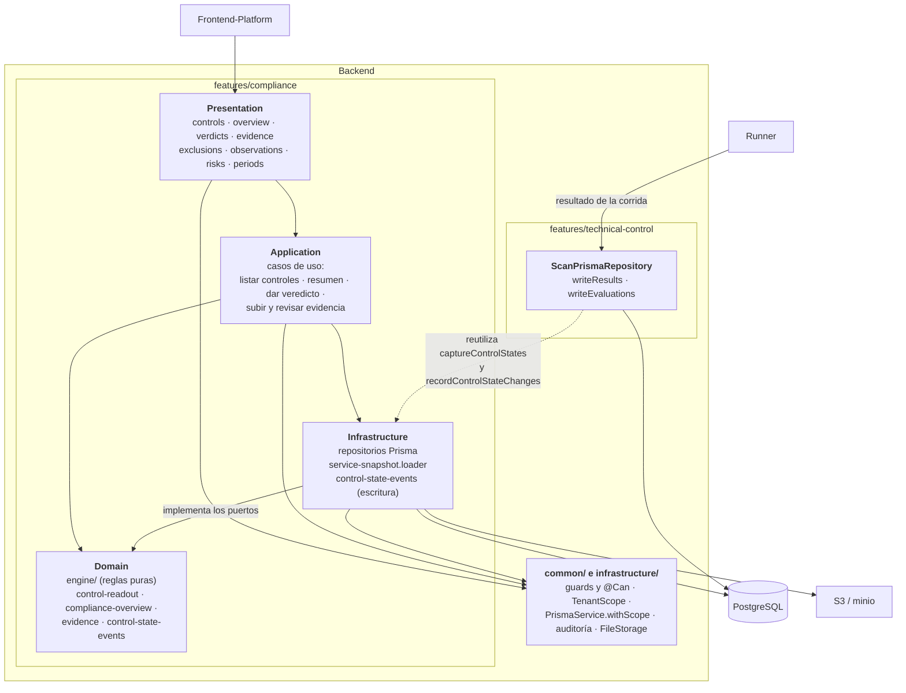
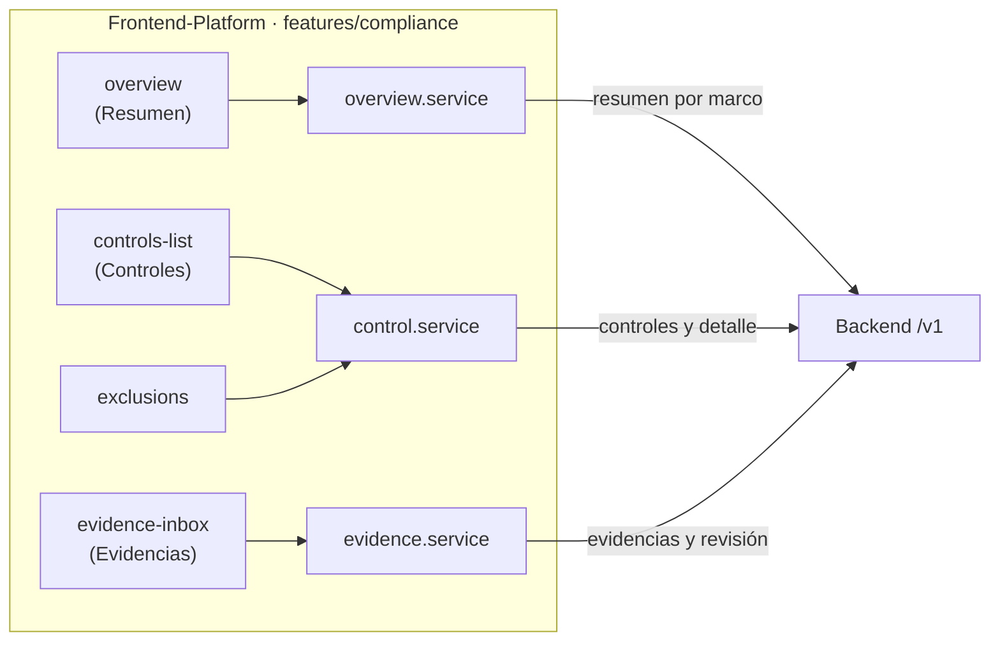

# Cumplimiento · C4

Responde: **¿qué piezas participan cuando se calcula o se cambia el cumplimiento?** Es el mapa general
([`../c4-contexto.md`](../c4-contexto.md), [`../c4-contenedores.md`](../c4-contenedores.md)) recortado a este módulo.

## Nivel 1 · Contexto: quién hace qué

**Tres formas de que entre un hecho** (y por tanto de que cambie el cumplimiento): una persona sube evidencia,
una persona da un veredicto o la sonda entrega un resultado. Todo lo demás es leer.

## Nivel 2 · Contenedores: por dónde viaja

**Para Cumplimiento, el Backend hace de todo**: el Runner no ve la base ni calcula nada; solo entrega resultados
crudos y es el Backend quien los guarda y los convierte en evaluaciones. El cálculo ocurre dentro del Backend,
**en memoria, al leer**, no en la base ni en un trabajo programado.

## Nivel 3 · Las piezas internas y sus componentes

La línea punteada es **un import de una feature a otra** (`technical-control` → `compliance`), contra la regla
«no importar el interior de otra feature». Está explicado en [`06-mejoras.md`](06-mejoras.md) (M1).

### Cómo se reparten los componentes

| Pieza del código | Componente |
|---|---|
| `domain/engine/`, `control-readout.ts` | [`motor/`](motor/README.md) |
| `presentation/controls`, `application/controls` | [`controles/`](controles/README.md) |
| `presentation/overview`, `presentation/periods`, `domain/overview` | [`resumen/`](resumen/README.md) |
| `presentation/evidence`, `domain/evidence` | [`evidencia/`](evidencia/README.md) |
| `presentation/verdicts` | [`veredictos/`](veredictos/README.md) |
| `presentation/exclusions` | [`exclusiones/`](exclusiones/README.md) |
| `presentation/observations` | [`observaciones/`](observaciones/README.md) |
| `presentation/risks`, `risk-assessment` | [`riesgos/`](riesgos/README.md) |
| `presentation/responsibles` | [`gestion-usuarios/`](../gestion-usuarios/README.md) (el reparto) |

## Pantallas del cliente que consumen esto

## Nivel 4 · Código

No se dibuja. Para estudiarlo, lee en este orden: `domain/engine/control.ts` (la más corta e ilustrativa) →
`domain/controls/control-readout.ts` (`readControl`) → `application/controls/list-controls.use-case.ts`.

## Cómo verificarlo

- Rutas y roles: `grep -nE "@(Get|Post|Put|Patch|Delete|Roles)\(" Backend/src/features/compliance/presentation/*/*.controller.ts`
- Pantallas y servicios: `ls Frontend-Platform/src/app/features/compliance/{presentation/views,domain/services}`.
