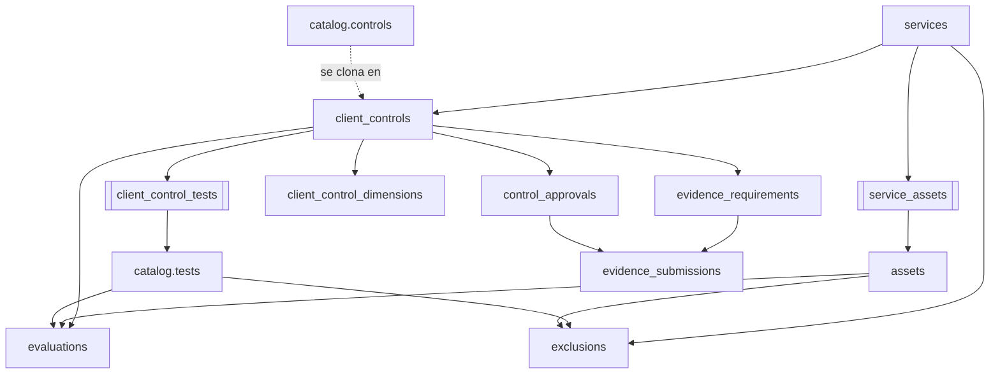

# Cumplimiento · Modelo

Responde: **¿qué tablas participan y cuáles toca cada operación?** El modelo completo y su porqué están en
`datos/modelo/07-cumplimiento.md` (§7); aquí solo el recorte de este módulo. Los nombres son los reales de la base.

## Qué tabla está dibujada dónde

**Ninguna se redibuja aquí.** El ER campo por campo vive en
[`datos/modelo/07-cumplimiento.md`](../../datos/modelo/07-cumplimiento.md); esta tabla dice en qué sección mirar.

| Tabla | Qué guarda | Dibujada en |
|---|---|---|
| `client_controls` · `client_control_dimensions` · `client_control_tests` | El control del cliente, copia del catálogo | §7.1 |
| `client_risks` · `client_causes` · sus puentes · `risk_treatments` · `residual_risks` | Riesgos y su tratamiento | §7.2 |
| `evidence_requirements` · `evidence_submissions` · `exclusions` | Evidencias y exclusiones | §7.3 |
| `control_approvals` · `manual_test_results` | Aprobación del control y resultado de una prueba manual (MD-504) | §7.3b |
| `evaluations` · `findings` · `vulnerabilities` · `compliance_events` | El histórico inmutable | §7.4 |
| `audit_observations` | Lo que escribe el auditor | §7.6 |
| `services` · `assets` · `service_assets` | De dónde cuelga todo | `06-onboarding.md` §6.2 y §6.3 |

## Cómo se encadenan (sin campos)

Es el recorte del módulo: quién depende de quién, para saber qué se carga al leer. Los atributos de cada caja
están en las secciones de arriba.

Fuera del diagrama, en el schema `audit`, sin llaves foráneas (solo `tenant_id`):

| Tabla | Qué guarda | Quién la escribe |
|---|---|---|
| `audit.audit_logs` | Quién hizo qué, con antes y después | `insertAuditLog`, en la misma transacción que el cambio |
| `audit.compliance_events` | Cada cambio de estado de un control (`control.state`) | `recordControlStateChanges` |

Las dos son **append-only por triggers** de la base (`SEG-38`): ni la aplicación puede modificarlas ni borrarlas.

## Lo que NO está en la base (a propósito)

| Dato | Dónde sale |
|---|---|
| Estado de un control, categoría o marco | Se calcula en memoria con el motor |
| Avance, cobertura y semáforo | Ídem |
| `excluded` de un activo | Se **superpone al leer**: una exclusión aprobada y vigente cambia el resultado de ese activo en esa prueba. La evaluación de la sonda no se toca (MD-144, D78) |
| `evidence_state` de una entrega | Se deriva de si fue devuelta (`evidenceStateOf`, D132) |
| `control_management_state` | Se calcula al leer con el motor y `control_approvals` / `manual_test_results` (MD-504) |
| «Quién es responsable de este control» | Se calcula al leer: la excepción del control o, si no hay, el responsable del servicio (D96) |

## Qué toca cada operación

`L` = lee · `E` = escribe · `—` = no toca.

| Tabla | Listar controles / resumen | Veredicto | Subir evidencia | Revisar evidencia | Sonda |
|---|:-:|:-:|:-:|:-:|:-:|
| `client_controls` | L | L | L | L | L |
| `client_control_tests` / `_dimensions` | L | L | L | L | L |
| `catalog.controls`, `points_of_focus`, `requirements` | L (para ubicar el control en su marco) | — | — | — | — |
| `service_assets`, `assets` | L | L | L | L | L |
| `evaluations` | L (la más reciente) | **E** | — | — | **E** |
| `exclusions` | L (las aprobadas y vigentes) | — | — | — | — |
| `evidence_requirements` | L | — | L (E si es la primera entrega de una prueba) | L | — |
| `evidence_submissions` | L | — | **E** | L | — |
| `control_approvals`, `manual_test_results` | L | — | — | **E** (`POST …/approval`, `POST …/result`) | — |
| `executions`, `check_results`, `asset_resources` | — | — | — | — | **E** |
| `audit.audit_logs` | — | **E** | **E** | **E** | **E** |
| `audit.compliance_events` | — | E (si cambió algún estado) | E (ídem) | E (ídem) | E (ídem) |
| Almacenamiento S3 | — | — | **E** | — | — |

**Cómo se lee esta tabla:** las lecturas nunca escriben. Y **solo tres tablas guardan hechos que mueven el
cumplimiento**: `evaluations`, `evidence_submissions`, `control_approvals` y `manual_test_results` (más `exclusions`, que reinterpreta).
Todo lo demás es contexto o rastro.

## Las reglas de datos que sostienen el cálculo

- **`evaluations` es histórico inmutable.** No se actualiza: se agrega una fila nueva y la lectura toma la más
  reciente por `(control, prueba, activo)`. Lo imponen triggers de la base (`SEG-38`).
- **Por eso `evaluated_at` es un instante y no un día**: la sonda corre varias veces al día y «la última» debe ser
  inequívoca.
- **`evidence_submissions` es append-only por diseño**: cada versión nueva es otra fila, la anterior queda.
- **Un control propio no tiene `control_id`.** No llega a ningún requisito del catálogo; su categoría es la que
  eligió la empresa. Por eso `readControl` y `buildOverview` tienen una rama especial para `origin: 'own'`.
- **Los clientes se aíslan por `tenant_id` + RLS.** Toda tabla del módulo lo lleva.

## Cómo verificarlo

- Modelo Prisma: `Backend/prisma/schema/tenant/compliance.prisma` (y `onboarding.prisma` para `services`, `assets`,
  `service_assets`).
- Lo que lee realmente una lectura: `loadServiceSnapshot` en `service-snapshot.loader.ts`. Es la lista autorizada de
  tablas que alimentan el motor.
- Inmutabilidad: `Backend/scripts/verify-audit-append-only.ts`.
