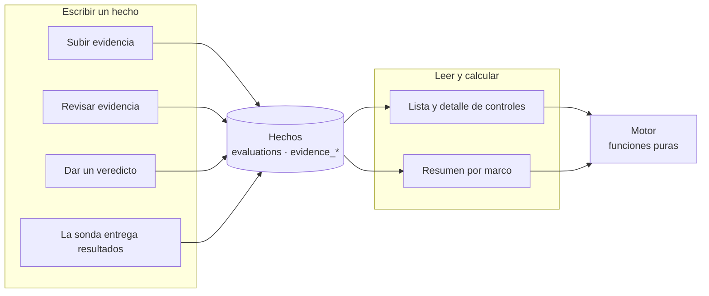

# Cumplimiento · Flujos

Responde: **¿qué operaciones mueven el cumplimiento y qué tienen en común?** El paso a paso de cada una está en
el `03-flujos.md` de su componente.

## Dos clases de operación



| Operación | Quién | Dónde está el detalle |
|---|---|---|
| Listar y ver controles | `admin_empresa` · `auditor` · `responsable` y `delegado` (solo lo suyo, D102) | [`controles/03-flujos.md`](controles/03-flujos.md) |
| Resumen por marco y categoría | los tres roles | [`resumen/03-flujos.md`](resumen/03-flujos.md) |
| Subir y revisar evidencia | suben el `admin_empresa`, el dueño o el ejecutor; revisan el dueño (lo que no subió él) y el `admin_empresa` (D102) | [`evidencia/03-flujos.md`](evidencia/03-flujos.md) |
| Dar un veredicto | lo registran el `admin_empresa`, el dueño o el ejecutor; lo revisan el dueño y el `admin_empresa` (D121) | [`veredictos/03-flujos.md`](veredictos/03-flujos.md) |
| Excluir un activo de una prueba | solo `admin_empresa` | [`exclusiones/03-flujos.md`](exclusiones/03-flujos.md) |
| Escribir y responder una observación | escribe el `auditor`, responde la empresa | [`observaciones/03-flujos.md`](observaciones/03-flujos.md) |
| Evaluar y tratar un riesgo | `admin_empresa` | [`riesgos/03-flujos.md`](riesgos/03-flujos.md) |
| La sonda entrega resultados | nadie: el Runner | [`../control-tecnico/03-flujos.md`](../control-tecnico/03-flujos.md) |

## El patrón común de toda escritura

Las escrituras humanas (evidencia, revisión, veredicto, exclusión) y la de la sonda hacen exactamente lo mismo:

```text
withScope (fija la empresa para RLS)
  ├─ foto ANTES de los controles del servicio
  ├─ escribir el hecho (evaluación, entrega o revisión)
  ├─ insertAuditLog  (rastro de quién hizo qué)
  └─ foto DESPUÉS → si algún control cambió de estado o semáforo, un evento control.state
```

**Por qué las dos fotos.** Como el estado se deriva, no hay un instante en que «cambie»: para saber *si cambió*
hay que calcularlo antes y después de escribir el hecho y comparar. Es el patrón de D91.

**Por qué todo en una transacción.** Hecho, rastro y eventos se confirman juntos o ninguno (D52, SEG-36). Si falla
el rastro de auditoría, el hecho no existe.

Si añades una cuarta forma de escribir un hecho que pueda mover el cumplimiento, **debe seguir este patrón**. Si no
lo hace, el historial de estados queda con huecos.

## Dos cosas que ninguna operación hace

- **Nada se pisa.** Una evaluación nueva agrega una fila; el estado actual es «la más reciente». Una evidencia
  nueva es otra versión. La única excepción es la revisión de una evidencia ([`06-mejoras.md`](06-mejoras.md), M4).
- **Nada guarda el resultado del cálculo.** No existe una columna «estado del control» en ninguna tabla.

## Cómo verificarlo

`grep -rn "recordControlStateChanges" Backend/src` encuentra todas las escrituras que siguen el patrón.
