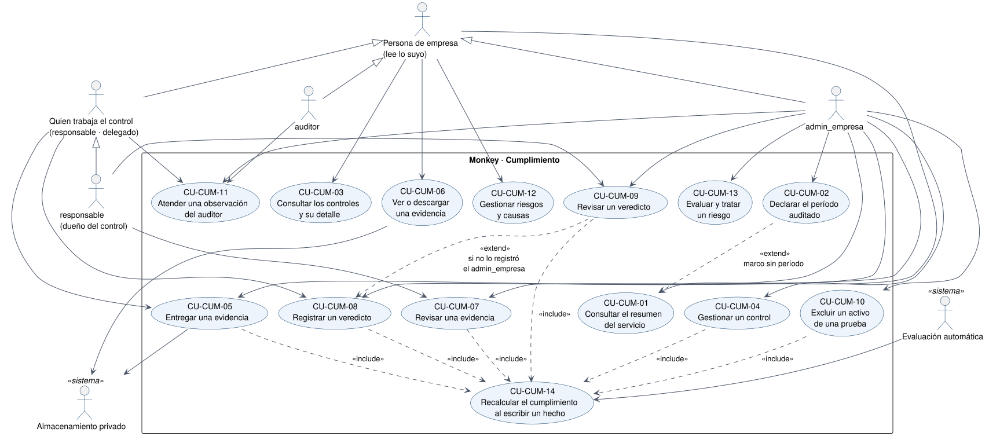

# Cumplimiento · casos de uso

Responde: **¿qué pasos sigue cada actor con el sistema para leer el cumplimiento de un servicio, aportar o revisar los
hechos que lo deciden, atender al auditor y gestionar los riesgos; qué puede salir distinto y en qué estado queda todo
al terminar?** Cada caso realiza una o varias [historias](04-historias.md); la secuencia técnica está en
[`03-flujos.md`](03-flujos.md) y en el de cada componente, y los cuerpos y errores en el
[contrato](../../../../../../contracts/cumplimiento/README.md).

## Diagrama de casos de uso

Fuente del diagrama: [`05-casos-de-uso.puml`](05-casos-de-uso.puml) (PlantUML; se regenera con
`skills/process/monkey-docs/scripts/render-uml.sh`). «Persona de empresa» generaliza a los cuatro roles; quien trabaja
un control (`responsable` o `delegado`) y el `admin_empresa` heredan sus casos de lectura. Todo caso que escribe un
hecho incluye **CU-CUM-14** (recalcular y registrar el cambio de estado).

**Regla común de alcance** (D102, SEG-66): el `responsable` y el `delegado` solo ven y tocan lo de sus controles; lo
ajeno de su empresa es `403 FORBIDDEN`, lo de otra empresa `404 NOT_FOUND`.

## Resumen

| ID | Caso | Actor principal | Historias |
|---|---|---|---|
| CU-CUM-01 | Consultar el resumen del servicio | Persona de empresa | HU-CUM-01, HU-CUM-03 |
| CU-CUM-02 | Declarar el período auditado | `admin_empresa` | HU-CUM-02 |
| CU-CUM-03 | Consultar los controles y su detalle | Persona de empresa | HU-CUM-03, HU-CUM-04, HU-CUM-05, HU-CUM-10 |
| CU-CUM-04 | Gestionar un control | `admin_empresa` | HU-CUM-06, HU-CUM-07, HU-CUM-08, HU-CUM-09 |
| CU-CUM-05 | Entregar una evidencia | Quien trabaja el control · `admin_empresa` | HU-CUM-11, HU-CUM-12, HU-CUM-16 |
| CU-CUM-06 | Ver o descargar una evidencia | Persona de empresa | HU-CUM-13 |
| CU-CUM-07 | Revisar una evidencia | `responsable` dueño · `admin_empresa` | HU-CUM-14, HU-CUM-15 |
| CU-CUM-08 | Registrar un veredicto | Quien trabaja el control · `admin_empresa` | HU-CUM-17, HU-CUM-19 |
| CU-CUM-09 | Revisar un veredicto | `responsable` dueño · `admin_empresa` | HU-CUM-18 |
| CU-CUM-10 | Excluir un activo de una prueba | `admin_empresa` | HU-CUM-20, HU-CUM-21 |
| CU-CUM-11 | Atender una observación del auditor | `auditor` · quien responde | HU-CUM-22, HU-CUM-23, HU-CUM-24 |
| CU-CUM-12 | Gestionar riesgos y causas | `admin_empresa` | HU-CUM-25, HU-CUM-26, HU-CUM-27 |
| CU-CUM-13 | Evaluar y tratar un riesgo | `admin_empresa` | HU-CUM-28, HU-CUM-29, HU-CUM-30 |
| CU-CUM-14 | Recalcular el cumplimiento al escribir un hecho | Sistema | HU-CUM-31 |

HU-CUM-32 (calificación del auditor) no tiene caso: está en pausa (D96, `P35`).

---

### CU-CUM-01 · Consultar el resumen del servicio

| | |
|---|---|
| **Actor** | Persona de empresa |
| **Precondición** | Sesión abierta; el servicio es de su empresa |
| **Postcondición** | Nada cambia: el estado se calcula al leer y no se guarda |

**Flujo principal**
1. La persona abre Cumplimiento de un servicio.
2. El sistema carga la foto del servicio (controles, pruebas, activos, últimos resultados y exclusiones vigentes).
3. El motor calcula cada control y lo agrega por categoría y marco, contando controles únicos.
4. El sistema muestra cada marco con su semáforo, avance, cobertura y los controles que fallan con su código.

**Flujos alternos**
- 3a. El marco no tiene período → sale «Sin medir», sin porcentaje; el `admin_empresa` puede seguir con **CU-CUM-02**.
- 3b. Es `responsable` o `delegado` → solo sus controles, y solo los marcos y categorías donde tiene alguno (D118); sin controles, vacío.
- 4a. Pide la vista técnica sin ser `admin_empresa` ni `auditor` → `403 FORBIDDEN`.

### CU-CUM-02 · Declarar el período auditado

| | |
|---|---|
| **Actor** | `admin_empresa` |
| **Precondición** | El marco está contratado y activo en el servicio |
| **Postcondición** | Período guardado, fecha de corte «hoy» (D105); rastro con el antes y el después |

**Flujo principal**
1. El administrador elige inicio y fin en el calendario.
2. El sistema valida el rango, guarda y deja el rastro en la misma transacción.
3. El resumen pasa a medirse con ese período.

**Flujos alternos**
- 2a. Inicio después del fin → `422 VALIDATION_FAILED` (`period.invalid_range`).
- 2b. Marco no contratado o servicio ajeno → `404 NOT_FOUND`.

### CU-CUM-03 · Consultar los controles y su detalle

| | |
|---|---|
| **Actor** | Persona de empresa |
| **Precondición** | Sesión abierta; el servicio es de su empresa |
| **Postcondición** | Nada cambia |

**Flujo principal**
1. La persona abre la pestaña Controles y, si quiere, filtra (categoría, tipo, semáforo, origen, responsable).
2. El sistema calcula todos los controles vigentes y devuelve la página con estado, avance, cobertura y códigos.
3. La persona abre un control y ve su interpretación, sus pruebas con nombre neutro, su evidencia y lo que falla.

**Flujos alternos**
- 1a. Filtra «Sin asignar» sin ser `admin_empresa` → `403 FORBIDDEN`.
- 3a. El control es ajeno → `403`; está dado de baja o es de otra empresa → `404 NOT_FOUND`.
- 3b. La prueba es automática → ve qué falló y cómo corregirlo (HU-CT-06).
- 3c. Marco sin categorías → la agrupación depende de `P27` (⚪).

### CU-CUM-04 · Gestionar un control

| | |
|---|---|
| **Actor** | `admin_empresa` |
| **Precondición** | El control (o el servicio, al crear) es de su empresa |
| **Postcondición** | Control creado, editado o dado de baja al instante; rastro y evento de cumplimiento; estado recalculado (**CU-CUM-14**) |

**Flujo principal**
1. El administrador crea un control propio (nombre, interpretación, categoría), edita la interpretación o las dimensiones de uno, o lo da de baja.
2. El sistema aplica el cambio y registra el rastro en la misma transacción.
3. Incluye **CU-CUM-14**: si cambió lo que se mide, queda el evento de cambio de estado.

**Flujos alternos**
- 1a. Categoría no contratada → `422 VALIDATION_FAILED` (`category.not_in_scope`); dimensión distinta de `policy` en uno propio → `dimension.policy_only`.
- 1b. Una dimensión que no aplica sin motivo → `422` (`reason.required`).
- 1c. El control ya está de baja → `409 CONTROL_RETIRED`.
- 1d. Qué se advierte antes de confirmar depende de `P33` (⚪). Crear un control propio no tiene pantalla (🟡).

### CU-CUM-05 · Entregar una evidencia

| | |
|---|---|
| **Actor** | Quien trabaja el control (`responsable` o `delegado`) o el `admin_empresa` |
| **Precondición** | El control es suyo y está vigente; la prueba es documental |
| **Postcondición** | Versión nueva con su huella SHA-256 en el almacenamiento privado; entrega pendiente de revisión; rastro; estado recalculado |

**Flujo principal**
1. La persona elige la prueba del control (o la pestaña Evidencias) y adjunta el archivo.
2. El sistema comprueba a quién le toca, valida tipo, tamaño y contenido y lo guarda en el almacenamiento privado.
3. En una transacción crea la versión siguiente (creando el requerimiento en la primera entrega), escribe el rastro e incluye **CU-CUM-14**.
4. La prueba vuelve a revisión; sigue **CU-CUM-07**.

**Flujos alternos**
- 2a. Tipo no permitido o contenido distinto del declarado → `415 UNSUPPORTED_MEDIA_TYPE`; más de 25 MB → `413 FILE_TOO_LARGE`; sin archivo → `422 FILE_REQUIRED`.
- 2b. Control de baja → `409 CONTROL_RETIRED`; el `auditor` → `403`.
- 3a. Falla la base o el rastro → el archivo se borra del almacenamiento y no queda nada.
- 1a. El `admin_empresa` crea un requerimiento propio (solo API); cambiar su responsable o quitarlo no está construido.

### CU-CUM-06 · Ver o descargar una evidencia

| | |
|---|---|
| **Actor** | Persona de empresa |
| **Precondición** | La entrega es de un control que puede ver |
| **Postcondición** | Enlace firmado de 5 minutos entregado; descarga en el rastro, sin la URL |

**Flujo principal**
1. La persona pide ver o descargar una entrega.
2. El sistema firma un enlace temporal con la disposición fijada y lo registra.
3. La persona lo abre en la pantalla (PDF, PNG, JPG) o lo descarga.

**Flujos alternos**
- 1a. Pide verla en pantalla con otro tipo → `422` (`disposition.not_supported`), sin enlace ni rastro.
- 2a. No hay almacenamiento → `503 STORAGE_UNAVAILABLE`.

### CU-CUM-07 · Revisar una evidencia

| | |
|---|---|
| **Actor** | `responsable` dueño del control o `admin_empresa` |
| **Precondición** | Hay una entrega; quien revisa no la subió (salvo el `admin_empresa` dueño, D132) |
| **Postcondición** | Revisión de su rol creada o reemplazada; estado combinado; rastro; estado recalculado |

**Flujo principal**
1. La persona valora los seis atributos y decide validar o rechazar.
2. El sistema fija el rol desde quien llama, guarda la revisión y combina las de los dos roles (un rechazo gana).
3. Incluye **CU-CUM-14**: si la prueba documental cambia, cambia el control.

**Flujos alternos**
- 1a. Rechaza sin nota → `422` (`note.required`).
- 1b. Envía `ai_prevalidated` → `422` (`enum.invalid`): solo lo deriva el sistema.
- 2a. Es `delegado`, `auditor`, un `responsable` ajeno o revisa lo que subió él → `403 FORBIDDEN`.
- Pantalla por construir (🟡).

### CU-CUM-08 · Registrar un veredicto

| | |
|---|---|
| **Actor** | Quien trabaja el control o el `admin_empresa` |
| **Precondición** | La prueba es manual y no documental, el control es suyo y está vigente, y la prueba tiene activos |
| **Postcondición** | Veredicto inmutable, pendiente (aprobado si lo registró el `admin_empresa`); rastro; estado recalculado |

**Flujo principal**
1. La persona elige cumple o no cumple y escribe lo que lo sustenta.
2. El sistema comprueba la prueba y crea el veredicto, que vale en todos los controles del servicio que la llevan (D85).
3. Incluye **CU-CUM-14**. Si no lo registró el `admin_empresa`, sigue **CU-CUM-09**.

**Flujos alternos**
- 2a. Prueba automática → `409 TEST_NOT_MANUAL`; documental → `409 TEST_DECIDED_BY_EVIDENCE`; sin activos → `409 TEST_HAS_NO_ASSETS`.
- 2b. El control tiene observaciones abiertas y falta el motivo → `422` (`closure_reason.required`, `P37`).
- 2c. `auditor` o alguien ajeno → `403`. Pantalla por construir (🟡).

### CU-CUM-09 · Revisar un veredicto

| | |
|---|---|
| **Actor** | `responsable` dueño o `admin_empresa` |
| **Precondición** | El veredicto es el último de la prueba en el servicio y no lo registró el dueño que revisa |
| **Postcondición** | Revisión de su rol guardada; estado combinado; si queda aprobado, cuenta; estado recalculado |

**Flujo principal**
1. La persona aprueba o rechaza, con nota si rechaza.
2. El sistema guarda la revisión de su rol y combina (un rechazo gana).
3. Incluye **CU-CUM-14**.

**Flujos alternos**
- 1a. Rechaza sin nota → `422` (`note.required`).
- 2a. Ya hay un veredicto más nuevo → `409 VERDICT_SUPERSEDED`.
- 2b. `delegado`, `auditor`, un `responsable` ajeno o quien lo registró → `403`. Pantalla por construir (🟡).

### CU-CUM-10 · Excluir un activo de una prueba

| | |
|---|---|
| **Actor** | `admin_empresa` |
| **Precondición** | La prueba y el activo son del servicio; el marco tiene período |
| **Postcondición** | Exclusión aprobada de hoy al fin del período; resultado medido intacto; rastro y evento; estado recalculado |

**Flujo principal**
1. El administrador elige prueba y activo y escribe el motivo (y el técnico si la prueba es automática).
2. El sistema la crea aprobada en el mismo acto, con vigencia hasta el `period_end`.
3. Incluye **CU-CUM-14**: el activo sale del universo de la prueba.
4. Al vencer, el activo vuelve a contar solo en la siguiente lectura.

**Flujos alternos**
- 2a. Sin período → `409 EVALUATION_NOT_DEFINED`.
- 2b. Ya hay una vigente de lo mismo → `409 EXCLUSION_ALREADY_EXISTS`.
- 2c. Falta el motivo técnico en una automática → `422 VALIDATION_FAILED`; activo de otro servicio → `404`.
- Crear no tiene pantalla todavía (🟡); listar sí.

### CU-CUM-11 · Atender una observación del auditor

| | |
|---|---|
| **Actor** | `auditor` (escribe y cierra) · `admin_empresa`, dueño o ejecutor (responde) |
| **Precondición** | El servicio es de la empresa; el control, si lo hay, está vigente |
| **Postcondición** | Observación cerrada, nunca borrada; cada paso en el rastro; el porcentaje no cambia |

**Flujo principal**
1. El auditor escribe una observación, recomendación o solicitud sobre el servicio, un control o una evidencia; queda abierta.
2. Quien responde la ve (en el servicio o en «Mi trabajo») y contesta con una nota y, si quiere, una evidencia del mismo servicio; queda respondida.
3. El auditor, su autor, la cierra.

**Flujos alternos**
- 1a. Control de baja → `409 CONTROL_RETIRED`; evidencia de otro control → `422` (`control.mismatch`).
- 2a. Ya respondida → `409 OBSERVATION_NOT_OPEN`; una de servicio completo, si no es `admin_empresa` → `403`.
- 3a. No queda conforme → la devuelve a abierta (conserva la última respuesta) y se repite desde 2.
- 3b. Otro que no es su autor → `403`; cerrar una abierta → `409 INVALID_TRANSITION`; tocar una cerrada → `409 OBSERVATION_CLOSED`.
- La empresa no recibe aviso todavía (D143, MD-515). Pantallas por construir (🟡).

### CU-CUM-12 · Gestionar riesgos y causas

| | |
|---|---|
| **Actor** | `admin_empresa` (los demás roles solo leen) |
| **Precondición** | El servicio tiene sus riesgos clonados del catálogo (D28) |
| **Postcondición** | Riesgos, causas y vínculos al día; rastro de cada cambio |

**Flujo principal**
1. El administrador abre Riesgos o Causas y ve el mapa de calor y la lista.
2. Crea un riesgo o causa propios, edita, da de baja o reactiva.
3. Vincula causas a riesgos y controles a causas, o quita un vínculo.

**Flujos alternos**
- 2a. Código repetido → `409 CODE_ALREADY_EXISTS`; editar uno de baja → `409 RISK_INACTIVE` / `CAUSE_INACTIVE`.
- 3a. Vínculo repetido → `409 LINK_ALREADY_EXISTS`; del otro lado otro servicio → `404`.
- 2b. Otro rol → `403`.

### CU-CUM-13 · Evaluar y tratar un riesgo

| | |
|---|---|
| **Actor** | `admin_empresa` |
| **Precondición** | El riesgo está vigente |
| **Postcondición** | Valor inherente y nivel guardados, historial; tratamiento vigente registrado |

**Flujo principal**
1. El administrador pone probabilidad e impacto (1 a 5).
2. El sistema calcula valor y nivel y deja el historial.
3. Registra el tratamiento: decisión, cargo responsable y fecha.

**Flujos alternos**
- 1a. Fuera de 1 a 5 → `422` (`number.range`); riesgo de baja → `409 RISK_INACTIVE`.
- 3a. Fecha pasada → `422` (`date.past`); cargo de otra empresa → `404`.
- 3b. El riesgo residual y las matrices siguen la regla de D134 (⚪, sin construir).

### CU-CUM-14 · Recalcular el cumplimiento al escribir un hecho

| | |
|---|---|
| **Actor** | Sistema (lo incluyen los casos que escriben; también la evaluación automática, desde Control técnico) |
| **Precondición** | Una escritura que puede mover el estado de algún control |
| **Postcondición** | Hecho, rastro y eventos confirmados juntos o ninguno (D52, SEG-36) |

**Flujo principal**
1. Dentro de la transacción, el sistema calcula el estado de los controles del servicio (antes).
2. Escribe el hecho y el rastro de auditoría.
3. Calcula de nuevo (después) y, por cada control que cambió de estado o semáforo, escribe un evento.

**Flujos alternos**
- 2a. Falla el rastro → se revierte todo: el hecho no existe.
- 3a. Ningún control cambió → no hay evento.
