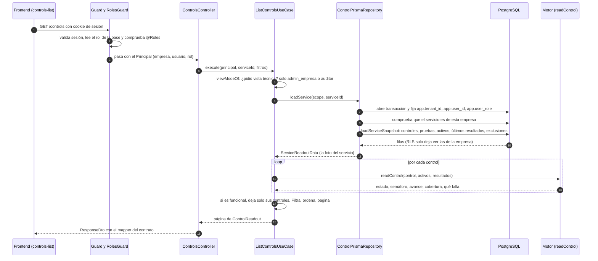

# Controles · Flujos

Responde: **¿qué pasa, paso a paso, al leer los controles de un servicio?**

Leyenda: **FE** = Frontend-Platform · **Guard** = sesión y rol · **UC** = caso de uso · **Repo** = repositorio
Prisma · **Motor** = funciones puras.

## Leer la lista de controles

`GET /v1/services/:serviceId/controls` · lo piden `admin_empresa`, `funcional` y `auditor`.

## Qué mirar

- **El cálculo ocurre en los pasos 12 y 13, en memoria.** La base solo entrega hechos. El estado de cada control no
  existe en ninguna tabla.
- **El aislamiento por empresa pasa en dos sitios**: la comprobación explícita del servicio (paso 8) y las políticas
  RLS de Postgres (pasos 7 y 10). Si una consulta olvida `withScope`, RLS devuelve vacío o falla; no filtra mal en silencio.
- **El funcional se filtra después de calcular** (paso 14), no en la base. Funciona, pero significa que se calculan
  todos los controles del servicio aunque el usuario vea pocos ([`../06-mejoras.md`](../06-mejoras.md), M2).
- **«Un número fijo de consultas»**: `loadServiceSnapshot` carga todo en bloque en vez de preguntar control por
  control. Es la decisión que evita el problema de las N+1 consultas.

## El detalle de un control

`GET /v1/controls/:id` hace lo mismo acotado a un control (`loadServiceSnapshot` acepta `onlyControlId`): la foto
del servicio se carga igual, pero solo para ese control.

## Cómo verificarlo

`ListControlsUseCase.execute` en `application/controls/list-controls.use-case.ts` y `ControlPrismaRepository.loadService`.
