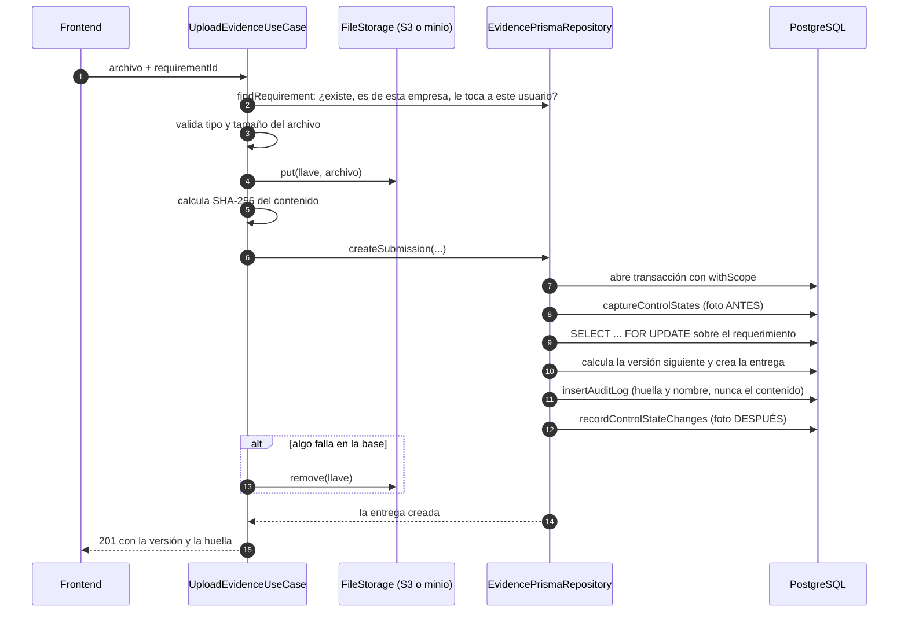
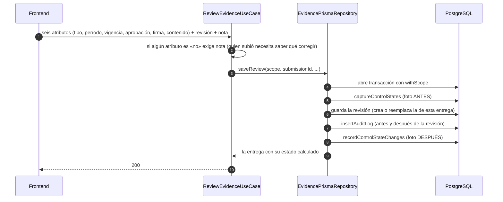

# Evidencia · Flujos

> **MD-504 (2026-11-25): el flujo «2 · Revisar» se retiró.** `PUT /v1/evidence-submissions/:id/review` ya no existe; la entrega cuenta si no fue devuelta y se devuelve al devolver el control (`contracts/cumplimiento/aprobacion.md`). Solo el flujo de subir sigue vigente.

**
Responde: **¿qué pasa al subir un documento y al revisarlo?** Las dos operaciones siguen el patrón común de
escritura ([`../03-flujos.md`](../03-flujos.md)): foto antes, hecho, rastro, foto después.

## 1 · Subir una evidencia

`POST /v1/evidence-requirements/:requirementId/submissions`, o `POST /controls/:controlId/tests/:testId/evidence`,
que además crea el «lugar» de la prueba en la primera entrega (D88).

**Qué mirar**

- **El archivo se sube a S3 antes de la transacción.** Si la base falla, el caso de uso borra el archivo
  (compensación). Si el proceso muere justo en medio, queda un archivo huérfano ([`../06-mejoras.md`](../06-mejoras.md), M5).
- **La versión se calcula bajo bloqueo** (`FOR UPDATE`) para que dos subidas simultáneas no obtengan el mismo
  número. El índice único `(requerimiento, versión)` es la red de seguridad.
- **Subir no valida.** La entrega nace `pending`, y como el estado de la prueba documental es el de la entrega más
  reciente, una versión nueva devuelve la prueba a revisión. Por eso hay foto antes y después.
- **El hash SHA-256** queda guardado: es la integridad que pide un auditor.

**Cómo verificarlo**: `UploadEvidenceUseCase` y `EvidencePrismaRepository.createSubmission`.

## 2 · Revisar una evidencia

`PUT /v1/evidence-submissions/:submissionId/review` · `admin_empresa` (cualquiera) o el `responsable` dueño (lo que no subió él) (D102).

**Qué mirar**

- **Aquí se decide `compliant`.** El estado de la evidencia lo calcula `evidenceStateOf` a partir de esta revisión
  humana. La IA puede dejarla `in_review`, nunca `compliant` (RN-03).
- **Hay una revisión por entrega y por rol** (el dueño y el `admin_empresa`); el estado combina las dos y un rechazo gana (D102). Revisar de nuevo con el mismo rol la **reemplaza**; lo que
  conserva el historial es el rastro de auditoría ([`../06-mejoras.md`](../06-mejoras.md), M4).

**Cómo verificarlo**: `ReviewEvidenceUseCase` y `EvidencePrismaRepository.saveReview`.
