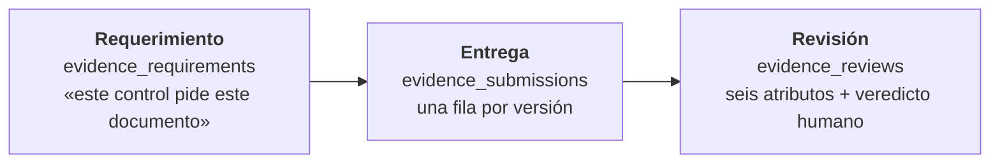

# Cumplimiento · Evidencia

> **VF18 (D128): esto describe el código construido con el catálogo v1.** Con la VF18 la evidencia se exige por requisito del control y por ventana, y se aprueba el control, no cada evidencia (D129, D131, D132).

Responde: **¿cómo se respalda una prueba documental con un documento, y quién decide si sirve?** Dos operaciones
encadenadas: alguien **sube** un documento y el `admin_empresa` lo **revisa**.

## Qué posee

| Qué | Dónde |
|---|---|
| Endpoints y casos de uso | `compliance/presentation/evidence/`, `application/evidence/` |
| El estado de una entrega | `domain/evidence/evidence.ts` → `evidenceStateOf` |
| Tablas | `evidence_requirements`, `evidence_submissions`, `evidence_reviews` |
| Los archivos | Almacenamiento S3 o minio (`infrastructure/storage`) |

## Las tres piezas, en orden

- **Una entrega nueva no pisa la anterior**: es otra versión. El estado de la prueba es el de la **más reciente**,
  así que subir una versión nueva devuelve el control a revisión.
- **Una entrega nace sin revisión**: su estado es `pending`. Subir no valida.
- **Solo una persona puede dejar una evidencia en `compliant`.** La IA puede dejarla `in_review`, nunca aprobada (RN-03).

## Quién hace qué (D96)

| Acción | Quién |
|---|---|
| Subir una entrega | El ejecutor (`delegado`), el dueño (`responsable`) o el `admin_empresa` (D102) |
| Revisar | El `responsable` dueño (lo que no subió él) y el `admin_empresa` (cualquiera): una revisión por rol y por entrega; el estado combina las dos (D102, MD-194) |
| Leer y descargar | Todos los roles (el `responsable` y el `delegado`, solo lo de sus controles) |

La descarga es un enlace firmado de 5 minutos; el archivo nunca pasa por una URL pública.

## Integridad

Cada entrega guarda el **SHA-256** de su contenido: es lo que permite demostrarle a un auditor que el documento no
cambió desde que se entregó.

## Dónde está cada dato

Contrato: `contracts/cumplimiento/evidencia.md` (subir, versionar, descargar y revisar). Decisiones: D88, D96. Flujos: [`03-flujos.md`](03-flujos.md).
