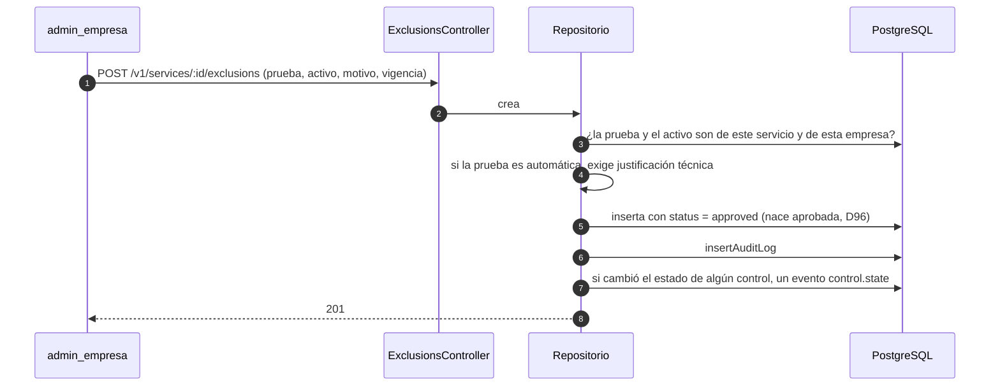
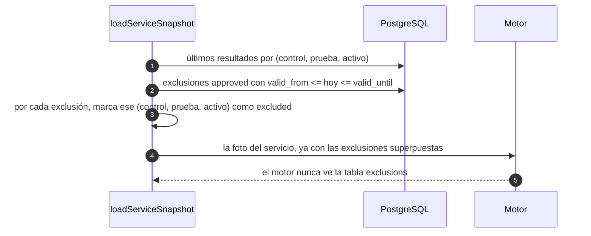

# Exclusiones · Flujos

Responde: **¿qué pasa al excluir un activo, y cuándo deja de valer?**

## 1 · Crear una exclusión

Es una **escritura que mueve el cumplimiento**, así que sigue el mismo patrón que las demás: foto antes, escritura,
rastro, foto después ([`../03-flujos.md`](../03-flujos.md)).

## 2 · Cómo entra en el cálculo

**El motor no sabe de exclusiones ni de fechas.** Recibe estados ya resueltos; quien resuelve la vigencia es quien
carga los datos. Por eso el motor sigue siendo una función pura.

## 3 · Qué pasa al vencer

Nada que haya que ejecutar: al día siguiente, la consulta de carga ya no la trae y el activo vuelve a contar. Si
estaba fallando, el control vuelve a fallar. **No hay un trabajo programado que «caduque» exclusiones**, y por eso
tampoco hay un evento de cambio de estado ese día: el cambio se ve en la siguiente lectura.

## Cómo verificarlo

`loadServiceSnapshot` (el bloque de `excluded`) y `test/cumplimiento/exclusiones.e2e-spec.ts`.
