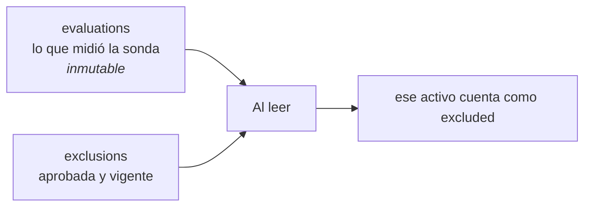

# Cumplimiento · Exclusiones

Responde: **¿cómo se saca un activo de una prueba sin mentir sobre el cumplimiento?** Una exclusión dice «esta
prueba no aplica a este activo, por esta razón, hasta esta fecha». No borra nada: **se superpone al leer**.

## La regla que lo define

El resultado que escribió la sonda **no se toca**. Al calcular, una exclusión aprobada y vigente convierte el
resultado de ese activo en `excluded`, y un activo excluido **sale del universo** de la prueba: no suma ni resta
(MD-144, D78). Si la exclusión vence, el activo vuelve a contar solo.

## Quién decide

**Solo el `admin_empresa`**, y propone y aprueba **en un solo acto**: una exclusión nace `approved` (D96). Los
estados `pending` y `rejected` existen en la tabla pero están sin uso.

Si la prueba es **automática**, la justificación técnica es obligatoria: excluir un activo de una comprobación
automática es la decisión más fácil de abusar, y el auditor va a pedir el porqué.

## Qué posee

Tabla `exclusions` (schema `tenant`) y `compliance/presentation/exclusions/`.
Rutas: `GET` y `POST /v1/services/:serviceId/exclusions`.

## Dónde está cada dato

| Dato | Dueño |
|---|---|
| Rutas y errores | `contracts/cumplimiento/exclusiones.md` |
| La tabla y sus columnas | `datos/modelo/07-cumplimiento.md` §7.3 |
| Cómo afecta al cálculo | `datos/modelo/09-calculo-cumplimiento.md` · [`../motor/reglas.md`](../motor/reglas.md) |
| Decisiones | D78, D79, D83, D96 · MD-144 |
| Requisitos | [`seguridad/roles-permisos.md`](../../../seguridad/roles-permisos.md): `SEG-67` |

## Contenido

[`03-flujos.md`](03-flujos.md). Sin `02-modelo.md`: la tabla está dibujada en §7.3.
