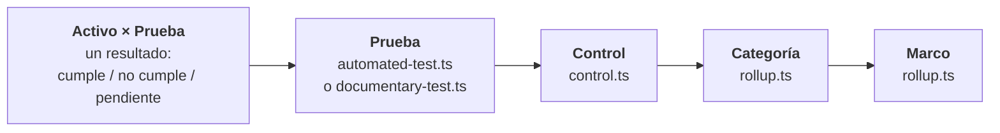
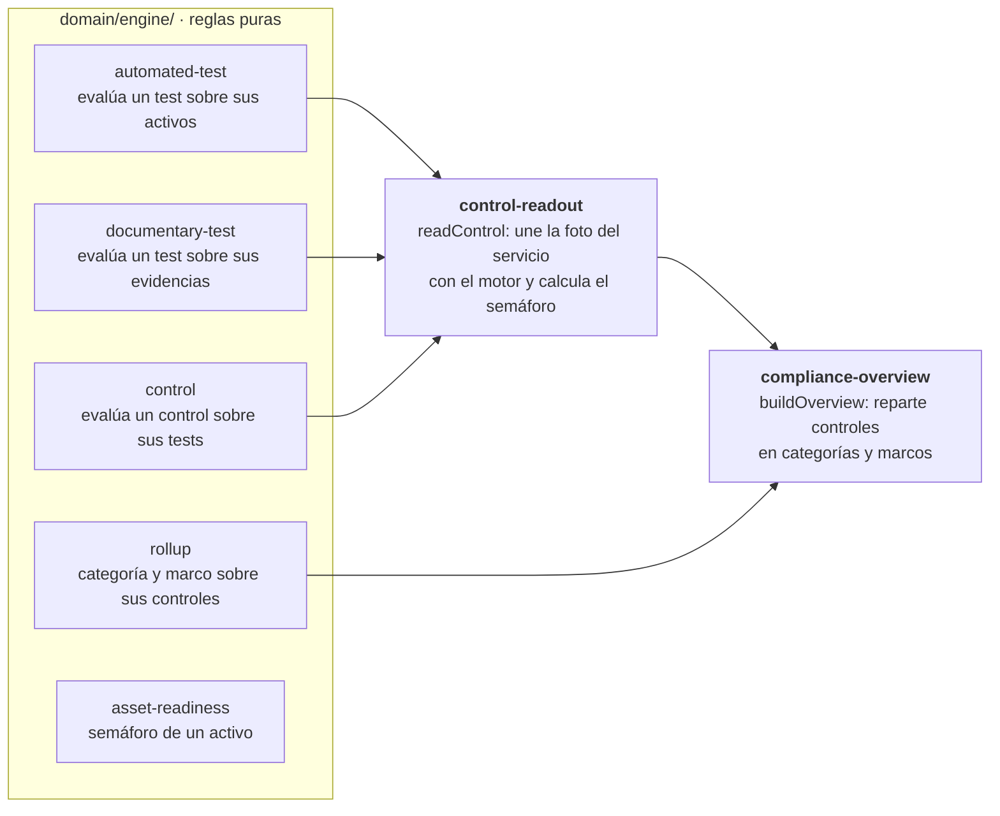

# Cumplimiento · Motor

Responde: **¿qué pieza convierte los hechos en «cumple» o «no cumple»?** Es el corazón del producto y la parte más
fácil de probar: `Backend/src/features/compliance/domain/engine/` y `domain/controls/control-readout.ts`.

La definición funcional es del comité (`datos/modelo/09-calculo-cumplimiento.md` y `contracts/enums.md`); aquí se
explica cómo la implementa el código. Las reglas, nivel por nivel, en [`reglas.md`](reglas.md).

## La cadena de cálculo

Cada flecha es **una función pura**: recibe los estados del nivel de abajo y devuelve el estado del nivel de arriba.
No lee la base, no escribe nada, no tiene fecha ni usuario. Misma entrada, misma salida.

## Los cinco principios

Si entiendes esto, entiendes el motor.

1. **Lo que no se midió no es cumplimiento.** Pendiente, sin activos, sin evidencia, sin ejecución: nunca producen
   «cumple». Está en cada archivo del motor y es la regla más importante del producto.
2. **Todo o nada en cada nivel.** Una prueba cumple solo si **todos** sus activos cumplen. Un control es efectivo
   solo si **todas** sus pruebas cumplen. Una categoría y un marco cumplen solo si **todos** sus controles son
   efectivos. 45 de 50 servidores conformes con 5 sin evaluar **no** es «casi cumple»: es «en evaluación».
3. **Lo que falla prevalece sobre lo pendiente.** Si hay un activo que no cumple, la prueba no cumple aunque falten
   otros por evaluar. Es lo que permite avisar una falla sin esperar a medir todo.
4. **Se cuenta, no se promedia.** El porcentaje es «cuántos cumplen de cuántos hay», nunca un promedio de
   porcentajes. Y **el porcentaje informa, no decide**: el estado se calcula aparte.
5. **Un fallo técnico no es un incumplimiento.** Un error de la sonda es `error`, no `non_compliant`, y no baja el
   porcentaje (pero tampoco deja el control en «efectivo»).

## Las piezas por dentro

`readout` y `overview` **no leen la base**: reciben datos ya cargados y devuelven resultados. Eso es lo que permite
probar el cumplimiento sin levantar Postgres.

## Dos cosas que el motor no hace

- **No sabe de roles.** Qué ve cada rol (`responsable` y `delegado` solo lo suyo, vista técnica solo `auditor` y `admin_empresa`)
  lo decide la capa de aplicación (`application/shared/view-access.ts` y los casos de uso).
- **No sabe de tiempo.** La vigencia de una exclusión o el corte del período los resuelve quien carga los datos
  (`service-snapshot.loader`) o el [resumen](../resumen/README.md). El motor solo recibe estados ya resueltos.

## Cómo verificarlo

- Los tests del propio motor son la mejor documentación viva: `domain/engine/*.spec.ts`, en especial
  `engine.acceptance.spec.ts`. Si cambias una regla, un test debe fallar.
- Corre solo esos tests: `cd Backend && npx jest src/features/compliance/domain`.
