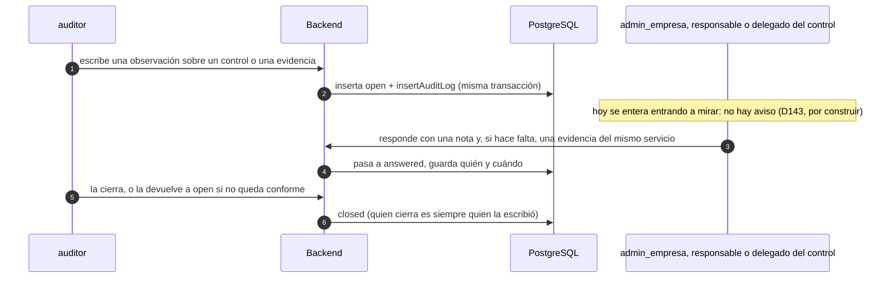
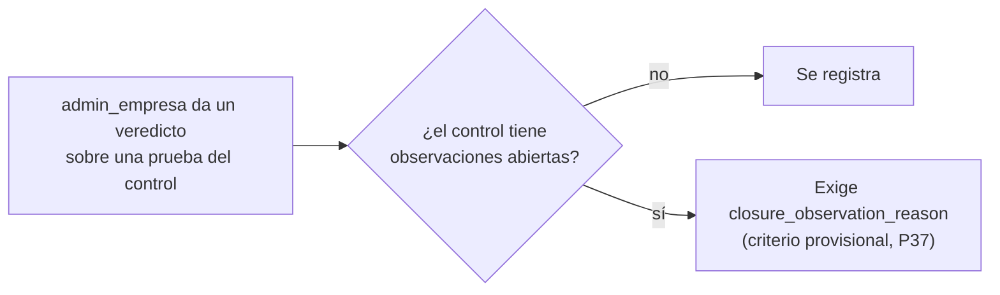

# Observaciones · Flujos

Responde: **¿cómo viaja una observación del auditor a quien tiene que arreglarlo?**

## El ciclo completo

**Qué mirar**

- **Si el auditor solo señala una evidencia**, el control se deduce de esa entrega: una entrega pertenece a un
  único control, así que la observación le llega a su responsable.
- **Sobre un control dado de baja no se abren observaciones nuevas**; las que ya tenía se conservan.
- **La respuesta no cambia el cumplimiento.** Si el documento que se adjunta debe contar, entra por el camino de la
  [evidencia](../evidencia/03-flujos.md) y lo valida el `admin_empresa`.
- **Nadie se entera solo.** No hay notificaciones ([`../../notificaciones/README.md`](../../notificaciones/README.md)).

## Dónde choca con el veredicto

Está detallado en [`../veredictos/03-flujos.md`](../veredictos/03-flujos.md).

## Cómo verificarlo

`test/cumplimiento/observaciones.e2e-spec.ts` y `compliance/presentation/observations/`.
