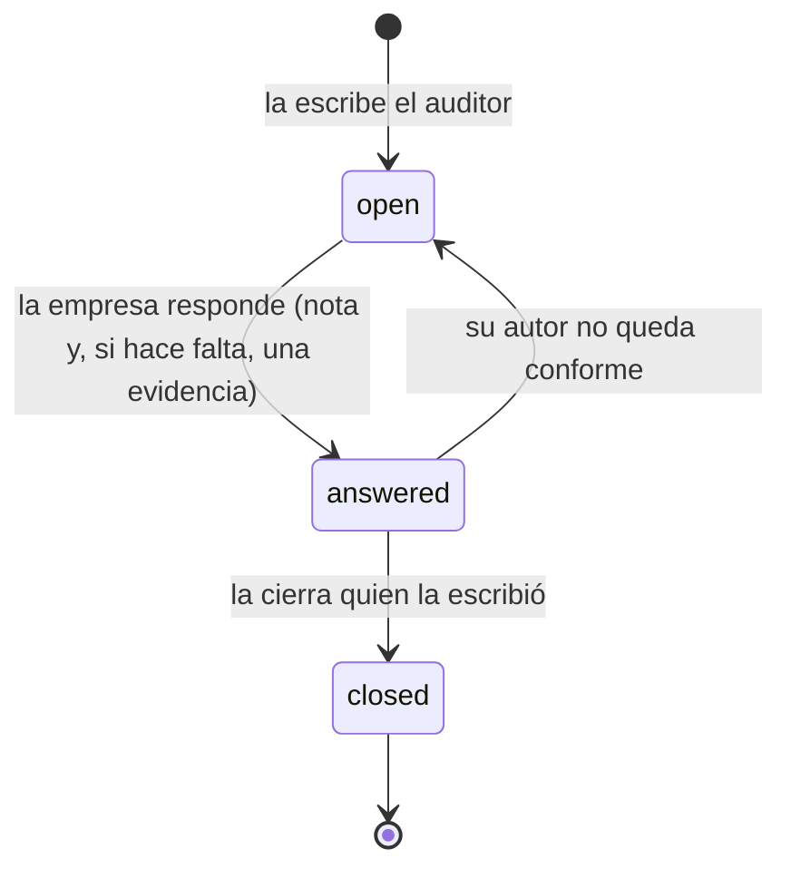

# Cumplimiento · Observaciones

Responde: **¿cómo le dice el auditor a la empresa que algo no le cuadra, y cómo queda constancia de que se
atendió?** Una observación la **redacta una persona**; un hallazgo lo **detecta el sistema**. No son lo mismo y no
viven en la misma tabla.

## Lo que define al componente

**Una observación no mueve el porcentaje.** El cumplimiento solo cambia por el camino de siempre: si la respuesta
es un documento, entra como [evidencia](../evidencia/README.md), se valida, y el `admin_empresa` da el
[veredicto](../veredictos/README.md). Si ese veredicto es negativo, el porcentaje baja — pero por el veredicto, no
por la observación.

Es la pieza que hace que el `auditor` pueda señalar sin calificar (D96).

## Tres tipos y tres estados

| Tipo | Para qué |
|---|---|
| Observación | Señalar algo que no cuadra |
| Recomendación | Sugerir una mejora |
| Solicitud de información | Pedirle más datos a la empresa |

**Una observación cerrada no se reabre**: si hace falta algo más, se crea otra. Mientras no esté cerrada, su autor
puede modificarla. Nunca se borra (SEG-69).

## Quién hace qué

| Acción | Quién |
|---|---|
| Escribir, editar, devolver a `open` y cerrar | **Solo el `auditor`** que la escribió (SEG-70) |
| Responder | El `admin_empresa`, el dueño (`responsable`) o el ejecutor (`delegado`) de ese control (D102) |

## El efecto que sí tiene

Con observaciones **abiertas** en el control de origen, dar un veredicto sobre él **exige explicar por qué** se
cierra el asunto (`closure_observation_reason`). Es un criterio provisional de desarrollo, pendiente de ratificar
en `P37`.

## Qué posee

Tabla `audit_observations` y `compliance/presentation/observations/`.

## Dónde está cada dato

| Dato | Dueño |
|---|---|
| Rutas y errores | `contracts/cumplimiento/observaciones.md` |
| La tabla, los tipos y los estados | `datos/modelo/07-cumplimiento.md` §7.6 |
| Decisiones | D85, D96 · MD-154 |
| Pendiente | `P37` (los criterios que fijó desarrollo sin que el comité los pidiera) |
| Requisitos | [`seguridad/roles-permisos.md`](../../../seguridad/roles-permisos.md): `SEG-70` · [`trazabilidad.md`](../../../seguridad/trazabilidad.md): `SEG-69` |

## Contenido

[`03-flujos.md`](03-flujos.md). Sin `02-modelo.md`: la tabla está dibujada en §7.6.
