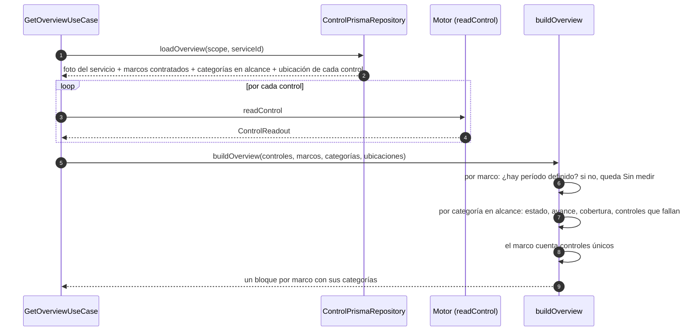

# Resumen · Flujos

Responde: **¿qué pasa al pedir el resumen de cumplimiento de un servicio?**

`GET /v1/services/:serviceId/compliance-overview`. Es igual que [leer los controles](../controles/03-flujos.md)
hasta cargar la foto del servicio, con tres diferencias: carga también los marcos y categorías en alcance, agrega
por categoría y marco, y comprueba el período.

## Qué mirar

- **El período se comprueba primero.** Un marco sin período auditado sale `not_measured`, no «0 %»: son cosas
  distintas y el producto no las confunde.
- **Los controles únicos.** Un control que sirve a tres requisitos cuenta **una vez** en el marco; si se contara
  tres veces, el porcentaje mentiría.
- **El resumen no es un promedio de porcentajes.** Cuenta controles: efectivos sobre únicos.

## Cómo verificarlo

`GetOverviewUseCase` y `domain/overview/compliance-overview.ts`.
