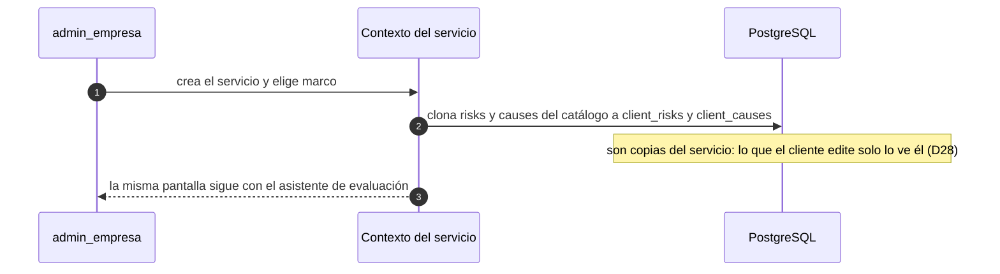
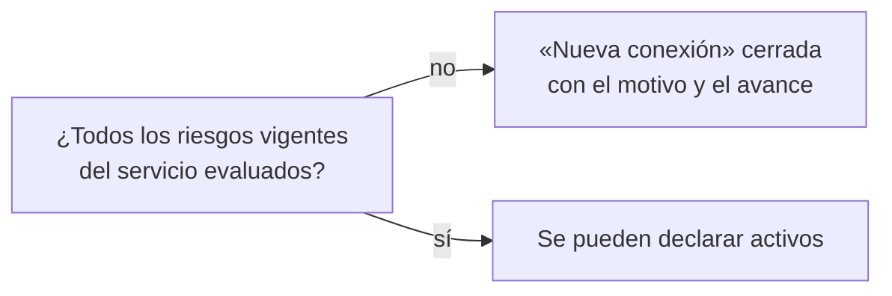

# Riesgos · Flujos

Responde: **¿cómo llega un riesgo del catálogo a tener un valor y un tratamiento?**

## 1 · De dónde salen los riesgos de un servicio



## 2 · Evaluar un riesgo

```mermaid
sequenceDiagram
    autonumber
    participant A as admin_empresa
    participant API as Backend
    participant DB as PostgreSQL
    A->>API: POST /v1/risks/:id/evaluation (probabilidad 1-5, impacto 1-5)
    API->>DB: guarda el valor inherente (producto) y su nivel
    API->>DB: insertAuditLog
    API-->>A: el riesgo evaluado; el asistente pasa al siguiente
    A->>API: GET /v1/risks/:id/evaluation-history
    API-->>A: cómo ha cambiado en el tiempo
```

**La evaluación no se pisa:** queda historial, porque un auditor pregunta cómo evolucionó la exposición, no solo
cómo está hoy.

## 3 · La puerta hacia los activos



Un servicio **sin riesgos vigentes** no se bloquea. El detalle está en
[`onboarding/03-flujos.md`](../../onboarding/03-flujos.md).

## 4 · Tratamiento

`POST` y `GET /v1/risks/:id/treatments` registran qué se decidió hacer con el riesgo. El **riesgo residual** que
debería salir de ahí todavía no se calcula: falta el efecto de cada relación causa–control (`P22` punto 1).

## 5 · Causas

`GET` y `POST /v1/services/:id/causes`, `GET`/`PATCH`/`DELETE /v1/causes/:id`. Una causa puede pertenecer a varios
riesgos y la ataca más de un control; esas dos relaciones son tablas puente
(`client_risk_causes`, `client_cause_controls`).

## Lo que este flujo NO hace

No mueve el porcentaje de cumplimiento. Riesgos y cumplimiento comparten los controles, pero se calculan aparte: el
cumplimiento cuenta controles efectivos ([`../motor/01-reglas.md`](../motor/01-reglas.md)) y el riesgo mide
exposición.

## Cómo verificarlo

`compliance/presentation/risks/` y `contracts/cumplimiento/riesgos.md`.
