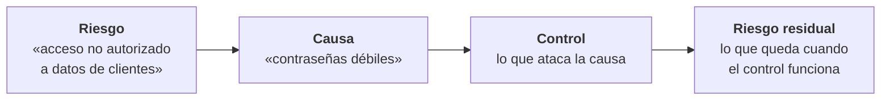

# Cumplimiento · Riesgos

> **VF18 (D128): el apetito de 9 sobre 25 y el efecto por relación describen el código construido.** La regla vigente es D134 (nivel por posición de la celda).

Responde: **¿cómo sabe una empresa qué puede salir mal y cuánto baja ese riesgo con sus controles?** Es la otra
mitad del módulo: el cumplimiento mide **controles**; los riesgos miden **exposición**.

## La cadena

Un riesgo nace de causas; las causas se atacan con controles; cuando los controles funcionan, el riesgo baja pero
casi nunca desaparece. Lo que queda es el **riesgo residual**.

## Lo que lo diferencia del resto del módulo

**Los riesgos son de cada servicio, no de la empresa.** La misma causa puede ser muy probable en un servicio y casi
imposible en otro, así que `client_risks` y `client_causes` se clonan por servicio (D28) y el cliente los evalúa uno
por uno.

**El cliente pone la probabilidad y el impacto** (D33, D76), en escalas de 1 a 5. El valor inherente es el producto:
de 1 a 25.

## Evaluar los riesgos es un paso del onboarding

Se hace en la pantalla del servicio, justo después de crearlo, y **bloquea declarar activos** hasta terminarlo
(D89). El recorrido está en [`onboarding/contexto-servicio/03-flujos.md`](../../onboarding/contexto-servicio/03-flujos.md);
el componente que lo implementa es este.

Al evaluar se puede **retirar** un riesgo que no aplica (con motivo), volver a incluirlo y **agregar uno propio**
con sus causas. Retirar un riesgo no retira sus causas ni sus controles (D93).

## Lo que todavía no se puede calcular

**Con la VF18 el riesgo ya tiene regla completa (D134)**, aunque no está construida: el nivel sale de la posición de la
celda en la matriz; el residual, de la **cobertura verificada** (relaciones causa–control cuyo control cumple) contra los
umbrales de 60% y 85%, que bajan la probabilidad uno o dos niveles; el impacto no se reduce; y el apetito se lee por
**zonas de color** (naranja, tolerable solo con plan de tratamiento aprobado). La valoración inherente viene del
catálogo y llega prellenada al asistente. El plan de tratamiento lleva qué se hará, quién y para cuándo; lo registra el responsable y lo aprueba el `admin_empresa` (D140).

## Qué posee

Tablas `client_risks`, `client_causes`, `client_risk_causes`, `client_cause_controls`, `risk_treatments`,
`residual_risks`, `action_plans`, `mitigations`.
Código: `compliance/presentation/risks/` (`risks.controller.ts` y `risk-assessment.controller.ts`).

## Dónde está cada dato

| Dato | Dueño |
|---|---|
| Rutas y errores | `contracts/cumplimiento/riesgos.md` |
| Las tablas y sus columnas | `datos/modelo/07-cumplimiento.md` §7.2 |
| El catálogo base de riesgos y causas | `datos/modelo/03-catalogo-maestro.md` §3.4 · [`../../catalogo-maestro/`](../../catalogo-maestro/README.md) |
| Decisiones | D28, D33, D74, D75, D76, D89, D93 |
| Decisiones | La regla del riesgo es D134; el plan de tratamiento, D140 |

## Contenido

[`03-flujos.md`](03-flujos.md). Sin `02-modelo.md`: las tablas están dibujadas en §7.2.
