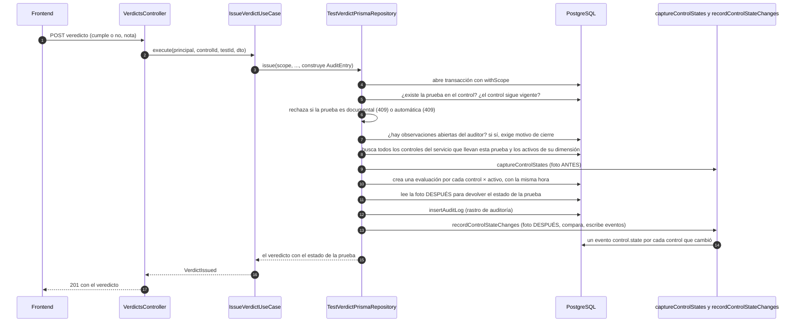

# Veredictos · Flujos

Responde: **¿qué pasa al dar un veredicto sobre una prueba manual?**

`POST /v1/controls/:controlId/tests/:testId/verdicts` · **solo `admin_empresa`** (D96).

## Qué mirar

- **Un veredicto es del test en el servicio, no del control** (D85). Por eso se crean varias filas (control × activo)
  con **la misma hora**.
- **Todo en una transacción.** Evaluaciones, rastro de auditoría y eventos se confirman juntos o ninguno. Si el
  rastro falla, el veredicto no existe (D52).
- **Nada se pisa.** Un veredicto nuevo agrega filas nuevas; el estado actual es «la más reciente».
- **Antes y después** (pasos 9 y 13): como el estado se deriva, para saber *si cambió* hay que comparar dos fotos
  del servicio. Es el patrón de D91, común a todas las escrituras.
- Si el control lleva observaciones abiertas, el veredicto **se permite pero exige explicar por qué** (MD-154).

## Cómo verificarlo

`TestVerdictPrismaRepository.issue`.
