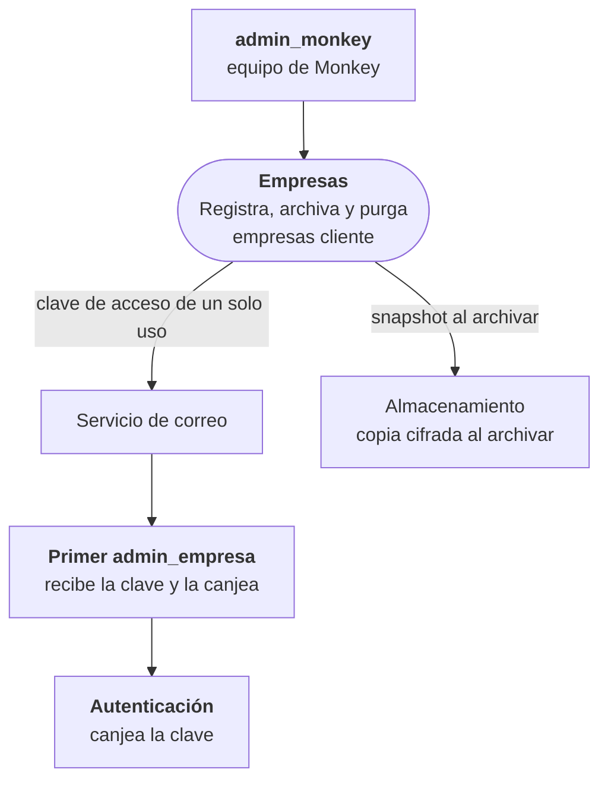
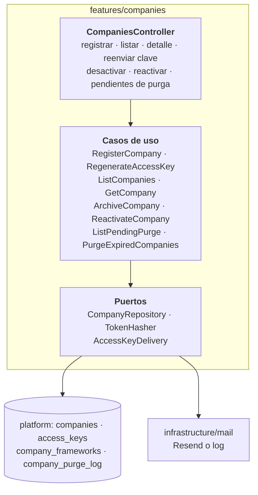

# Empresas · C4

Responde: **¿qué piezas registran y dan de baja a una empresa?**

## Nivel 1 · Contexto

**La clave nunca sale en la respuesta de la API** (D99): viaja por correo. Si el envío falla, la empresa queda
creada y `admin_monkey` reenvía una nueva, que anula la pendiente.

## Nivel 2 · Contenedores

`Frontend` (panel de Monkey) → Backend → PostgreSQL (`platform`), más el correo y el almacenamiento. Es el único
módulo que usa el `Frontend` de administración y no `Frontend-Platform`.

## Nivel 3 · Piezas internas

Todas las rutas exigen `@Roles('admin_monkey')`, y el aislamiento lo refuerza RLS: `companies` y `access_keys` solo
se leen desde `admin_monkey` o desde el propio tenant (D31).

## Cómo verificarlo

`grep -nE "@(Get|Post|Roles)\(" Backend/src/features/companies/presentation/companies.controller.ts`
