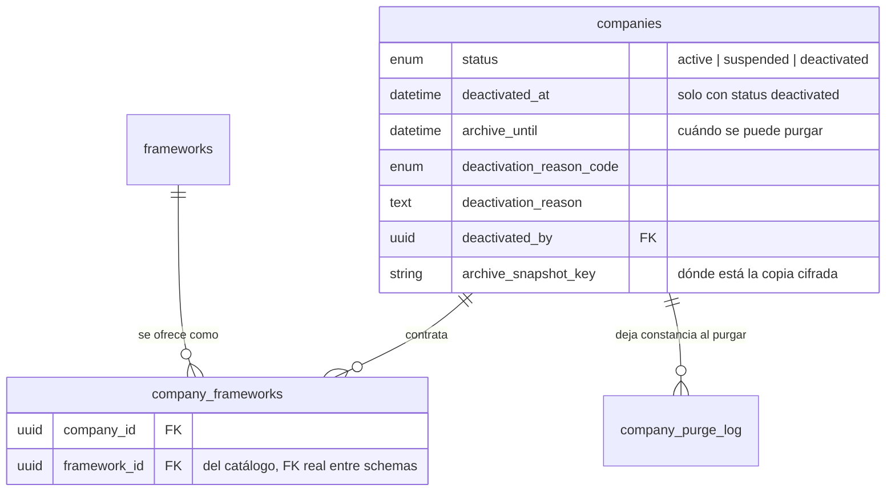

# Empresas · Modelo

Responde: **¿qué guarda una empresa y su clave de acceso?** El diagrama de `companies` y `access_keys` está en
[`datos/modelo/04-monkey-admin.md`](../../datos/modelo/04-monkey-admin.md) §4.1 y **no se redibuja**. Aquí lo que
ese archivo no dibuja: las columnas del archivado (D97) y la relación con los marcos.

## Lo que D97 agregó

Las columnas de desactivación **se vacían al reactivar**: una empresa activa no arrastra el motivo por el que
estuvo de baja.

## Tres cosas que importan

- **`companies.name` es la razón social y se fija aquí.** El Componente 1 del onboarding lo recibe precargado y
  bloqueado; no se edita dos veces.
- **El marco lo contrata Monkey, no el cliente** (D47). `company_frameworks` es el permiso; el cliente elige entre
  los contratados al declarar cada servicio. Un marco `coming_soon` se muestra pero no se puede contratar (D50).
- **La clave solo existe como hash** (`code_hash`, HMAC con *pepper*, SEG-17). Por eso no se puede «volver a
  enviar la misma»: se genera otra.

## La base dedicada no está construida

`isolation_strategy` admite `dedicated`, pero el registro lo rechaza con `DEDICATED_DATABASE_NOT_AVAILABLE`: el
aprovisionamiento no existe y depende de `P2(d)`. El porqué de las dos estrategias está en
[`aislamiento-tenant/`](../aislamiento-tenant/README.md).

## Cómo verificarlo

`Backend/prisma/schema/platform/companies.prisma`.
