# Empresas · Flujos

Responde: **¿qué pasa al registrar, archivar y purgar una empresa?**

## 1 · Registrar

```mermaid
sequenceDiagram
    autonumber
    participant A as admin_monkey
    participant UC as RegisterCompanyUseCase
    participant DB as PostgreSQL
    participant M as Mailer
    A->>UC: POST /v1/companies (nombre, correo del admin, marcos)
    UC->>UC: ¿base dedicada? se rechaza: no está construida
    UC->>DB: ¿el nombre o el correo ya están usados?
    UC->>UC: valida los marcos: solo los contratables (hoy SOC 2)
    UC->>DB: crea empresa + marcos + clave de acceso (solo el hash) + auditoría
    UC->>M: envía la clave al correo del administrador
    UC-->>A: la empresa y el estado del envío; la clave NO vuelve en la respuesta
```

**Qué mirar**

- **Tres campos basta**: razón social, si requiere base dedicada y el correo administrativo.
- **Un marco que no está en el catálogo no es opción**; uno `coming_soon` se ofrece como gancho comercial pero no
  se puede contratar (D50).
- **Si el correo no sale, la empresa queda creada.** `POST /v1/companies/:id/access-key/regenerate` anula la clave
  pendiente y manda otra.
- A partir de aquí el cliente sigue en [Autenticación](../autenticacion/03-flujos.md): canjea la clave y crea su
  contraseña.

## 2 · El ciclo de vida completo

```mermaid
stateDiagram-v2
    [*] --> active: registro
    active --> deactivated: baja con motivo y plazo de archivo
    deactivated --> active: alta; se vacían los datos de baja
    deactivated --> purgada: vencido archive_until
    purgada --> [*]
```



Al desactivar se toma una **copia cifrada** y se guarda dónde quedó (`archive_snapshot_key`). `GET /v1/companies/pending-purge`
lista las que ya cumplieron su plazo y `PurgeExpiredCompanies` las elimina dejando `company_purge_log`.

## 3 · Lo que no dispara nadie

El barrido de purga no tiene quien lo invoque dentro de `Backend/src/`: hay que llamarlo desde fuera. Mismo hueco
que lo programado del control técnico ([`06-mejoras.md`](06-mejoras.md), M1).

## Qué se audita

| `action` | Cuándo |
|---|---|
| `company.create` | Se registra la empresa |
| `access_key.regenerate` | Se reenvía la clave |
| `company.deactivate` · `company.reactivate` | Baja y alta |
| `company.purge` | Se borran los datos, con constancia en `company_purge_log` |

## Cómo verificarlo

`Backend/src/features/companies/application/use-cases/` y `contracts/empresas.md`.
