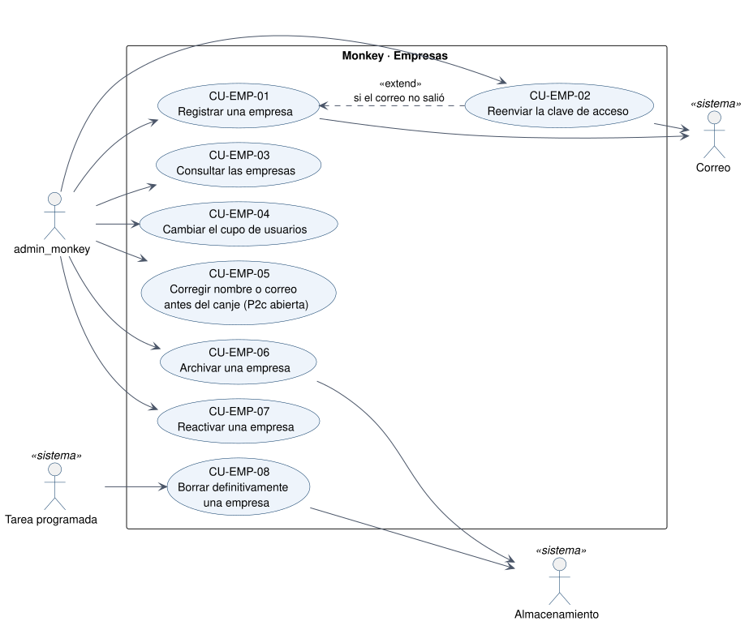

# Empresas · casos de uso

Responde: **¿qué pasos sigue cada actor con el sistema, qué puede salir distinto y en qué estado queda todo al
terminar?** Cada caso realiza una o varias [historias](04-historias.md); la secuencia técnica (tablas, transacciones)
está en [`03-flujos.md`](03-flujos.md) y los cuerpos y errores en el
[contrato](../../../../../../contracts/empresas.md).

## Diagrama de casos de uso

Fuente del diagrama: [`05-casos-de-uso.puml`](05-casos-de-uso.puml) (PlantUML; se regenera con
`skills/process/monkey-docs/scripts/render-uml.sh`). El único actor humano es `admin_monkey`, en Monkey Admin; el
cliente solo recibe la clave por correo y la canjea en [Autenticación](../autenticacion/05-casos-de-uso.md)
(CU-AUTH-01).

CU-EMP-05 y la variante dedicada de CU-EMP-01 dependen de `P2(c)` y `P2(d)`, abiertas: se describen como el contrato
las supone, no como decididas.

## Resumen

| ID | Caso | Actor principal | Historias |
|---|---|---|---|
| CU-EMP-01 | Registrar una empresa | `admin_monkey` | HU-EMP-01, HU-EMP-02, HU-EMP-07 |
| CU-EMP-02 | Reenviar la clave de acceso | `admin_monkey` | HU-EMP-03 |
| CU-EMP-03 | Consultar las empresas | `admin_monkey` | HU-EMP-04, HU-EMP-10 |
| CU-EMP-04 | Cambiar el cupo de usuarios | `admin_monkey` | HU-EMP-05 |
| CU-EMP-05 | Corregir el nombre o el correo antes del canje | `admin_monkey` | HU-EMP-06 |
| CU-EMP-06 | Archivar una empresa | `admin_monkey` | HU-EMP-08 |
| CU-EMP-07 | Reactivar una empresa | `admin_monkey` | HU-EMP-09 |
| CU-EMP-08 | Borrar definitivamente una empresa | Tarea programada | HU-EMP-10, HU-EMP-11 |

---

### CU-EMP-01 · Registrar una empresa

| | |
|---|---|
| **Actor** | `admin_monkey`; actor secundario: el correo |
| **Precondición** | Sesión abierta en Monkey Admin |
| **Postcondición** | Empresa `active` con sus marcos contratados y su cupo; clave `pending` (7 días) enviada al correo administrativo; rastro `company.create` |

**Flujo principal**
1. `admin_monkey` escribe la razón social, el correo administrativo y el cupo de usuarios, y deja sin marcar «requiere
   base de datos dedicada».
2. El formulario muestra los 7 marcos ofrecidos; `admin_monkey` contrata los disponibles (hoy SOC 2, por defecto).
3. El sistema comprueba que la razón social y el correo no estén usados y que los marcos sean contratables.
4. El sistema crea la empresa, sus marcos y la clave (solo su hash) en una transacción, con su rastro.
5. El sistema envía la clave al correo administrativo y responde con el estado del envío, sin la clave.
6. El cliente sigue en **CU-AUTH-01**.

**Flujos alternos**
- 1a. Campo vacío, razón social de más de 255 caracteres, correo inválido o cupo menor que 1 → `VALIDATION_FAILED`.
- 1b. Marca la base dedicada → `DEDICATED_DATABASE_NOT_AVAILABLE` (temporal, `P2(d)`); si el aprovisionamiento
  existiera y fallara → `PROVISIONING_FAILED`.
- 2a. Elige un marco «próximamente» → `FRAMEWORK_NOT_AVAILABLE`; un código fuera del catálogo → `422`.
- 3a. Razón social ya usada por una empresa activa → `COMPANY_NAME_TAKEN`.
- 3b. Correo ya administrativo de otra empresa o de un usuario → `ADMIN_EMAIL_TAKEN`.
- 5a. El correo no sale → `delivery_status: "failed"`; la empresa queda creada y Monkey Admin ofrece **CU-EMP-02**.

### CU-EMP-02 · Reenviar la clave de acceso

| | |
|---|---|
| **Actor** | `admin_monkey`; actor secundario: el correo |
| **Precondición** | Empresa no archivada cuya clave no se ha canjeado |
| **Postcondición** | Clave anterior `revoked`; clave nueva `pending` con vigencia completa, enviada; rastro `access_key.regenerate` |

**Flujo principal**
1. `admin_monkey` abre la empresa y elige reenviar la clave.
2. El sistema anula la clave pendiente, emite otra y deja el rastro en la misma transacción.
3. El sistema la envía al correo administrativo y responde con el estado del envío, sin la clave.

**Flujos alternos**
- 1a. La empresa ya canjeó su clave → `ACCESS_KEY_NOT_PENDING`.
- 1b. La empresa está archivada → `COMPANY_ALREADY_DEACTIVATED`.
- 1c. La empresa no existe o es la interna de Monkey → `404`.
- 3a. El correo no sale → `200` con `delivery_status: "failed"`; se puede reenviar otra vez.

### CU-EMP-03 · Consultar las empresas

| | |
|---|---|
| **Actor** | `admin_monkey` |
| **Precondición** | Sesión abierta en Monkey Admin |
| **Postcondición** | Nada cambia |

**Flujo principal**
1. `admin_monkey` abre el listado; puede ordenarlo por fecha de alta o nombre y filtrarlo por estado.
2. El sistema devuelve la página con cupo y uso, marcos, estado y vencimiento de la clave vigente y si el onboarding
   terminó; nunca la clave ni su hash.
3. `admin_monkey` abre una empresa y ve su detalle, con el historial de claves sin códigos.

**Flujos alternos**
- 1a. Filtra por `status=deactivated` → ve las archivadas, que por defecto se ocultan.
- 1b. Pide las empresas por borrarse → ve cada una con su fecha de borrado y los días que faltan.
- 3a. Pide el detalle de la empresa interna de Monkey → `404`.

### CU-EMP-04 · Cambiar el cupo de usuarios

| | |
|---|---|
| **Actor** | `admin_monkey` |
| **Precondición** | Empresa existente, antes o después del canje |
| **Postcondición** | `max_users` nuevo; rastro `company.max_users_update` con el valor anterior y el nuevo |

**Flujo principal**
1. `admin_monkey` elige «Cambiar cupo» en la empresa y escribe el nuevo valor.
2. El sistema comprueba que no sea menor que las cuentas que cuentan (`active`, `pending`, `suspended`).
3. El sistema guarda el cupo y el rastro en la misma transacción.

**Flujos alternos**
- 2a. Menor que las cuentas que cuentan → `MAX_USERS_BELOW_CURRENT`, con cuántas cuentan.
- 2b. Menor que 1 o ausente → `VALIDATION_FAILED`.

### CU-EMP-05 · Corregir el nombre o el correo antes del canje

> ⚪ **Por construir; depende de `P2(c)`, abierta.** Pasos según el supuesto del contrato.

| | |
|---|---|
| **Actor** | `admin_monkey` |
| **Precondición** | La clave de la empresa sigue `pending` |
| **Postcondición** | Razón social o correo administrativo corregidos |

**Flujo principal**
1. `admin_monkey` corrige la razón social o el correo administrativo.
2. El sistema lo guarda.

**Flujos alternos**
- 1a. La empresa ya canjeó su clave → `COMPANY_ALREADY_ONBOARDED`.

### CU-EMP-06 · Archivar una empresa

| | |
|---|---|
| **Actor** | `admin_monkey`; actor secundario: el almacenamiento (copia cifrada) |
| **Precondición** | Empresa `active`; `admin_monkey` con segundo factor |
| **Postcondición** | Empresa `deactivated` con motivo y plazo; sesiones y desafíos cerrados, evaluaciones canceladas; copia cifrada guardada; rastro `company.deactivate` |

**Flujo principal**
1. `admin_monkey` elige archivar y ve el aviso de consecuencias.
2. Escribe la razón social exacta, el motivo y su texto, el plazo hasta el borrado (180 días por defecto) y su código
   TOTP.
3. El sistema comprueba la razón social y el código.
4. El sistema toma la copia cifrada de la empresa.
5. En una transacción: la empresa pasa a `deactivated`, se cierran sesiones y desafíos de segundo factor, se cancelan
   las evaluaciones en cola o en curso y se deja el rastro.
6. Desde ahí, ingreso, renovación de sesión, canje de clave y trabajador rechazan a la empresa.

**Flujos alternos**
- 2a. Texto del motivo fuera de 5 a 500 caracteres o plazo menor que 7 días → `VALIDATION_FAILED`.
- 3a. La razón social no coincide → `CONFIRMATION_MISMATCH`, con rastro sin lo escrito.
- 3b. Código TOTP equivocado → `MFA_CODE_INVALID`; bloqueado → `ACCOUNT_LOCKED`; sin segundo factor → `MFA_NOT_ENABLED`.
- 3c. Ya estaba archivada, o otra petición la archivó a la vez → `COMPANY_ALREADY_DEACTIVATED`, con rastro.
- 4a. La copia no se puede guardar → no se archiva.

### CU-EMP-07 · Reactivar una empresa

| | |
|---|---|
| **Actor** | `admin_monkey` |
| **Precondición** | Empresa `deactivated` con el plazo sin vencer |
| **Postcondición** | Empresa `active`, datos de la baja y plazo vaciados, copia borrada; rastro `company.reactivate` |

**Flujo principal**
1. `admin_monkey` elige reactivar y escribe el motivo y su código TOTP.
2. El sistema comprueba el código, el estado y el plazo.
3. El sistema devuelve la empresa a `active`, vacía los datos de la baja, borra la copia y deja el rastro.
4. Los usuarios inician sesión de nuevo; claves y credenciales vuelven a servir si no vencieron.

**Flujos alternos**
- 2a. Código TOTP con error → los mismos errores que en **CU-EMP-06** (3b).
- 2b. No está archivada → `COMPANY_NOT_DEACTIVATED`.
- 2c. El plazo venció, también entre la verificación y el cambio → `COMPANY_ARCHIVE_EXPIRED`.
- 2d. Ya fue borrada → `404`.

### CU-EMP-08 · Borrar definitivamente una empresa

| | |
|---|---|
| **Actor** | Tarea programada; actores secundarios: el almacenamiento y el correo (aviso, aún no existe) |
| **Precondición** | Empresa `deactivated` con el plazo vencido |
| **Postcondición** | Nada de la empresa queda en la base ni en el almacenamiento; solo el rastro mínimo en `company_purge_log` (`company.purge`) |

**Flujo principal**
1. ⚪ Al menos 3 días antes del vencimiento, el sistema avisa a todos los `admin_monkey` por correo y en la app
   (DT-83: aún no existe; mientras tanto, **CU-EMP-03** 1b).
2. La tarea corre cada `COMPANY_PURGE_INTERVAL_MINUTES` y toma las empresas con el plazo vencido.
3. Por cada una toma un candado y, con un rol propio, borra sus archivos, sus datos, credenciales, usuarios, auditoría
   y su copia.
4. Deja el rastro mínimo: nombre, fecha y hora, y quién.

**Flujos alternos**
- 3a. Otra réplica tiene el candado, o la empresa ya fue borrada → la salta.
- 3b. Algo falla a medias (por ejemplo, el almacenamiento) → la empresa sigue archivada y la pasada siguiente la reintenta.
- 4a. Se restaura un respaldo → la restauración termina volviendo a purgar lo listado en `company_purge_log`.
