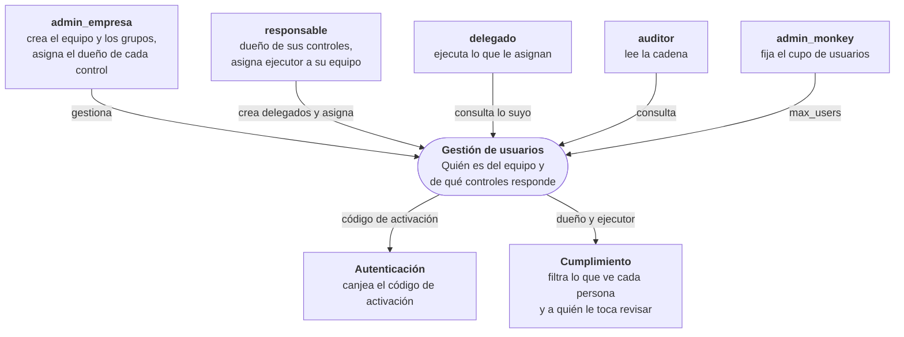
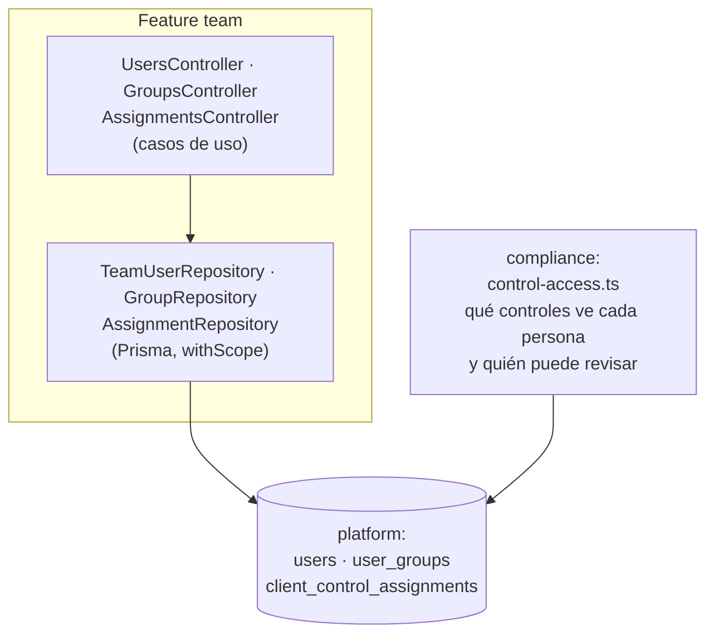

# Gestión de usuarios · C4

Responde: **¿qué piezas gestionan el equipo y la asignación de controles?** Rutas: `contracts/gestion-usuarios.md`.

## Nivel 1 · Contexto

## Nivel 2 · Contenedores que toca

Frontend-Platform (pantallas **Equipo**, **Grupos**, **Asignación de controles** y **Mi trabajo**), Frontend (el cupo de usuarios en la
ficha de la empresa), Backend y PostgreSQL. El código de activación **sale por correo** desde el sprint 3 (D102); las
notificaciones siguen fuera (D143, MD-515).

## Nivel 3 · Componentes

Los permisos de sus rutas los aplica [`roles-permisos/`](../roles-permisos/README.md).

## Cómo verificarlo

`find Backend/src/features/team -type f` y `Backend/src/features/compliance/infrastructure/shared/`.
