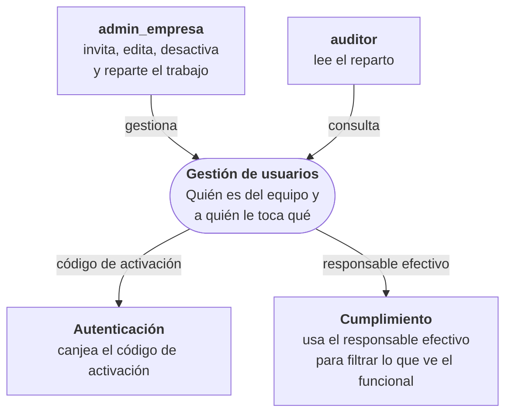
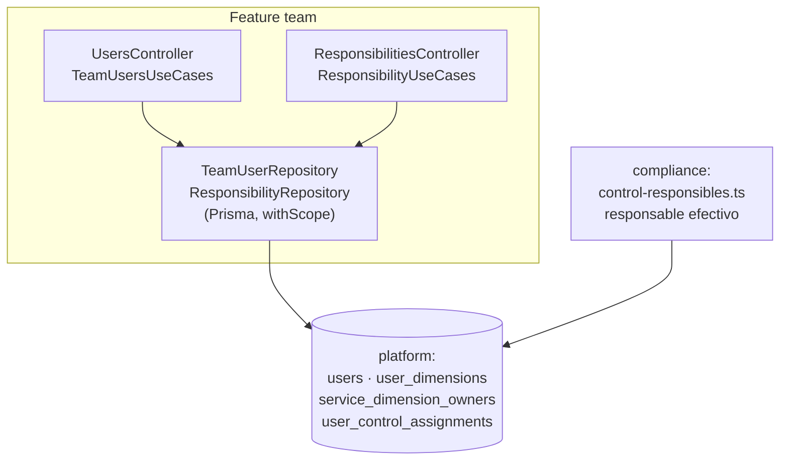

# Gestión de usuarios · C4

Responde: **¿qué piezas gestionan el equipo y el reparto?** Rutas: `contracts/gestion-usuarios.md`.

## Nivel 1 · Contexto

## Nivel 2 · Contenedores que toca

Frontend-Platform (pantalla **Equipo**), Backend y PostgreSQL. No usa correo todavía: el código de activación se
entrega a mano (MD-69 pendiente, `P39`).

## Nivel 3 · Componentes

Los permisos de sus rutas (`@Roles('admin_empresa')`) los aplica [`roles-permisos/`](../roles-permisos/README.md).

## Cómo verificarlo

`find Backend/src/features/team -type f` y `Backend/src/features/compliance/infrastructure/shared/control-responsibles.ts`.
