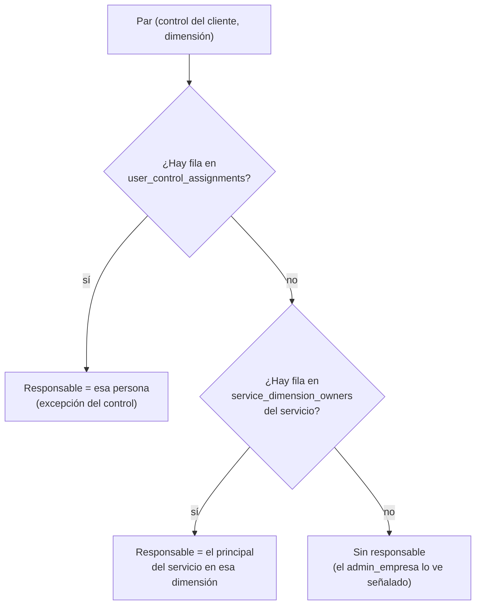

# Gestión de usuarios · Modelo

Responde: **¿qué tablas guardan el equipo y el reparto, y cómo se llega al responsable de una prueba?** El diagrama
ER está en [`datos/modelo/05-usuarios.md`](../../datos/modelo/05-usuarios.md) §5.2 y **no se redibuja**. Aquí solo lo
que ese archivo cuenta en prosa: la resolución del responsable.

## Resolver el responsable efectivo (no se guarda)

Restricciones: una fila por (servicio, dimensión) y por (control, dimensión); solo se asigna a un `funcional` con esa
especialidad; la fila apunta a `client_controls`, no al catálogo.

## Vigente por D98

El `funcional` atiende **todo** lo de sus especialidades sin asignación. La resolución de arriba se conserva en la
API y la base, pero no cambia lo que nadie ve (la interfaz del reparto está apagada, `contracts/gestion-usuarios.md`). P38 decide si
vuelve a restringir y a qué nivel.

## Cómo verificarlo

`Backend/prisma/schema/platform/users.prisma` y `control-responsibles.ts`.
