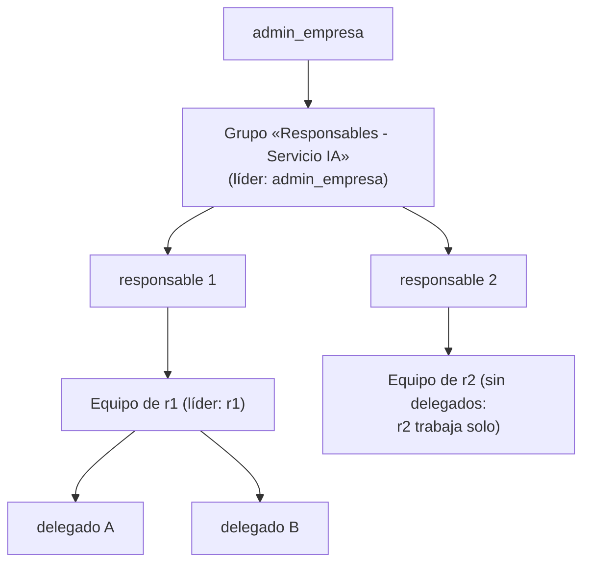

# Gestión de usuarios · Modelo

Responde: **¿qué tablas guardan el equipo, los grupos y la asignación, y cómo se llega al dueño y al ejecutor de un control?**
El diagrama ER está en [`datos/modelo/05-usuarios.md`](../../datos/modelo/05-usuarios.md) §5.2 y **no se redibuja**. Aquí solo lo
que ese archivo cuenta en prosa.

## Grupos

Cada persona (salvo el `admin_empresa` y el `auditor`) pertenece a **un** grupo (`users.group_id`). El responsable de un
delegado es el líder de su grupo: no se guarda aparte.

## Dueño y ejecutor (no hay una fila por prueba)

`client_control_assignments` tiene **una fila por control del cliente**: `owner_id` (un `responsable` o un `admin_empresa`) y
`executor_id` (nulo = ejecuta el dueño; si no, un `delegado` del grupo del dueño). **Sin fila = «Sin asignar».** La
asignación apunta a `client_controls`, que cuelga de un servicio: el mismo control en dos servicios se asigna dos veces.

## Qué pasa cuando algo cambia

| Hecho | Efecto en `client_control_assignments` |
|---|---|
| El `admin_empresa` cambia el dueño | `executor_id` se limpia |
| Se mueve un delegado a otro equipo | los controles que ejecutaba quedan sin ejecutor (siguen con su dueño) |
| Se desactiva un delegado | igual: sin ejecutor |
| Se desactiva un responsable sin delegados | sus filas se borran: «Sin asignar» (con aviso y confirmación) |
| Se intenta desactivar un responsable con delegados | `409 RESPONSIBLE_HAS_DELEGATES` |
| Se clona un control nuevo | no tiene fila |

## Cómo verificarlo

`Backend/prisma/schema/platform/users.prisma`.
