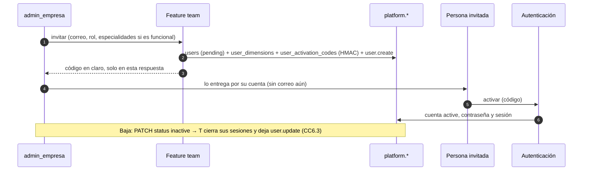

# Gestión de usuarios · Flujos de información

Responde: **¿cómo entra una persona al equipo y cómo se reparte el trabajo?** Rutas y cuerpos: `contracts/gestion-usuarios.md`.

## 1 · Invitar, activar y dar de baja

Frontera entre módulos: Gestión de usuarios **entrega** el código; Autenticación lo **canjea**. El único acoplamiento
es la fila `user_activation_codes`.

## 2 · Repartir el trabajo

| Quién | Acción | Efecto en datos | Rastro |
|---|---|---|---|
| `admin_empresa` | Asigna el responsable principal de una dimensión en un servicio | `service_dimension_owners` | `dimension_owner.set` |
| `admin_empresa` | Fija o quita la excepción de un control | `user_control_assignments` | `control_responsible.set` |
| `admin_empresa` | Cambia las especialidades de un `funcional` | `user_dimensions` | `user.update` |

Reglas: solo a un `funcional` con esa especialidad; no se quita una especialidad mientras la persona sea responsable
de algo; desactivar a un responsable **no** lo reasigna.

## Cómo verificarlo

`test/equipo/equipo.e2e-spec.ts`.
