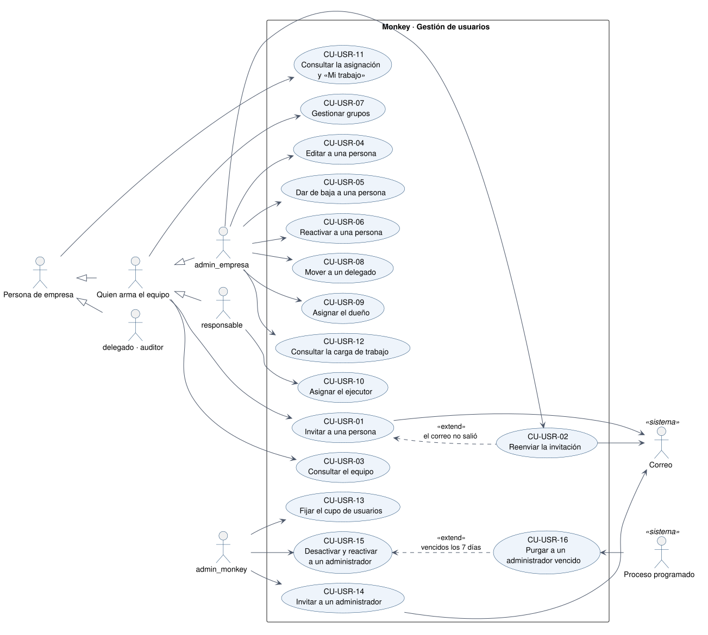

# Gestión de usuarios · casos de uso

Responde: **¿qué pasos sigue cada actor con el sistema, qué puede salir distinto y en qué estado queda todo al
terminar?** Cada caso realiza una o varias [historias](04-historias.md); la secuencia técnica (tablas, transacciones)
está en [`03-flujos.md`](03-flujos.md) y los cuerpos y errores en el
[contrato](../../../../../../contracts/gestion-usuarios.md) y en el de
[administradores](../../../../../../contracts/gestion-usuarios/administradores.md).

## Diagrama de casos de uso

Fuente del diagrama: [`05-casos-de-uso.puml`](05-casos-de-uso.puml) (PlantUML; se regenera con
`skills/process/monkey-docs/scripts/render-uml.sh`). «Persona de empresa» generaliza a los cuatro roles de Platform;
«Quien arma el equipo» es el `admin_empresa` o el `responsable` (este, solo para sus delegados y su equipo).

La activación de la cuenta invitada es de [Autenticación](../autenticacion/05-casos-de-uso.md) (CU-AUTH-01): este módulo
**entrega** el código; Autenticación lo **canjea**. Restablecer el segundo factor de alguien del equipo es CU-AUTH-08.

## Resumen

| ID | Caso | Actor principal | Historias |
|---|---|---|---|
| CU-USR-01 | Invitar a una persona | `admin_empresa` · `responsable` | HU-USR-01, HU-USR-02, HU-USR-09 |
| CU-USR-02 | Reenviar la invitación | `admin_empresa` | HU-USR-03 |
| CU-USR-03 | Consultar el equipo | `admin_empresa` · `responsable` | HU-USR-04, HU-USR-14, HU-USR-25 |
| CU-USR-04 | Editar a una persona | `admin_empresa` | HU-USR-05, HU-USR-06 |
| CU-USR-05 | Dar de baja a una persona | `admin_empresa` | HU-USR-07 |
| CU-USR-06 | Reactivar a una persona | `admin_empresa` | HU-USR-08, HU-USR-09 |
| CU-USR-07 | Gestionar grupos | `admin_empresa` (el `responsable` solo los ve, MD-503) | HU-USR-11, HU-USR-12 |
| CU-USR-08 | Mover a un delegado de equipo | `admin_empresa` | HU-USR-13 |
| CU-USR-09 | Asignar el dueño de controles | `admin_empresa` | HU-USR-15 |
| CU-USR-10 | Asignar el ejecutor de controles | `responsable` | HU-USR-16 |
| CU-USR-11 | Consultar la asignación y «Mi trabajo» | Persona de empresa | HU-USR-17, HU-USR-18, HU-USR-19 |
| CU-USR-12 | Consultar la carga de trabajo | `admin_empresa` | HU-USR-20 |
| CU-USR-13 | Fijar el cupo de usuarios | `admin_monkey` | HU-USR-10 |
| CU-USR-14 | Invitar a un administrador de Monkey | `admin_monkey` | HU-USR-21 |
| CU-USR-15 | Desactivar y reactivar a un administrador | `admin_monkey` | HU-USR-22, HU-USR-23 |
| CU-USR-16 | Purgar a un administrador vencido | Proceso programado | HU-USR-22, HU-USR-24 |

HU-USR-26 y HU-USR-27 (⚪, `P47` y `P41`) no tienen caso hasta que el comité responda.

---

### CU-USR-01 · Invitar a una persona

| | |
|---|---|
| **Actor** | `admin_empresa` (cualquier rol de empresa) · `responsable` (solo `delegado` de su equipo); actor secundario: el correo |
| **Precondición** | Sesión abierta; la empresa no llegó a su cupo; para un `delegado`, el equipo de su responsable ya existe |
| **Postcondición** | Cuenta `pending` en su grupo, código de activación guardado como HMAC y enviado por correo; rastro `user.create` |

**Flujo principal**
1. Quien invita escribe correo, nombre, apellido y rol; para un `delegado`, el equipo y si es interno o externo.
2. El sistema comprueba el rol de quien invita, el correo y el cupo, en la misma transacción.
3. El sistema crea la cuenta `pending` (un `responsable` queda en «Responsables» si no se elige otro grupo).
4. Tras guardar, el sistema envía el código por correo e informa si salió (`invitation.delivery_status`).
5. La persona activa su cuenta en **CU-AUTH-01**.

**Flujos alternos**
- 1a. Un `responsable` (o cualquier rol que no sea `admin_empresa`) intenta crear → `403 FORBIDDEN` (D150, MD-503).
- 1b. Grupo o marca de interno en un rol que no la lleva → `VALIDATION_FAILED` (`group_id.not_allowed`, `is_internal.not_allowed`).
- 2a. El correo ya tiene cuenta → `EMAIL_TAKEN`, sin decir de quién.
- 2b. La empresa llegó al cupo → `USER_LIMIT_REACHED` con `max_users` y `users_count`; no queda cuenta ni rastro.
- 2c. El delegado no trae `group_id` → `VALIDATION_FAILED` (`group_id:required`); el equipo del responsable se crea primero (**CU-USR-07**). `RESPONSIBLE_HAS_NO_TEAM` se eliminó en MD-503.
- 2d. El grupo «Responsables» no lo lidera un `admin_empresa` → `RESPONSIBLES_GROUP_INVALID`; se elige otro grupo.
- 4a. El correo no sale → `delivery_status: failed`; la cuenta existe y se reenvía (**CU-USR-02**).

### CU-USR-02 · Reenviar la invitación

| | |
|---|---|
| **Actor** | `admin_empresa`; actor secundario: el correo |
| **Precondición** | La persona es de su empresa y su cuenta sigue `pending` |
| **Postcondición** | Código anterior revocado, uno nuevo enviado por correo; rastro `user.activation_code_regenerate` |

**Flujo principal**
1. El administrador elige «Reenviar invitación» en la persona.
2. El sistema revoca el código vigente, emite uno nuevo y lo envía por correo.
3. La respuesta trae solo `invitation` (estado del envío y vencimiento), nunca el código.

**Flujos alternos**
- 1a. La persona ya activó → `USER_ALREADY_ACTIVE`.
- 1b. La persona es de otra empresa o es `admin_monkey` → `404`.

### CU-USR-03 · Consultar el equipo

| | |
|---|---|
| **Actor** | `admin_empresa` · `responsable` |
| **Precondición** | Sesión abierta |
| **Postcondición** | Ninguna (solo lectura) |

**Flujo principal**
1. La persona abre Equipo → Personas.
2. El sistema lista, paginado, a todo el equipo (`admin_empresa`) o solo a su equipo (`responsable`), con grupo, estado y,
   en cada `delegado`, su responsable.
3. La persona filtra por rol, estado, grupo o interno/externo y abre una persona en solo lectura.

**Flujos alternos**
- 1a. Un `delegado`, un `auditor` o un `admin_monkey` → `403`. El `delegado` ve a su responsable en su perfil (`/auth/me`).
- 3a. Buscar por nombre o correo, o un detalle con historial: no existe (`P42`, abierta).

### CU-USR-04 · Editar a una persona

| | |
|---|---|
| **Actor** | `admin_empresa` |
| **Precondición** | La persona es de su empresa |
| **Postcondición** | Nombre o marca de interno corregidos; rastro `user.update` con antes y después |

**Flujo principal**
1. El administrador corrige nombre y apellido o, en un `delegado`, si es interno o externo.
2. El sistema valida y guarda; el rol no cambia.

**Flujos alternos**
- 1a. Marca de interno en un rol que no es `delegado` → `VALIDATION_FAILED` (`is_internal.not_allowed`).
- 1b. Nombre de más de 100 caracteres → `VALIDATION_FAILED`.
- 1c. Sobre sí mismo → solo el nombre.

### CU-USR-05 · Dar de baja a una persona

| | |
|---|---|
| **Actor** | `admin_empresa` |
| **Precondición** | La persona es de su empresa y está `active` |
| **Postcondición** | Cuenta `inactive`, sesiones cerradas, cupo liberado, controles reasignados según su rol; rastro `user.update` y un `control_assignment.set` por control |

**Flujo principal**
1. El administrador elige «Desactivar».
2. El sistema comprueba si la persona tiene controles como dueño o ejecutor.
3. Si no tiene, la desactiva y cierra todas sus sesiones al instante (fin).
4. Si tiene, avisa cuántos y pide confirmación; el administrador confirma.
5. El sistema la desactiva en una transacción: un `delegado` deja sus controles sin ejecutor; un `responsable` sin
   delegados o un `admin_empresa`, «Sin asignar».

**Flujos alternos**
- 2a. Es un `responsable` con delegados activos o pendientes → `RESPONSIBLE_HAS_DELEGATES` con `delegates_count`; la
  confirmación no lo salta. Primero se mueven (**CU-USR-08**) o se dan de baja.
- 2b. Es él mismo, o el único `admin_empresa` activo → `LAST_ADMIN`.
- 2c. La cuenta está `pending` → `USER_NOT_ACTIVATED`.
- 4a. Se envía sin confirmación → `USER_HAS_ASSIGNMENTS` con `controls_count`.
- 5a. Quien actúa fue desactivado mientras tanto → `ACCOUNT_INACTIVE`; no se escribe nada.

### CU-USR-06 · Reactivar a una persona

| | |
|---|---|
| **Actor** | `admin_empresa` |
| **Precondición** | La persona es de su empresa y está `inactive` |
| **Postcondición** | Cuenta `active` sin sus asignaciones anteriores; rastro `user.update` |

**Flujo principal**
1. El administrador elige «Reactivar».
2. El sistema comprueba el cupo y, en un `delegado`, que su responsable siga vigente.
3. El sistema la reactiva; los controles que dejó siguen «Sin asignar».

**Flujos alternos**
- 2a. La empresa está en su cupo → `USER_LIMIT_REACHED`.
- 2b. El responsable del `delegado` no está `active` ni `pending` → `TEAM_LEADER_INACTIVE`; se mueve antes (**CU-USR-08**).
- 2c. La cuenta está `pending` → `USER_NOT_ACTIVATED`.
- 3a. Es un `responsable` → vuelve a liderar el equipo que tenía.

### CU-USR-07 · Gestionar grupos

| | |
|---|---|
| **Actor** | `admin_empresa` (MD-503: el `responsable` solo lista el suyo, no crea) |
| **Precondición** | Sesión abierta |
| **Postcondición** | Grupo creado o renombrado; rastro `group.create` o `group.update` |

**Flujo principal**
1. La persona abre Equipo → Grupos (para el responsable, «Mi equipo»).
2. Elige crear un grupo y le pone nombre; el administrador indica, si es el caso, el responsable cuyo equipo crea.
3. El sistema crea un grupo de responsables (sin líder indicado, lo lidera el administrador) o un equipo de delegados.
4. El administrador puede renombrar un grupo.

**Flujos alternos**
- 2a. El responsable ya lidera un equipo → `TEAM_ALREADY_EXISTS`.
- 2b. El nombre ya existe en la empresa o es «Responsables» → `GROUP_NAME_TAKEN`.
- 2c. El responsable indicado no es de la empresa → `404`; un `responsable` que indica a otro → `403`.
- 4a. Se intenta renombrar «Responsables» → `GROUP_RESERVED`.

### CU-USR-08 · Mover a un delegado de equipo

| | |
|---|---|
| **Actor** | `admin_empresa` |
| **Precondición** | La persona es un `delegado` de su empresa |
| **Postcondición** | Delegado en el nuevo equipo; sus controles, con su dueño y sin ejecutor; rastro `user.update` y un `control_assignment.set` por control |

**Flujo principal**
1. El administrador elige el equipo de destino del delegado (desde Grupos o el Organigrama).
2. El sistema comprueba el destino y si el delegado ejecuta controles.
3. Si ejecuta, avisa cuántos y pide confirmación; el administrador confirma.
4. El sistema lo mueve; los controles que ejecutaba quedan sin ejecutor.

**Flujos alternos**
- 1a. La persona no es `delegado` → `VALIDATION_FAILED` (`group_id.not_allowed`).
- 2a. El destino no es el equipo de un responsable `active` o `pending` de la empresa → `404`.
- 2b. El destino es su mismo equipo → no cambia nada.
- 3a. Se envía sin confirmación → `USER_HAS_ASSIGNMENTS` con `controls_count`.

### CU-USR-09 · Asignar el dueño de controles

| | |
|---|---|
| **Actor** | `admin_empresa` |
| **Precondición** | Sesión abierta; controles vigentes de su empresa |
| **Postcondición** | Dueño puesto o quitado en cada control elegido, con el ejecutor limpio; un `control_assignment.set` por control que cambió |

**Flujo principal**
1. El administrador filtra los controles (servicio, marco, categoría, requisito, «Sin asignar»…) y elige uno o varios (hasta 200).
2. Elige el dueño: un `responsable` o él mismo, o ninguno.
3. El sistema aplica todo o nada; cambiar el dueño limpia el ejecutor y «ninguno» deja el control «Sin asignar».
4. El sistema responde cuántos cambiaron.

**Flujos alternos**
- 2a. El dueño no es un `responsable` activo o pendiente de la empresa ni el propio administrador → `OWNER_NOT_ELIGIBLE`.
- 2b. El dueño o un control no existen o son de otra empresa → `404`.
- 3a. Algún control está dado de baja → `CONTROL_RETIRED`; no se cambia ninguno.
- 1a. Más de 200 controles, ninguno o repetidos → `422` (`array.max`, `array.min`, `array.unique`).

### CU-USR-10 · Asignar el ejecutor de controles

| | |
|---|---|
| **Actor** | `responsable` |
| **Precondición** | Es dueño de los controles elegidos |
| **Postcondición** | Ejecutor puesto o quitado en cada control; un `control_assignment.set` por control que cambió |

**Flujo principal**
1. El responsable elige uno o varios de sus controles (hasta 200).
2. Elige un `delegado` de su equipo, o ninguno (ejecuta él).
3. El sistema aplica todo o nada y responde cuántos cambiaron.

**Flujos alternos**
- 1a. Algún control no es suyo → `403`.
- 2a. El ejecutor no es un `delegado` activo o pendiente de su equipo → `EXECUTOR_NOT_IN_TEAM`.
- 2b. El responsable no tiene equipo → solo puede dejar el ejecutor vacío.
- 3a. Algún control está dado de baja → `CONTROL_RETIRED`.

### CU-USR-11 · Consultar la asignación y «Mi trabajo»

| | |
|---|---|
| **Actor** | Persona de empresa |
| **Precondición** | Sesión abierta |
| **Postcondición** | Ninguna (solo lectura) |

**Flujo principal**
1. Un `responsable` o `delegado` entra y llega a «Mi trabajo»: sus controles agrupados (rechazado, por revisar, por
   subir, en revisión, listo) y el avance de lo suyo.
2. La persona abre la asignación: los controles con código, requisitos, servicio, estado, dueño y ejecutor.
3. El sistema le muestra solo lo que le toca: todo al `admin_empresa` y al `auditor` (este en solo lectura); al
   `responsable`, lo suyo; al `delegado`, lo que ejecuta.

**Flujos alternos**
- 1a. El `admin_empresa` no tiene «Mi trabajo» (`403`): entra a Inicio y ve todo en Cumplimiento.
- 1b. El `delegado` pide «por revisar» → lista vacía.
- 3a. Sin controles → listas vacías, sin error.
- 3b. Pide un control ajeno de su empresa → `403`; de otra empresa → `404`; la vista técnica → `403`.
- 2a. `admin_monkey` → `403`.

### CU-USR-12 · Consultar la carga de trabajo

| | |
|---|---|
| **Actor** | `admin_empresa` |
| **Precondición** | Sesión abierta |
| **Postcondición** | Ninguna (solo lectura) |

**Flujo principal**
1. El administrador abre la carga de trabajo.
2. El sistema lista a cada `responsable` y `delegado` activo y a cada `admin_empresa` dueño de algún control, con
   controles que posee, que ejecuta y su avance, más los «Sin asignar» de la empresa.

**Flujos alternos**
- 1a. Otro rol → `403`.

### CU-USR-13 · Fijar el cupo de usuarios

| | |
|---|---|
| **Actor** | `admin_monkey` |
| **Precondición** | La empresa existe |
| **Postcondición** | `max_users` cambiado; rastro `company.max_users_update` con antes y después |

**Flujo principal**
1. El administrador de Monkey abre la empresa y elige «Cambiar cupo».
2. Escribe el nuevo cupo; el sistema lo compara con las cuentas que ya cuentan y lo guarda.

**Flujos alternos**
- 2a. Menor que el uso actual → `MAX_USERS_BELOW_CURRENT`, con el número de cuentas que cuentan.
- 1a. Otro rol → `403`.

### CU-USR-14 · Invitar a un administrador de Monkey

| | |
|---|---|
| **Actor** | `admin_monkey`; actor secundario: el correo |
| **Precondición** | Sesión abierta en Monkey Admin, cuenta `active` con segundo factor |
| **Postcondición** | Cuenta `admin_monkey` `pending`, código enviado por correo; rastro `admin.invite` |

**Flujo principal**
1. El administrador abre Parametrización → Administradores y elige invitar.
2. Escribe correo, nombre, apellido y su código del segundo factor.
3. El sistema crea la cuenta `pending` y envía el código por correo, con un enlace a Monkey Admin.
4. La persona activa su cuenta en **CU-AUTH-01** y configura su segundo factor.

**Flujos alternos**
- 2a. Código del segundo factor equivocado → `MFA_CODE_INVALID`; suma al bloqueo (`ACCOUNT_LOCKED`).
- 2b. Rol distinto de `admin_monkey` → `VALIDATION_FAILED` (`role.not_allowed`).
- 3a. El correo ya tiene cuenta → `EMAIL_TAKEN`.
- 3b. El correo no sale → `delivery_status: failed`; se reenvía (`USER_ALREADY_ACTIVE` si ya activó).

### CU-USR-15 · Desactivar y reactivar a un administrador

| | |
|---|---|
| **Actor** | `admin_monkey` |
| **Precondición** | El otro administrador está `active` (desactivar) o `inactive` en gracia (reactivar) |
| **Postcondición** | Desactivado: `inactive`, `purge_at` a 7 días, sesiones cerradas, rastro `admin.deactivate`. Reactivado: `active`, sin `purge_at`, rastro `admin.reactivate` |

**Flujo principal**
1. El administrador elige «Desactivar» en otro administrador.
2. El sistema avisa que en 7 días se borra y que hasta entonces se puede reactivar; el administrador confirma con su
   código del segundo factor.
3. El sistema lo desactiva en una transacción y cierra sus sesiones al instante.
4. Dentro de los 7 días, un administrador elige «Reactivar»; el sistema lo reactiva sin pedir el segundo factor y la
   persona debe iniciar sesión de nuevo.

**Flujos alternos**
- 1a. Es él mismo → `CANNOT_DEACTIVATE_SELF` (queda registrado con `result: error`).
- 3a. Es el último administrador activo, incluso con dos bajas simultáneas → `LAST_ADMIN`.
- 1b. Ya estaba inactivo → `ADMIN_ALREADY_INACTIVE`; estaba `pending` → `USER_NOT_ACTIVATED`.
- 2a. Código del segundo factor equivocado → `MFA_CODE_INVALID`.
- 4a. Pasaron los 7 días → `404`; hay que invitarlo de nuevo (**CU-USR-14**).
- 4b. No estaba en gracia → `ADMIN_NOT_INACTIVE`.

### CU-USR-16 · Purgar a un administrador vencido

| | |
|---|---|
| **Actor** | Proceso programado (cada `ADMIN_PURGE_INTERVAL_MINUTES`, un día por defecto) |
| **Precondición** | Un administrador `inactive` con `purge_at` vencido |
| **Postcondición** | Sello en `audit.admin_tombstones`; cuenta y credenciales borradas; correo libre; rastro `admin.purge` con actor del sistema |

**Flujo principal**
1. El proceso busca a los administradores con la gracia vencida.
2. Por cada uno, en una transacción, guarda el sello (id, nombre completo y rol) y borra sus credenciales y su cuenta.
3. Donde un registro lo nombra, la lectura muestra el sello como «Administrador eliminado».

**Flujos alternos**
- 2a. Corre dos veces seguidas → no falla ni duplica el sello.
- 2b. Falla a medias → no queda la persona sin cuenta y sin sello.
