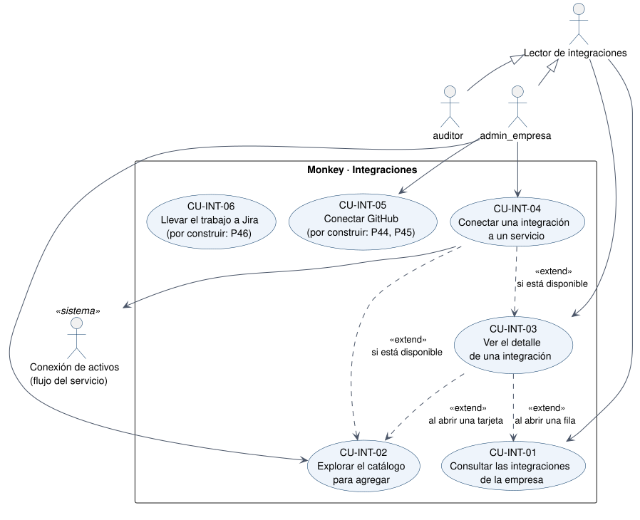

# Integraciones · casos de uso

Responde: **¿qué pasos sigue cada actor con la sección Integraciones, qué puede salir distinto y en qué estado queda todo
al terminar?** Cada caso realiza una o varias [historias](04-historias.md); la forma de la arquitectura está en el
[README](README.md) y los cuerpos y errores en el [contrato](../../../../../../contracts/integraciones.md).

## Diagrama de casos de uso

Fuente del diagrama: [`05-casos-de-uso.puml`](05-casos-de-uso.puml) (PlantUML; se regenera con
`skills/process/monkey-docs/scripts/render-uml.sh`). `admin_empresa` generaliza al «Lector de integraciones» (lo que
también puede el `auditor`). Los casos CU-INT-05 y CU-INT-06 están por construir y dependen de pendientes del comité.

## Resumen

| ID | Caso | Actor principal | Historias |
|---|---|---|---|
| CU-INT-01 | Consultar las integraciones de la empresa | `admin_empresa` · `auditor` | HU-INT-01, HU-INT-02, HU-INT-07 |
| CU-INT-02 | Explorar el catálogo para agregar | `admin_empresa` | HU-INT-03, HU-INT-08 |
| CU-INT-03 | Ver el detalle de una integración | `admin_empresa` · `auditor` | HU-INT-04, HU-INT-05, HU-INT-07, HU-INT-08 |
| CU-INT-04 | Conectar una integración a un servicio | `admin_empresa` | HU-INT-06 |
| CU-INT-05 | Conectar GitHub ⚪ | `admin_empresa` | HU-INT-09 |
| CU-INT-06 | Llevar el trabajo de cumplimiento a Jira ⚪ | por decidir (P46) | HU-INT-10 |

---

### CU-INT-01 · Consultar las integraciones de la empresa

| | |
|---|---|
| **Actor** | `admin_empresa` o `auditor` |
| **Precondición** | Sesión iniciada en Monkey Platform |
| **Postcondición** | Nada cambia: la lista se deriva de las conexiones y no se guarda (D110 punto 3) |

**Flujo principal**
1. El actor abre «Integraciones» en el menú.
2. El sistema deriva, de las conexiones vigentes de la empresa (D61), una fila por integración con su estado, sus
   recursos reconocidos, su última validación y sus conexiones.
3. El sistema la muestra ordenada `needs_attention`, `active`, `pending` y, dentro, por nombre.
4. El actor busca por nombre o filtra por estado (opciones del catálogo `integration_status`).
5. El actor abre una fila y sigue con **CU-INT-03**.

**Flujos alternos**
- 1a. El actor es `responsable` o `delegado` → la ruta no se muestra y la API responde `403`.
- 2a. La empresa no tiene conexiones vigentes → lista vacía; el `admin_empresa` ve «Agregar integración» (**CU-INT-02**),
  el `auditor` solo el mensaje.
- 2b. La carga falla → mensaje de error con reintento; no se muestra una lista parcial.
- 3a. Alguna integración está en `needs_attention` → aviso arriba de la lista con cuántas son; al desplegarlo muestra las
  conexiones afectadas. Es un problema de conexión, no un incumplimiento (D57). El `admin_empresa` puede ir al detalle de
  cada conexión en su servicio; el `auditor`, no.

### CU-INT-02 · Explorar el catálogo para agregar

| | |
|---|---|
| **Actor** | `admin_empresa` |
| **Precondición** | Sesión iniciada |
| **Postcondición** | Nada cambia; el actor eligió una integración para ver o conectar |

**Flujo principal**
1. El actor pulsa «Agregar integración» desde la lista.
2. El sistema trae el catálogo (`GET /v1/integrations/catalog`) y lo agrupa por propósito (`integration_purpose`):
   medición antes que flujo de trabajo y, dentro, por el orden del catálogo.
3. Cada tarjeta muestra marca, logo, descripción en el idioma del actor, disponibilidad (la de la plataforma de conexión
   cuando la tiene, D67) y si la empresa ya la tiene conectada.
4. El actor busca por nombre o descripción.
5. El actor abre una tarjeta (**CU-INT-03**) o pulsa «Conectar» en una disponible (**CU-INT-04**).

**Flujos alternos**
- 1a. El actor es `auditor`, `responsable` o `delegado` → no hay ruta y la API responde `403`.
- 4a. La búsqueda no encuentra nada → «sin resultados»; el catálogo no cambia.
- 5a. La integración es `coming_soon` → se muestra sin «Conectar» (D110 punto 6).

### CU-INT-03 · Ver el detalle de una integración

| | |
|---|---|
| **Actor** | `admin_empresa` (cualquier integración del catálogo) o `auditor` (solo las conectadas) |
| **Precondición** | Sesión iniciada; el actor viene de la lista, del catálogo o de la «Nueva conexión» de un servicio |
| **Postcondición** | Nada cambia |

**Flujo principal**
1. El actor abre una integración.
2. El sistema trae el detalle (`GET /v1/integrations/{code}`): catálogo, estado y conexiones de la empresa, qué hace,
   requisitos, permisos, tipos de recurso, cobertura y seguridad, en el idioma del actor y sin nombrar al motor que
   evalúa (regla 1).
3. El sistema muestra las pestañas: resumen, conexiones (si la empresa tiene alguna), permisos, qué evalúa y seguridad,
   con un panel lateral de estado, capacidades y dónde se usa.
4. En «Qué evalúa», el sistema muestra las pruebas que la integración alimenta y cuántos controles y marcos alcanzan,
   aclarando que alimentar no es aprobar (D56, regla 4).
5. En «Seguridad», el sistema muestra solo lo verificado (un `SEG-n` en ✅ o una decisión construida).
6. Si es `admin_empresa` y la integración está disponible, puede seguir con **CU-INT-04**.

**Flujos alternos**
- 2a. El código no existe → `404 INTEGRATION_NOT_FOUND`; la pantalla dice que no se encontró.
- 2b. El actor es `auditor` y la empresa no tiene esa integración → `404 INTEGRATION_NOT_FOUND`, igual que un código
  inexistente (D110 punto 5).
- 2c. El actor es `responsable` o `delegado` → `403`.
- 3a. La integración es `coming_soon` → requisitos, permisos, seguridad y recursos vacíos; las pestañas lo explican y
  el resumen va en tiempo futuro.
- 3b. El enlace pide una pestaña que no existe (o «Conexiones» sin conexiones) → se abre el resumen.
- 4a. No hay checks cargados de esa plataforma → `coverage` es `null` y la pestaña lo dice.

### CU-INT-04 · Conectar una integración a un servicio

| | |
|---|---|
| **Actor** | `admin_empresa` |
| **Precondición** | La integración está `available` y tiene plataforma de conexión; la empresa tiene al menos un servicio |
| **Postcondición** | El actor está en el asistente de conexión del servicio; lo que se crea (activo, aprovisionamiento) lo fija ese flujo ([`conectar.md`](../../../../../../contracts/onboarding/conexion-activos/conectar.md)) |

**Flujo principal**
1. El actor pulsa «Conectar» en una tarjeta del catálogo o en el detalle.
2. El sistema pide elegir el servicio al que va la conexión.
3. El actor elige un servicio.
4. El sistema lo lleva al asistente de conexión de ese servicio con la categoría y la plataforma de la integración
   (`/services/{id}/connections/new/{categoría}/{plataforma}`); al cerrar el asistente vuelve a donde estaba.

**Flujos alternos**
- 1a. El actor llegó desde la «Nueva conexión» de un servicio → el servicio ya está elegido; se salta a 4.
- 2a. La empresa no tiene servicios → el sistema lo dice y ofrece ir a «Mis servicios».
- 2b. La lista de servicios no carga → mensaje de error en el selector; no se navega.
- 4a. Los riesgos del servicio no están evaluados → el sistema lo manda a evaluarlos antes de declarar activos (D89).

### CU-INT-05 · Conectar GitHub ⚪

| | |
|---|---|
| **Actor** | `admin_empresa` |
| **Precondición** | Por decidir: categoría de activo, qué es el activo y canal de conexión (P45) |
| **Postcondición** | Cuentan los 34 vínculos de GitHub de `TEST_CHECKS` (D129); la categoría de activo, por decidir (P45) |

**Flujo principal:** no se escribe hasta que el comité cierre P45 (regla 5 de `CLAUDE.md`). Hoy GitHub está en el
catálogo como `coming_soon` y no se puede conectar (D110 punto 6).

**Lo que ya está fijado:** sin la cadena check → prueba → control ratificada, un resultado no cuenta (D56); si se usa
una aplicación propia de Monkey, su llave nunca llega a la evaluación automática y se emite un token de instalación por
cliente y por corrida ([README](README.md#la-frontera-del-conector-objetivo-d110)).

### CU-INT-06 · Llevar el trabajo de cumplimiento a Jira ⚪

| | |
|---|---|
| **Actor** | Por decidir (P46, punto 3) |
| **Precondición** | Por decidir: quién conecta Jira y con qué permisos (P46, punto 2) |
| **Postcondición** | Por decidir: remediación, evidencia o ambas (P46, punto 1) |

**Flujo principal:** no se escribe hasta que el comité cierre P46. Hoy Jira está en el catálogo como `coming_soon`, con
propósito `workflow`: no mide nada (D110).
