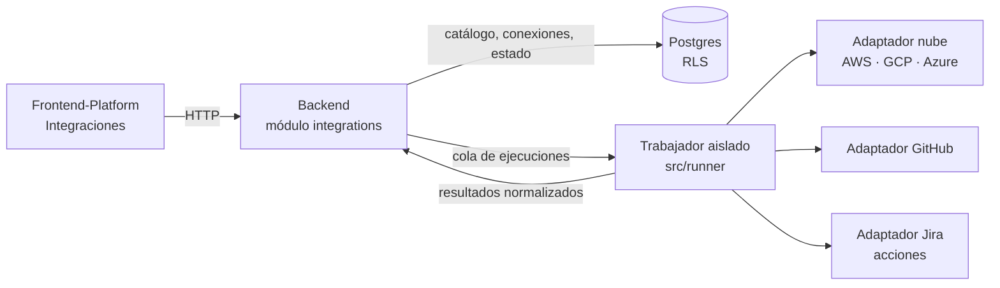

# Integraciones

Responde: **¿con qué plataformas de terceros trabaja Monkey, cómo se conectan y cómo se suma una nueva sin tocar el
resto del sistema?** Decisión: [D110](../../datos/decisiones/integraciones.md). Contrato:
[`contracts/integraciones.md`](../../../../../../contracts/integraciones.md). Pendientes: [P45, P46](../../datos/pendientes/integraciones.md) (P44 la cerró D129).

## Qué es una integración

Una plataforma de un tercero con un **propósito**:

| Propósito | Qué hace | Hoy |
|---|---|---|
| `measurement` | Evalúa la configuración de la plataforma; sus resultados alimentan las pruebas (`check_results`, §8) | AWS (disponible); Azure, GCP, Microsoft 365, Google Workspace y GitHub (`coming_soon`) |
| `workflow` | No mide: lleva el trabajo de cumplimiento a la herramienta del cliente (tickets, avisos) | Jira (`coming_soon`) |

Los servidores, bases de datos y equipos con la sonda (`ac_02` a `ac_06`) **no** son integraciones: se conectan dentro de
cada servicio ([Conexión de activos](../onboarding/conexion-activos/README.md)).

## Lo construido (MD-211)

| Pieza | Dónde | Qué hace |
|---|---|---|
| Catálogo | `catalog.integrations` (§6.3) | Una fila por integración. Si apunta a una plataforma de conexión (D67), toma de ella nombre, logo y disponibilidad |
| `GET /v1/integrations/catalog` | `Backend/src/features/integrations` | El catálogo para agregar; dice si la empresa ya la tiene conectada |
| `GET /v1/integrations` | ídem | Lo que la empresa conectó, **derivado** de `assets` y `asset_provisionings`, con su estado |
| `GET /v1/integrations/{code}` | ídem | El detalle de una integración (qué hace, permisos, cobertura, seguridad y sus conexiones) |
| Sección «Integraciones» | `Frontend-Platform/src/app/features/integrations` | La lista (admin y auditor), «Agregar integración» (admin) y el detalle (`/integraciones/:code`). Conectar lleva al flujo del servicio |

Nada se guarda por tenant en este módulo todavía: la lista se deriva. La primera integración que conecte por fuera del
flujo de servicio (GitHub o Jira) traerá su tabla de conexiones por tenant.

## La frontera del conector (objetivo, D110)

Cada proveedor es un **adaptador** detrás de una interfaz única. El backend no sabe qué programa hay detrás.

| Operación | Qué hace | Ejemplo AWS (ya existe) |
|---|---|---|
| `connect` | Registra la conexión con lo que el cliente entrega (nunca un secreto de larga vida si hay alternativa) | Rol de solo lectura con `ExternalId` (D58) |
| `validate` | Comprueba de verdad, en solo lectura, que la conexión sirve | Asumir el rol y confirmar la cuenta |
| `issueCredential` | Credencial temporal y acotada a **un** cliente para una corrida | STS, 1 h (SEG-26) |
| `execute` | Corre la medición o la acción en un contenedor efímero | Escaneo de la cuenta en las regiones declaradas |
| `normalize` | Traduce la salida al formato único (`check_results`) o al resultado de la acción | Resultado del motor → `check_results` |

**Por qué no un servicio aparte todavía:** el trabajador ya está aislado (sin base, sin acceso a la API salvo la suya, un
contenedor por corrida, D57). Un microservicio sumaría red, autenticación entre servicios y otro despliegue sin una razón
medible. Se separa cuando la haya (carga que frene la API, o un auditor que exija aislar credenciales en otra máquina);
con la frontera hecha, moverlo es mecánico.

**Una regla para las integraciones con aplicación propia de Monkey** (GitHub App, aplicación de Atlassian): la llave de la
aplicación sirve para **todos** los clientes que la instalaron. Nunca se le pasa al motor: el trabajador emite un token de
instalación por cliente y por corrida, igual que STS en AWS.

## Qué falta decidir

- ~~P44~~ (cerrada por D129): los checks de GitHub que cuentan son los 34 vínculos de `TEST_CHECKS` de la VF18.
- [P45](../../datos/pendientes/integraciones.md#p45--en-qué-categoría-de-activo-entra-github): la categoría de activo de GitHub.
- [P46](../../datos/pendientes/integraciones.md#p46--qué-hace-la-integración-con-jira): qué hace Jira (remediación, evidencia o ambas).

## Contenido

[`04-historias.md`](04-historias.md) · [`05-casos-de-uso.md`](05-casos-de-uso.md)
