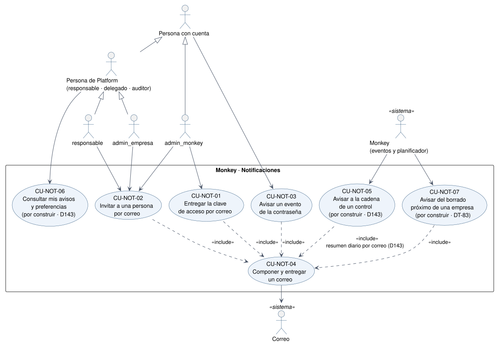

# Notificaciones · casos de uso

Responde: **¿qué pasos siguen el sistema y cada actor para que un aviso llegue, qué puede salir distinto y en qué estado
queda todo al terminar?** Cada caso realiza una o varias [historias](04-historias.md). Este módulo no tiene contrato propio:
los cuerpos y errores están en los contratos de quien envía
([`empresas`](../../../../../../contracts/empresas.md), [`gestion-usuarios`](../../../../../../contracts/gestion-usuarios.md),
[`administradores`](../../../../../../contracts/gestion-usuarios/administradores.md),
[`autenticacion`](../../../../../../contracts/autenticacion.md)).

## Diagrama de casos de uso

Fuente del diagrama: [`05-casos-de-uso.puml`](05-casos-de-uso.puml) (PlantUML; se regenera con
`skills/process/monkey-docs/scripts/render-uml.sh`). Los casos CU-NOT-01 a CU-NOT-03 incluyen **CU-NOT-04**, el envío
común por el puerto `Mailer`. CU-NOT-05 a CU-NOT-07 están **por construir**: los dos primeros ya están decididos (D138, D143) y se construyen en MD-69.

## Resumen

| ID | Caso | Actor principal | Historias |
|---|---|---|---|
| CU-NOT-01 | Entregar la clave de acceso por correo | `admin_monkey` | HU-NOT-01, HU-NOT-03 |
| CU-NOT-02 | Invitar a una persona por correo | `admin_empresa` · `responsable` · `admin_monkey` | HU-NOT-02, HU-NOT-03 |
| CU-NOT-03 | Avisar por correo un evento de la contraseña | Persona | HU-NOT-04, HU-NOT-05 |
| CU-NOT-04 | Componer y entregar un correo | Sistema (incluido) | HU-NOT-06 |
| CU-NOT-05 | Avisar a la cadena de un control ⚪ | Sistema | HU-NOT-07 a HU-NOT-11 |
| CU-NOT-06 | Consultar mis avisos y preferencias ⚪ | Persona de Platform | HU-NOT-12, HU-NOT-13 |
| CU-NOT-07 | Avisar del borrado próximo de una empresa ⚪ | Sistema | HU-NOT-14 |

---

### CU-NOT-01 · Entregar la clave de acceso por correo

| | |
|---|---|
| **Actor** | `admin_monkey` (Monkey Admin); recibe el `admin_email` de la empresa |
| **Precondición** | Empresa por registrar, o registrada con la clave sin canjear |
| **Postcondición** | Empresa creada, clave pendiente guardada solo como huella, correo enviado o `delivery_status: "failed"`; `access_key.email` en la auditoría |

**Flujo principal**
1. `admin_monkey` registra la empresa (`POST /v1/companies`).
2. El sistema crea la empresa y su clave en una transacción.
3. El sistema compone y envía el correo al `admin_email` (**CU-NOT-04**), en el idioma de `admin_monkey` (D111).
4. Monkey Admin muestra a qué correo salió y que salió; nunca la clave (D99).

**Flujos alternos**
- 3a. El servicio de correo no acepta el mensaje → la empresa queda creada, `delivery_status: "failed"`, auditoría con
  `result = error`; Monkey Admin ofrece reenviar.
- 4a. Reenviar (`POST /v1/companies/{id}/access-key/regenerate`) → anula la clave pendiente, emite otra con vigencia
  completa y vuelve al paso 3. Si ya se canjeó → `409 ACCESS_KEY_NOT_PENDING`.

### CU-NOT-02 · Invitar a una persona por correo

| | |
|---|---|
| **Actor** | `admin_empresa` o `responsable` (equipo de una empresa); `admin_monkey` (otro administrador) |
| **Precondición** | Sesión con un rol que puede crear la cuenta; correo sin cuenta en Monkey; cupo disponible (D103) |
| **Postcondición** | Cuenta `pending` con un código de activación vigente, enviado por correo; la respuesta trae solo `invitation` |

**Flujo principal**
1. El actor da de alta a la persona (`POST /v1/users` o `POST /v1/admins`).
2. El sistema crea la cuenta `pending` y su código, y confirma la transacción.
3. Después del commit, el sistema compone y envía la invitación (**CU-NOT-04**), marcada confidencial (SEG-75).
4. La respuesta trae `invitation: { delivery_status, expires_at }`, nunca el código.

**Flujos alternos**
- 1a. El correo ya tiene cuenta → `409 EMAIL_TAKEN`; sin cupo → `409 USER_LIMIT_REACHED`.
- 3a. El correo no sale → `delivery_status: "failed"`; la cuenta existe y se reenvía. El fallo no se guarda (DT-90).
- 3b. El proceso muere entre el commit y el envío → cuenta `pending` sin correo; el reenvío está siempre disponible (DT-90).
- 4a. Reenviar (`POST /v1/users/{id}/activation-code`, solo `admin_empresa`; `POST /v1/admins/{id}/activation-code`,
  `admin_monkey`) → revoca el código vigente y envía otro. Cuenta ya activa → `409 USER_ALREADY_ACTIVE`.

### CU-NOT-03 · Avisar por correo un evento de la contraseña

| | |
|---|---|
| **Actor** | Persona (cualquier rol, en Monkey Admin o Platform) |
| **Precondición** | Recuperación: cuenta `active`. Cambio: contraseña ya cambiada (voluntario o por recuperación) |
| **Postcondición** | Correo enviado en el idioma guardado de la persona, o fallo anotado en el log sin el cuerpo |

**Flujo principal**
1. La persona pide el enlace (`POST /v1/auth/password/forgot`) o termina de cambiar su contraseña.
2. El sistema arma el enlace de un solo uso (30 min) hacia la app de quien lo pidió, o el aviso de cambio.
3. El sistema compone y envía el correo (**CU-NOT-04**) en `users.preferred_language` (D111).

**Flujos alternos**
- 1a. La cuenta no existe o no está `active` → igual `202`, sin correo (no se revelan cuentas).
- 1b. Más de 5 enlaces en una hora → `202` y no se envía otro.
- 2a. Falta la dirección de la app → no se envía; aviso en el log.
- 3a. El correo no sale → el cambio o el enlace siguen valiendo; aviso en el log sin el cuerpo (D101).

### CU-NOT-04 · Componer y entregar un correo

| | |
|---|---|
| **Actor** | Sistema (lo incluyen CU-NOT-01 a CU-NOT-03); servicio de correo externo |
| **Precondición** | Servicio de correo configurado (`MAIL_PROVIDER`); fuera de producción puede ser el modo que solo escribe en el log |
| **Postcondición** | Mensaje aceptado por el servicio, o error devuelto a quien llamó, que decide qué hacer |

**Flujo principal**
1. El sistema elige el idioma (el de quien recibe si tiene cuenta; si no, el de quien envía) (D111).
2. Arma la plantilla en texto y HTML, con el logo incrustado y las fechas en ese idioma.
3. Comprueba que el texto no nombra al proveedor de la sonda ni de la evaluación automática (D70, SEG-39).
4. Entrega el mensaje por el puerto `Mailer` (D99).

**Flujos alternos**
- 4a. El servicio rechaza el mensaje → error sin el cuerpo (puede llevar una clave); quien llamó lo convierte en
  `delivery_status: "failed"` o en un aviso en el log.
- 4b. Mensaje confidencial (código o clave) en el modo de log → se registra sin el cuerpo (SEG-75).
- *Arranque.* En producción, sin servicio real o con el modo de log → el servidor no arranca (D99 punto 5, SEG-71).

### CU-NOT-05 · Avisar a la cadena de un control ⚪

| | |
|---|---|
| **Actor** | Sistema; reciben `admin_empresa`, `responsable`, `delegado` según D138 |
| **Precondición** | Un evento de cumplimiento registrado en `compliance_events` |
| **Postcondición** | El aviso queda en la campana de cada destinatario y entra en su resumen diario por correo (D143) |

**Flujo principal**
1. Ocurre un evento: asignación o reasignación, evidencia revisada, control que pasa a «no cumple», fallo de la evaluación
   automática, observación del auditor o los eventos de D138 (ventana por vencer o vencida, check Directo en falla, control por aprobar, aprobado o devuelto, avisos de Documentos).
2. El sistema resuelve el dueño y el ejecutor del control (D102).
3. El sistema genera el aviso con la plantilla de 7 campos de `producto/philosophy.md`, sin nombrar proveedores (SEG-39).

4. El aviso se guarda en la tabla de notificaciones (campana, al instante) y entra en el resumen diario por correo, salvo que la persona haya apagado el correo (D143). El resumen necesita un planificador que hoy no existe.

### CU-NOT-06 · Consultar mis avisos y preferencias ⚪

| | |
|---|---|
| **Actor** | Persona de Platform |
| **Precondición** | Sesión abierta |
| **Postcondición** | La persona ve sus avisos y su preferencia de correo queda guardada |

1. La persona abre la campana: ve sus avisos de los últimos 90 días, con leído y no leído (D143).
2. Marca avisos como leídos.
3. En sus preferencias, apaga o enciende el resumen diario por correo; los avisos de la app no se apagan (D143).

### CU-NOT-07 · Avisar del borrado próximo de una empresa ⚪

| | |
|---|---|
| **Actor** | Sistema; reciben todos los `admin_monkey` |
| **Precondición** | Empresa archivada cuyo plazo vence en 3 días o menos |
| **Postcondición** | Todos los `admin_monkey` avisados por correo y en la app; la purga sigue su curso |

**Flujo principal**
1. Un proceso programado consulta las empresas por vencer (lo que expone `GET /v1/companies/pending-purge`).
2. El sistema envía el correo (**CU-NOT-04**) y la notificación en la app a cada `admin_monkey` (D97).

**Flujos alternos**
- 2a. El aviso falla → la purga no se detiene: el aviso es informativo (DT-83).
